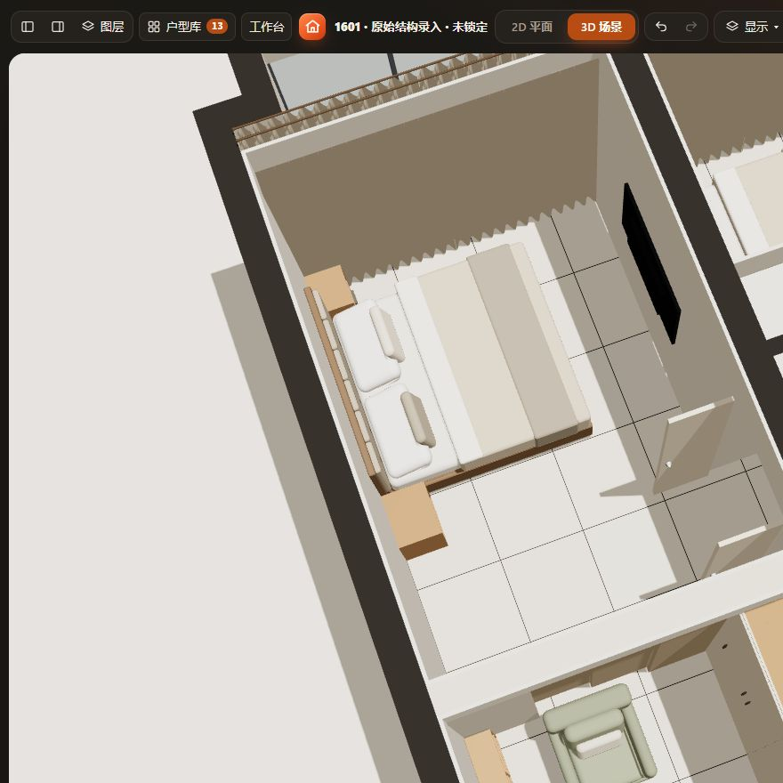
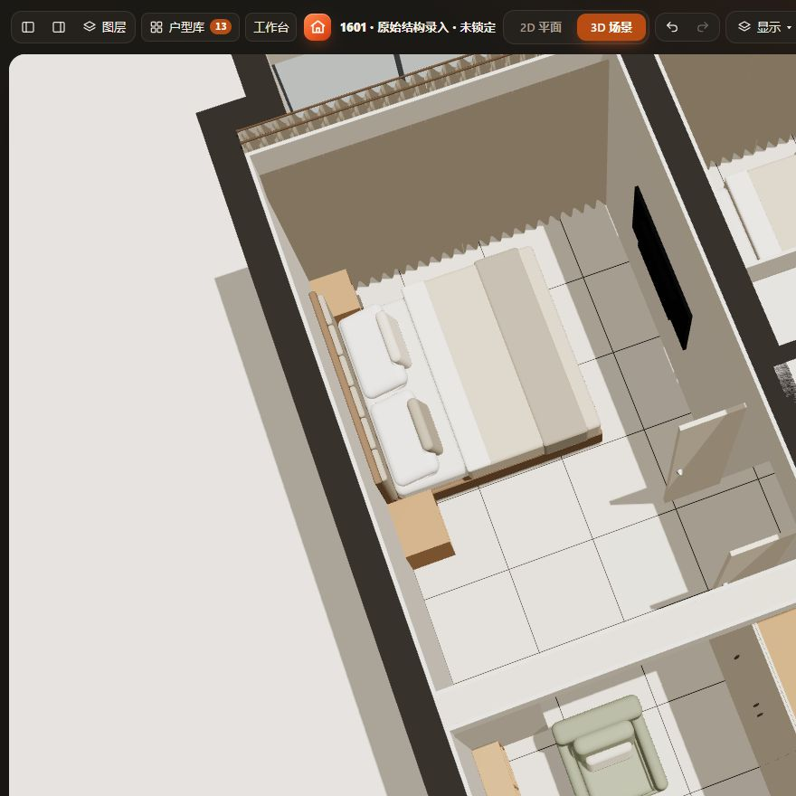
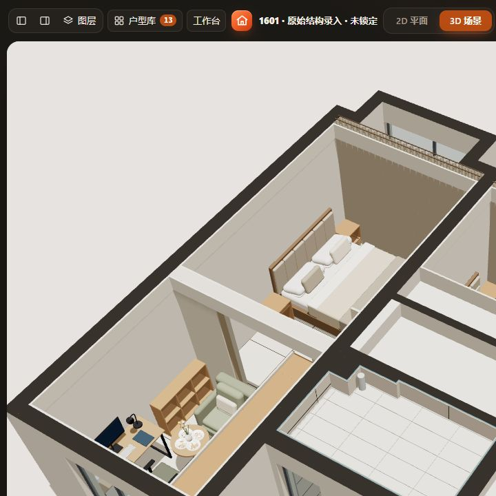
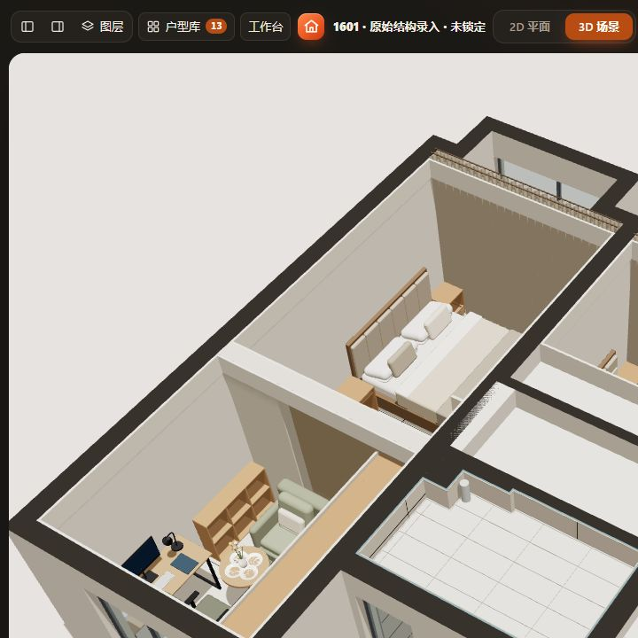
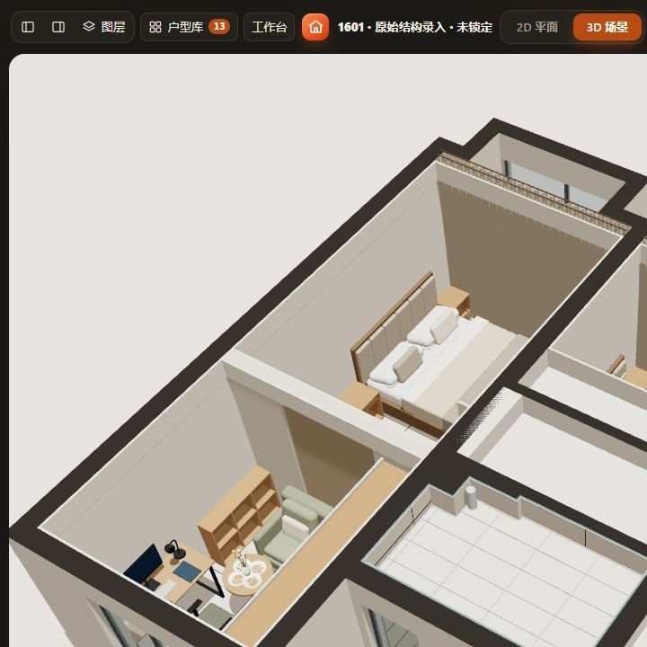

# 口袋门隔断：定制布局草模

## 2026-10-31：正式导出身份

整链路验证发现同类墙袋蒙板／端板及门扇在严格生产导出时身份重复。`pocketLayout()`现在分别提供物理侧、面或门扇的`partId`，生产构造器消费具名记录范围；原`key`语义、尺寸、开合、实体和保存字段不变。不使用当前坐标或遍历序号，重复身份继续拒绝。`test-pocket-identities.cjs`覆盖重排、改尺寸、开合、收纳侧与错误重复身份；双侧双扇和单侧三扇分别走HTTP／file正式导出及真实Blender验证，最终证据见[整链路记录](validation/model-pipeline-20261031/README.md)。

## 2026-10-29：关闭端抵柜门版（当前1601）

按用户截图把关闭端实际做到首扇衣柜门面，不增门垛。复用单侧三联动模型，仅调整项目数据：西端x839.5、东端x3073、cx1956.25／cy6900，总宽2233.5、厚220、高2640mm，向西入袋。名义开口1585.125、墙袋648.375mm；相较原抵东墙的2057.625开口减少472.5mm，原因是柜门面突出东墙630mm，且三联动墙袋随总跨度重算。最终净宽还受五金和止口影响。

实际生产实体核对：末扇关闭边x3073，与柜门外表面一致；末扇平面y6930–6970，位于首扇柜门y6751–7150.906中段，避开把手。两者接触无穿板；沿x向柜内移0.5mm会检出相交，退0.5mm无相交。接触高度仅为距完成面61–2290mm，柜门上下空隙、轨道与密封未深化，不能称为完整遮光／隔声节点。

衣柜2800×630×2300及原位置不变。本轮不需要向北延长；其北端距现有墙面已仅约31mm。柜顶加630×220×340mm封口占位块，底部距完成面2300、顶2640，与隔断门头接合。该块是可独立编辑的草案，未绑定柜体，移动柜体后需重新核对；不代表已有吊轨承重构造。

隔断比上版北移265mm，吊顶两区边界同步至y6790／7010。低书柜cy7580，阅读椅cx1880／cy7450，茶桌cy8200，共用座椅cy8900；保留1.4m桌。其余64件原家具、入口对开门和建筑不变。阅读椅至柜门静态净距约818mm，仅是平面布置距离。书柜与桌沿墙间距约12.5mm，不作为施工安装余量。

「1601」默认关闭展示接触；新增「1601 · 抵柜门打开预览」，保留「1601 · 口袋门2.06m抵柜前」及更早方案。柜门需先收回隔断再开启，按用户已接受的使用顺序：关闭时保留分区1柜门开启路径被占用的核对警告，没有豁免；打开后该项消失。全屋关闭42项、打开41项（均含16项待确认），不是全屋无问题。

本轮仅布局与文档，保存数据校验、生产接触及±0.5mm边界、其余家具和旧方案保留、重复恢复3次、项目往返通过。HTTP正常加载、撤销重做、开关预览、刷新恢复及二维／三维目视通过，见[数值记录](validation/pocket-cabinet-contact-20261029/checks.json)。未执行全量check、file://、窄屏或声光／安装验证；模型源码与加载机制无变化。

## 2026-10-29：单侧三联动扩大版（前一轮记录）

用户认为原1.33m开口窄，接受单向入袋，并补充「门关闭时可以抵在柜门上」。当前先用三扇向西侧叠合入袋扩大开口：总宽2863.5、厚220、高2640mm，位置cx2271.25／cy6635；名义开口2057.625×2340mm，单侧墙袋805.875mm。比原1331.75增加725.875mm（约54.5%）。不增加独立关闭端门垛；**当前草模并未强行把门板移到柜门上接触**，用户允许的接触作为后续止口、缓冲与密封深化条件。柜门开启仍需隔断先收回，不能用穿插代替边缘接触。

新增类型pocketdoor_triple，沿原模块与slidingOpen／slidingStackSide能力，可在属性选择左／右收门；本案默认左侧，镜像、旋转随整组。尺寸范围与构造集中在product-rules：三轨、各40mm门扇、轨间10mm间隙、18mm面板、端板30、门头300、门下缝10、相邻门扇20mm搭接；总宽预留120后按3/4分给名义开口。门框、止口与密封五金未定，最终净宽会受影响。

三扇各699.208mm宽，开时在三条独立轨道上同位叠合；闭合后分段覆盖开口。2块墙袋面板、1块端板、1块门头、3块门扇共7件生产实体。无额外玻璃或帘子。最小总宽2000、总厚200、总高1800是草模能力下限，不是厂商安装范围。总厚增加至220容纳三轨，非继续使用160厚墙体假装收进三扇门；五金联动、吊轨承重、密封与检修未深化，不能保证隔声。

隔断南北两面为y6525／6745，主卧吊顶用setRegion同步收至两面；书柜北移40至cy7340。建筑入口门及其它67件家具保持。替换时明确不设柜门／抽屉式额外600mm正面预留（frontClearance=0），真实门板与墙袋碰撞仍检查，不是实体豁免。原双侧模型及尺寸不变，保留「1601 · 双侧口袋门1.33m」和原关闭预览；新增「1601 · 单侧口袋门关闭预览」。

修复口袋门空间确认未覆盖开合姿态的问题：checkContext仅对pocket-door族追加实际构造参数、开合及支持的收门侧，双侧原型也同步覆盖；旧口袋门确认自然失效。颜色／价格等不改变确认。模型数值实体原缓存已经覆盖类型、尺寸、开合和收门侧，无独立缓存／存储通道。

本轮11套增量通过：wide-pocket-door、pocket-door、product-rules、telescopic-20、curtains-sliding、furniture-solids-cache、furniture-solids-coverage、enclosed-boundary-distances、spatial-review-cache、review-consistency、project-validation。包括真实生产7件／9件几何、左右三轨空腔、旋转／镜像、开关、最小尺寸边界、替换、重复恢复与项目往返、空间确认的姿态失效及颜色／价格稳定。enclosed套件覆盖95种目录类型×8变换；6个修改JS模块语法通过，入口复用原switch及加载脚本。

HTTP属性左右切换、开关、撤销重做、刷新恢复、2D／3D视觉验证通过；开关均无本隔断或书柜实体冲突，全屋仍41项原核对提示，未豁免。当前／命名方案、1.33m快照、其它旧数据保存和重复恢复通过，见[checks.json](validation/wide-pocket-door-20261029/checks.json)。未执行全量check、file://、窄屏、Blender或声光／安装验证，无加载机制改动。

## 双侧原版与首次试排记录

用途是1601主卧南北分区试排。用户接受口袋门和屏风，排除玻璃门＋窗帘和内部平开门。不是固定型号产品；采用参数化定制构造，未用Blender重做成品模型，没有厂家、型号、价格或性能数据。

## 尺寸与生产语义

类型pocketdoor_double，家具库「门窗·隔断」。默认总宽2800、总厚160、总高2640mm；局部+Z为正面，输入mm，生产边界转m，普通旋转／镜像沿原模型变换。总宽**包含左右墙袋**，不是净开口宽。

product-rules集中设计参数：开口宽=总宽/2−100；每侧墙袋=(总宽−开口)/2；门头300高；门扇40厚、下缝10、侧搭接20、中缝2；墙袋双面板18厚、端板30宽。数值均为布局假设，非厂家或安装要求。最小总宽1600、厚120、高1800是模型能力限制，非产品可选范围。

四块袋壁面板、两块端板、一块封顶门头、两块门板共9件生产实体。开启后两扇分别藏入墙袋；关闭时不透光。未画滑车、阻尼器、拉手、密封条或骨架；面板示意不证明可承重、隔声或真实可施工。无贯通地轨示意不等于不需要地导向。没有按包络豁免实体碰撞。

复用sliding-opening-model、家具solidModel记录器、CabinetMotion.solidParts及Geometry.bodyParts／Snapping.directional。状态slidingOpen复用原字段，默认打开；属性开合、三维点击门板共用原mutate，2D／实际生产实体读取已保存姿态。三维过渡动画只是显示插值，数值检查读取目标姿态，不进行全行程动态扫掠。门扇入袋后通过属性关门。未新增加载脚本、字段或格式版本；旧类型及显式旧配置保持。更换为其它家具清理slidingOpen。

## 1601应用

- 总宽2863.5、厚160、完成面以上总高2640；位置cx2271.25、cy6650、旋转0。中间开口1331.75、高2340；每侧墙袋765.875mm。完成地面+60，总顶绝对2700，与项目原顶对应；原顶与施工实测仍须核对。
- 移除原睡眠区玻璃门和遮光帘。入口建筑对开门保留，其余68件家具（含用户此前更改的次卧柜门姿态）不变。
- 主卧原沿边灯槽在y6570／6730处止到隔断两面，分南北吊顶区域，沿ceiling-core.setRegion重建，保留原配方。北侧轮廓收至原墙内面x3703，避免新分段越界。原睡眠区吊顶轮廓的既有待确认仍保留。
- 「1601」默认开；「1601 · 主卧口袋门关闭预览」用于对比；「1601 · 口袋门调整前」保留最近当前数据。其他旧方案不改写。

隔断通过家具组件表示，不重新切分建筑物理房间。部分基于整包框的家具剩余面积／候选通道统计仍可能保守；真实板件测距及碰撞使用9件实体。当前开口可连通视线，但两侧墙袋有实墙感。关闭后密封／声光性能、墙袋检修和禁设插座位置、供暖空调与猫进出均待深化，不能称为满足一睡一茶的隔声方案。

## 本轮验证

通过test-pocket-door、test-curtains-sliding、test-telescopic-20、test-product-rules、test-furniture-solids-cache、test-furniture-solids-coverage、test-enclosed-boundary-distances共7套增量。覆盖真实Three包络／射线通道、生产9件实体、开关、旋转／镜像、高度分离、非法输入、替换、旧缺省、项目往返；其中边界测距套件遍历94种目录类型×8个变换并覆盖外部／包含／局部重叠／接触及未知高度。五个修改JS模块语法通过，入口仅增加现有switch分支，浏览器实际载入通过。

HTTP实际属性开关、二维／三维、撤销重做、打开／关闭命名方案及刷新恢复通过。工作区校验、重复恢复3次、其它数据保留和当前／命名项目往返通过，结果见[checks.json](validation/pocket-door-20261029/checks.json)。开／关均无口袋门实体冲突；全屋仍41项提示，未豁免。未执行全量check、file://、390px、Blender或声光／安装验收，无加载机制改动。

