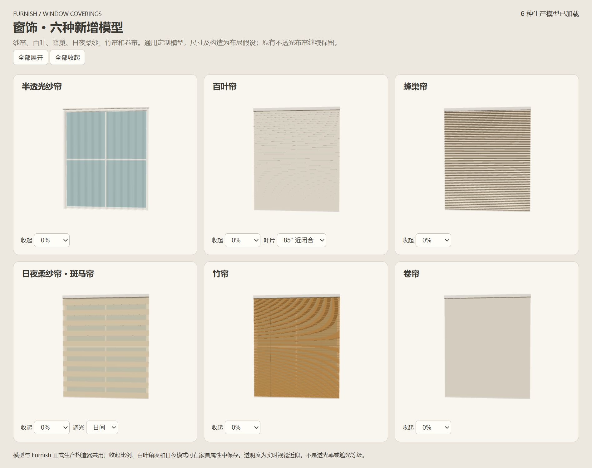
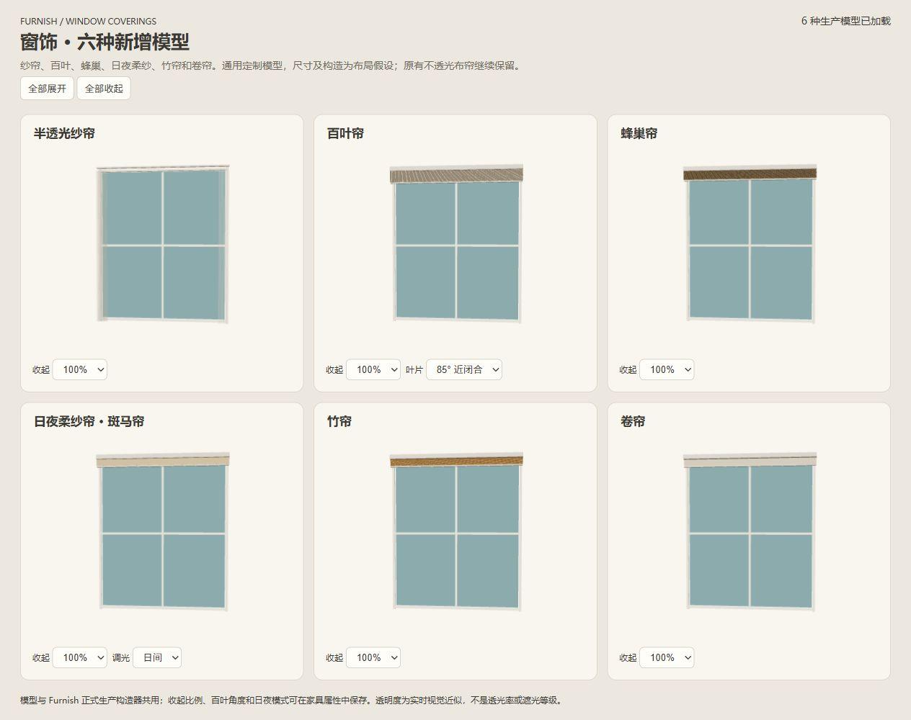

# 通用窗饰模型（2026-10-29）

本轮提供可调整尺寸的通用定制模型，未指定厂家或固定型号，不作为成品尺寸／安装说明。原不透光布帘保持原构造，新增半透光纱帘、百叶、蜂巢、日夜柔纱（斑马帘）、竹帘与卷帘六个条目，入口在家具库「布艺」。用户确认这里的“罗马日夜帘”指条纹错位调光的柔纱帘，本轮不另建立向上层叠的罗马帘。

分类参考 [Hunter Douglas 窗饰分类](https://www.hunterdouglas.com/window-treatments/shades)，只用于核对结构类别；所有下表数值均为模型假设，不来自该厂家的尺寸或性能规格。没有使用品牌身份、参考价格或虚构遮光等级。

| 类型 | 正式 type | 构造与交互 |
|---|---|---|
| 不透光布帘 | curtain | 保留原褶皱布面及单／双开，增加可保存的收起比例 |
| 半透光纱帘 | curtain_sheer | 褶皱薄面、双面材质、半透明，无深度写入；单／双开横向收拢 |
| 百叶 | blind_venetian | 独立水平叶片；0°水平，85°近闭合；向上收起时自动转平以免堆叠穿插 |
| 蜂巢 | blind_honeycomb | 菱形空腔四片薄壁单元，上下压叠，不用整实心盒填满 |
| 日夜柔纱 | blind_zebra | 前后两层纱底及不透明条纹；日间对齐，夜间错开；可上收 |
| 竹帘 | blind_bamboo | 横向竹片与纵向编带、上收体块；卷绕及编织细节为简化示意 |
| 卷帘 | blind_roller | 平面薄布、顶盒与下梁；向上收起，卷筒与内部卷绕未细化 |

## 尺寸与安装基准

输入与持久数据为mm，生产边界统一转m。局部X为宽、+Z为正面，沿既有旋转和镜像。高度表示完全展开时的外包高度；`mountHeight` 表示完全展开时最低点距所在房间完成面的高度。升降保持顶部固定，仅下部上移，安装高度不因收起改变。

新纱帘默认2400×120×2400、安装0；原布帘的2400／3000宽及已有规格保持。其它五类默认1500宽、1800高、安装900；深度分别百叶65、蜂巢60、柔纱75、竹65、卷帘75。安装900只是新建初值，不自动匹配窗头或保证不超天花。

产品核心集中通用头盒50、下梁14、蜂巢节距30、百叶节距38／片厚1.5、柔纱条带90、竹片节距10、薄布1mm；小尺寸下按外包约束退让。新类型模型能力下限为宽100、深20、高100，非采购范围。百叶／蜂巢／竹片有数量上限；大尺寸会调整单元间距，不能推导真实产品规格。

`curtainOpen` 为0–1，0完全展开、1收起；`blindAngle` 只供百叶，范围0–85°；`shadeMode=day/night` 只供柔纱。单开的左右侧沿原镜像控制。新建前方额外操作预留为0，不把窗饰当柜门强加600mm；这不是厂家检修要求。轨道、窗把手、窗扇开启和安装余量须另行核对。

## 数据与空间契约

定义、字段能力、缺省值、替换清理、尺寸派生集中在product-rules。旧布帘缺失新字段读取关闭／安装0，不向旧实例补写字段；原外观与位置保持。复制保留姿态；跨类型替换清理不支持的角度和调光参数，安装按目标类型缺省重建；UI仍沿mutate、撤销与原自动保存。包含新类型或显式布帘新参数时使用项目／工作区v34及独立缓存；合并主线后的烟机v33、洗碗机v32及更早数据继续可读。

生产window-covering-model和数值实体同源，复用CabinetMotion.solidParts、Geometry.bodyParts和Snapping.directional；未建专用测距算法。软布／纱保持已有软帘的碰撞处理，纱帘通过产品的soft能力消费；其它五类按当前真实帘片、顶盒、下梁检查，收起后下方空间可清空。二维保留完整轨道及占地示意，软帘显示横向收拢，升降帘标收起比例。空间确认与三维／实体缓存覆盖开合、叶片角度、日夜模式、尺寸和安装；颜色、价格不使确认失效。

只检查当前姿态，不提供升降全过程与所有中间姿态的扫掠保证。薄壁与竹片外观近似，收起堆叠为简化。2026-10-29按用户厚密暖白纱参考图，将独立纱帘的材质不透明度从0.28提高至0.84，减少窗框和后方物体的可辨识程度；斑马帘纱带仍为0.28。两者均为视觉参数，不是真实透光率。夜间模式只表示布带错位，不承诺完全遮光、隐私等级或隔声。纱布叠加时可分别放置两件并独立开合；未自动添加双轨或成套替换当前主卧。

## 验收与预览

运行 `node scripts/preview-window-coverings.cjs` 生成 `output/window-coverings/preview.html`；页面直接调用正式生产构造器，可比较展开、半收起、全收起、百叶角度和日夜模式，不使用另一个精修模型。

增量检查和边界见 [checks.json](validation/window-coverings-20261029/checks.json)。实际HTTP家具库添加、属性编辑、50%收起与夜间模式、撤销重做、刷新恢复和2D／3D通过，试验只在独立工作树，不修改主目录1601搭配。`file://` 实际打开被浏览器工具协议策略拒绝；390像素视口设置未实际生效（DOM仍1280×720），因此离线页面和窄屏均未记为通过。经典脚本及项目兼容自动检查单独记录；未运行全量check或Blender渲染。

