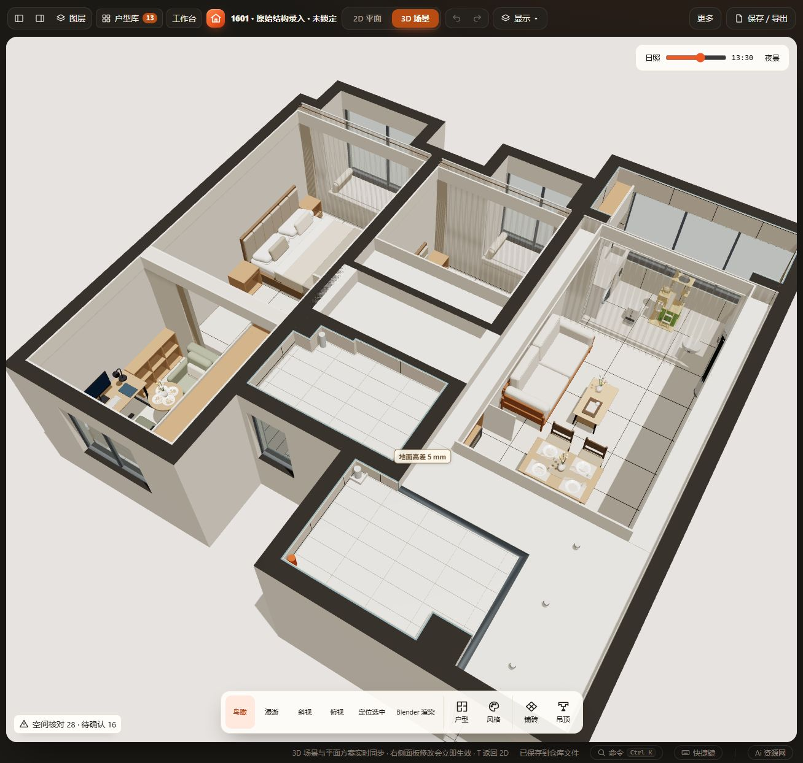
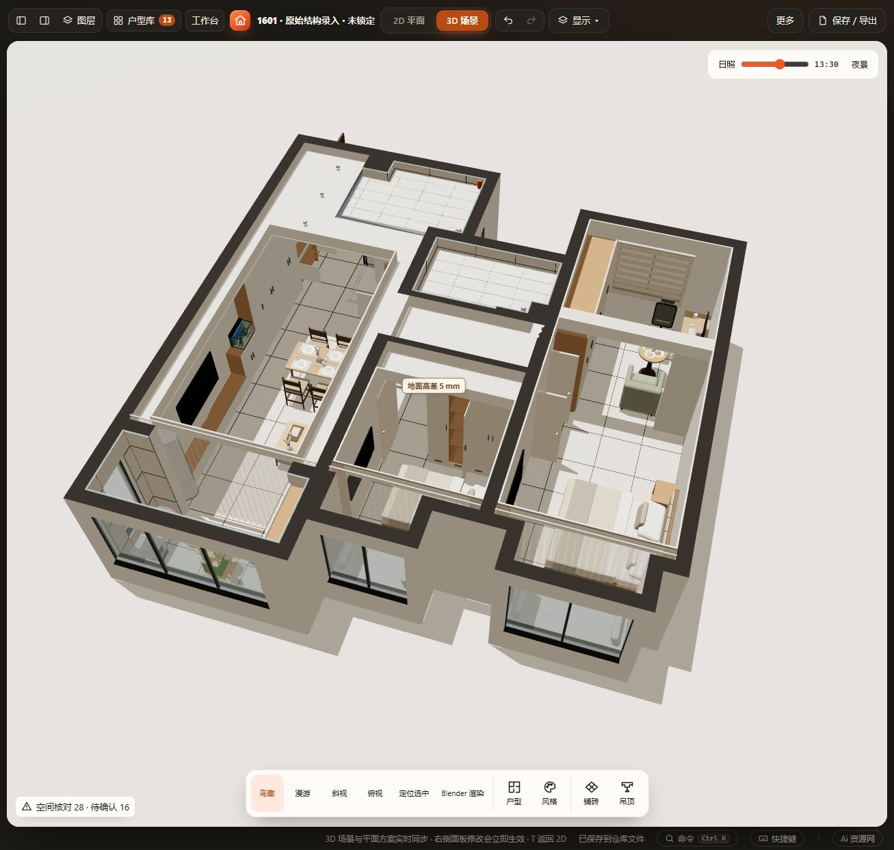

# 1601窗饰应用（2026-10-29）

按用户要求应用现有窗饰模型，无模型源码或新字段变化。纱帘采用现有目录暖白色 `#f4f1e8`。

- 主卧靠飘窗一层 `fmv3wt92611`（y2387）、次卧靠飘窗一层 `fmv3xgqxc1`（y2384）换为纱帘。两件室内侧原布帘保留，收起比例1，展示白天纱帘展开效果。
- 客厅 `fmvg9e7763` 换为暖白纱帘。三件替换均保持原位置、宽深高、旋转和双开；原2700mm高度沿用，不新增厂家高度／遮光性能承诺。
- 主卧北窗按用户补充照片要求采用室内墙面的**窗洞外装**，撤回中途试排的窗洞内装。新增 `f1601_north_zebra`，正面朝室内（rot180），日间模式、展开。窗洞为x1548–3002、y9581–9821，窗台绝对955、窗头2307mm，来自项目现有数据。
- 外装帘宽1554、深75、高1452mm，cx2275、cy9513.5；两侧各外搭50mm、下沿外搭50mm，顶部含50mm模型顶盒。帘底绝对905、完成面+60，因此mountHeight845；顶部绝对2357。背面止于y9551，与30mm墙面层相接。覆盖余量及顶盒均为布局假设，不是厂家安装要求。

**保留的开启问题**：斑马帘本体未检出占地越界、墙体或当前家具实体冲突，但衣柜分区4（最北端）的完整柜门开启路径与帘体交叠。没有改衣柜开向或增加碰撞豁免，也不声称外装帘已通过柜门开启验收。后续需结合实际五金、收起体积、柜门开向及照片条件深化；不能仅凭参考照片推定当前柜门一定不碰。全屋原43项提示，本轮44项（界面28项＋待确认16项），新增仅此一项。

“1601”与当前工作槽一致；新增“1601 · 窗饰替换前”保存用户调整前当前布置（含当时已打开的口袋门）。其余65件原家具、建筑、吊顶和全部旧命名方案保持。原内侧布帘仅增加收起姿态，其余参数保留。

通过工作区／新旧数据校验、当前与命名方案项目往返、重复恢复3次及65件不变断言；HTTP实际加载、撤销重做、布帘收起、刷新恢复和2D／3D目视通过。见 [checks.json](checks.json)。本轮仅布局，无需重跑窗饰源码的全套回归；未运行全量check、file://、窄屏、Blender或实物安装验收。

