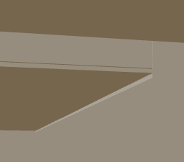
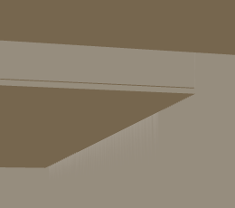
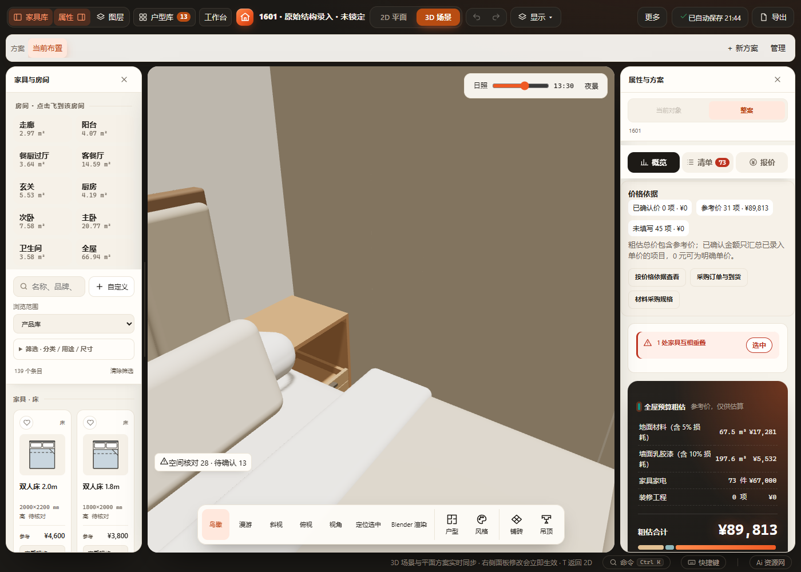

# 梁与飘窗交界阴影 · 2026-10-31

用户反馈：墙体辅助描边移除后，飘窗侧边与梁墙交界仍有细线。使用 1601 正式文件的只读副本，在独立缓存中复现。

## 原因与改动

- 原主日照灯的 `normalBias=0.02` 将接收阴影采样点沿法线偏移 20 mm；`bias=-0.0004` 又在近／远面 1–60 m 的阴影相机中产生约 23.6 mm 深度偏移。交界处出现亮带，不能用此前的墙体描边解释。
- 同一相机、几何、环境、曝光下对比：关闭阴影会消除亮带，缩小偏移也会减弱它。主日照改为 `normalBias=0.001`、`bias=-0.00001`，保留投影、阴影分辨率和原材质；不调整吊顶灯、筒灯等其它光源。
- 本方案同时存在真实错台：被观察的梁面为 x=6728 mm，邻墙面 x=6730 mm；主卧飘窗正面 y=2329 mm，一侧邻墙面 y=2337 mm。射线分别命中梁和墙的同向面，不能把所有竖线都当成辅助描边。未改变这 2／8 mm 的几何差异，未承诺真实边界完全不可见。

## 固定机位对比

梁机位：位置 (7710,5816,2200)，目标 (1150,4376,1914) mm，水平视场 70°，日照 11:15。下图为同一截图位置局部。

| 修改前 | 修改后 |
| --- | --- |
|  |  |

飘窗机位：位置 (2200,3800,1400)，目标 (1228,2329,500) mm，水平视场 60°，日照 13:30。保留真实错台和窗帘投影。

| 修改前 | 修改后 |
| --- | --- |
|  |  |

对照图来自独立浏览器诊断，临时参数对比不是正式方案编辑。生产参数只修改主日照灯；正式桌面生产截图与离线复核另记录在本机 `output/wall-seams/`。

## 验证范围

已通过 index 内联语法、`test-scene-shadow-cache`、`test-scene-observation`、`test-beam-heights`、`test-recessed-bay-windows`。无新字段、模型顶点、加载顺序、保存／撤销或空间确认变化。

同一打包 EXE 使用独立源码、方案、缓存与端口；断网 file 页面使用独立浏览器缓存。两端均读取正式主灯参数、保留阴影，梁及飘窗左右机位与390px窄屏已截图。测试主动改变日照设置，空间与家具数据保持，正式文件哈希未变，页面异常为0；见[回执](results.json)。初次验收误将测试主动修改的日照设置纳入“不变”断言而失败，已改为核对空间与家具数据后复跑通过，没有据此改动保存逻辑。

未运行全量检查、全部日照时刻／全部户型的视觉组合或 Blender 渲染。有限分辨率阴影仍可能存在边缘采样、细小条纹，几何错台、材质分界与真实投影不会因本次修复全部消失。
