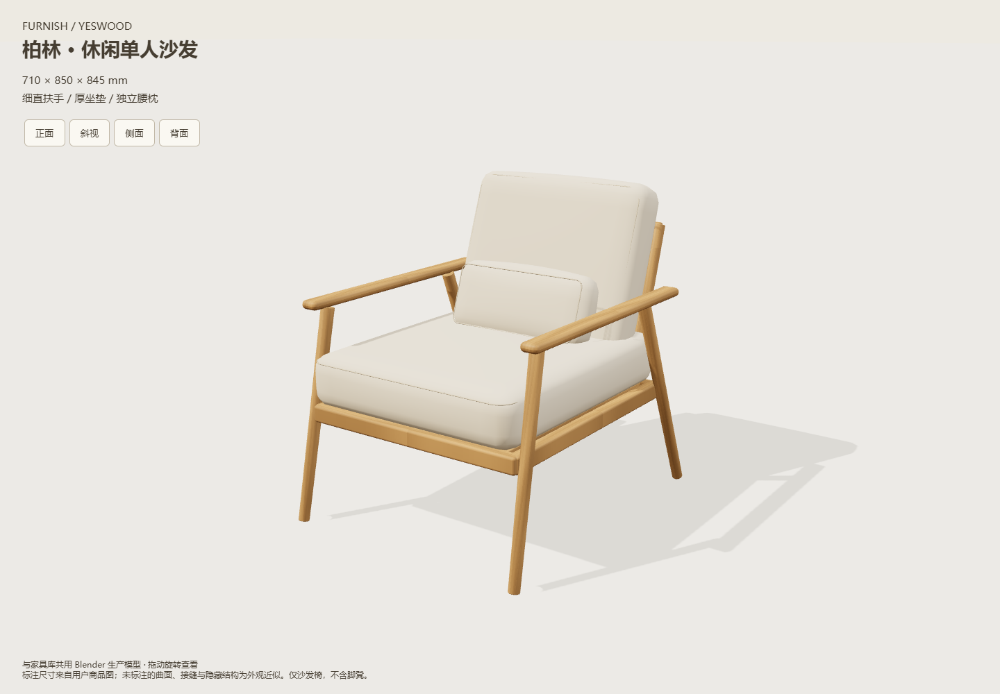

# 柏林单人沙发椅验收

2026-10-29，终版源目录`assets/models/armchair-berlin/v3`。

已通过：

- `node tests/test-armchair.cjs --berlin`：源哈希、28件稳定身份、腰枕/直扶手独立存在、默认845mm高度、有限单位法线、整体710×850×845mm、坐垫顶460mm和厚150mm、实际尺寸编辑、旋转镜像、外距/吸附、接触和0.1mm穿入、包含/局部碰撞、高度分离/未知、重复恢复无漂移、项目和命名方案往返。
- 两款Node回归，以及改动JS模块语法与`git diff --check`。
- `node scripts/verify/verify-armchair.cjs --berlin`：独立副本HTTP及断网file://，家具库条目、尺寸mutate、撤销重做、保存/刷新、生产GLB28件身份、无外部请求/页面错误、390px无横向溢出。第一款同命令去掉选项的服务和离线回归也通过。
- Blender4.5.15 LTS真实导入源/正式生产GLB：28件闭合正体积，1.2倍缩放、37°旋转及镜像后的逐件相对边界一致；删去直扶手的负例拒绝发布，前版目标文件保持。见[浏览器摘要](summary.json)和[回读摘要](blender-roundtrip.json)。
- 正面/斜视/侧面/背面及窄屏目视：腰枕收拢并后靠，扶手为细直轮廓，座框托住厚垫，色彩、包边和后架可辨。未按照片重建全部褶皱、文字商标或隐藏连接。

[正面](http-front.png) · [侧面](http-side.png) · [背面](http-back.png) · [断网窄屏](file-narrow.png)

未跑全量`node scripts/check.cjs`；原款资产未重做，用户工作区修改未纳入提交。完整测试副本、生产导出与发布负例保留本机`output/armchair-berlin-validation`。曲面/鼓面采用现有保守空间算法，不表示实物承载或受压验证。
