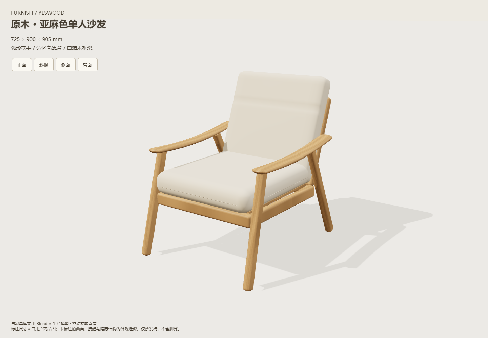

# 单人沙发椅增量验收

2026-10-29。最终资产为`assets/models/armchair/v4/armchair-v1.glb`；源码脚本在独立后台Blender4.5.15 LTS执行。没有改动用户工作区数据。

已通过：

- `node tests/test-armchair.cjs`：源哈希、28件稳定身份、有限顶点/单位法线、725×900×905mm生产包络、460mm坐高与120mm垫厚、尺寸编辑、缺高默认值、旋转/镜像、100mm外距、外部吸附、完整包含、局部碰撞、刚好接触/0.1mm穿入、高度分离/未知高度、重复恢复无漂移、项目与命名方案往返。
- 新增/改动JS模块语法及`git diff --check`；未执行`node scripts/check.cjs`全量。
- 共用发布器的SE2及书柜回归：`test-blender-appliance-asset.cjs`、`test-blender-bookcase-asset.cjs`。
- `node scripts/verify/verify-armchair.cjs`：独立副本、HTTP及断网file://，家具库条目、mutate改尺寸、撤销重做、缓存保存及刷新、生产GLB28件身份、零外部请求/页面错误、390px无横向溢出。导出在3D入场动画完成后执行。
- `scripts/verify/verify-armchair-blender.py`：28源网格闭合及正体积；真实导入应用生产GLB，逐件比较1.2倍缩放、37°旋转、镜像后的相对边界；缺扶手负例拒绝发布且保留上一资产。详见[浏览器摘要](summary.json)与[Blender摘要](blender-roundtrip.json)。
- 正面、斜视、侧面、背面及窄屏截图已目视检查：连续分区靠背、弧扶手、木腿与软垫无明显面翻转或悬空头枕。木材/软包为布局外观近似，未覆盖实物全细节。

[正面](http-front.png) · [侧面](http-side.png) · [背面](http-back.png) · [断网窄屏](file-narrow.png)

完整测试副本、生产导出及负例保留本机`output/armchair-validation`；用户原始workspace未进入本次提交。当前算法对曲面采用保守高度截面，未验证承载、受压、任意现场环境或面料真实性。
