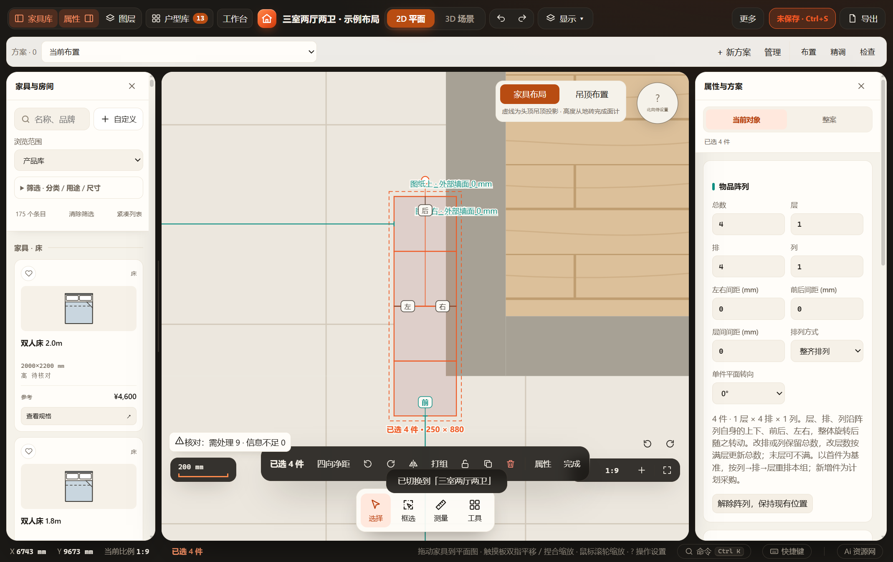
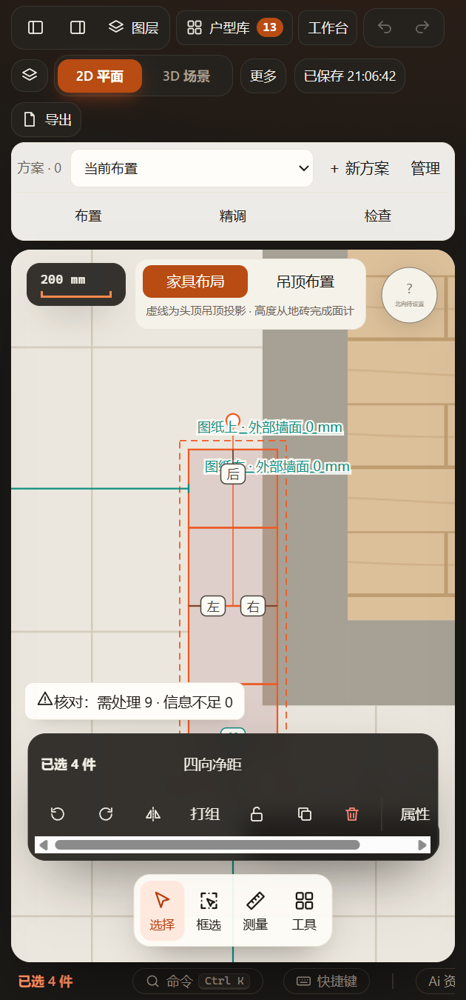

# 阵列方向提示去重（2026-11-08）

关联阵列在二维选择时，原先对每件重复画前后左右，4件会出现16个提示。改为按inventoryArray.id聚合，在可见成员整体投影外沿放一套4个标记；参考序号最小的可见成员朝向。普通单件、多阵列和解除后的显示分别保留。仅drawing-core派生标记及plan-renderer消费变化，无持久字段／模型／测距规则变化。

## 验证范围

- `tests/test-array-directions.cjs`：4件聚合、多个阵列和普通单件、解除／可见子集、0／37／90／180度、镜像、四种图纸旋转及X倾斜后的实际占地外包，标记在整体外沿，输入不变。
- 原`test-furniture-directions.cjs`和`test-drawing.cjs`通过，保留单件方向／固定屏幕间隔与图纸尺寸行为；改动脚本语法检查通过。
- `tests/test-array-directions-ui.cjs`：同一打包EXE独立目录／缓存／端口，4件仅一套4标记，两阵列加普通件共3套，图纸旋转文字正向、方向开关、改数量／撤销、解除／撤销、保存刷新、420px布局。渲染前后家具记录与directionalMeasurements结果相同；HTTP及阻断HTTP网络的file入口同组界面检查。

[运行报告](ui-report.json)。实际查看宽／窄屏截图，整组不再逐件重复标记；原有工具栏在窄屏仍可能遮挡底部方向提示，本次不改工具栏布局。完整证据在 `output/playwright/array-directions-lByLEb/`，成功副本的源码／缓存已清理，报告与截图保留。

未执行全量检查；没有新增资产或几何，未作Blender往返。正式方案未修改，其他会话修改保留；不把整组方向标记用于推定净距方向，原多选“图纸左／右／上／下”测距语义保持。
