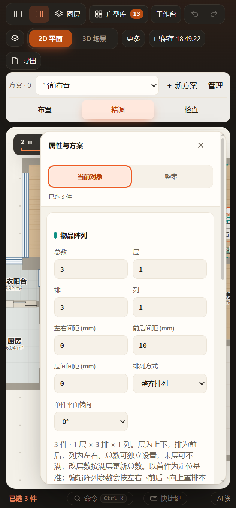
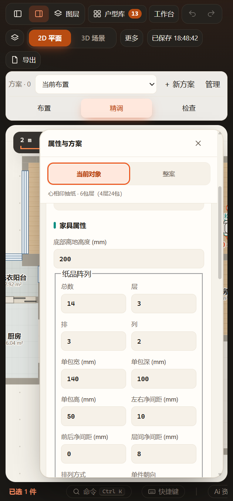

# 阵列数量表达（2026-11-07）

纸品及关联物品阵列统一依次显示“总数、层、排、列”。层为上下，排为前后，列为左右；仍映射原count／rows／columns，不迁移或新增持久字段。

- 总数独立设置，层数由ceil(总数/(排×列))派生，允许末层不足。
- 改排或列保留总数，自动重算层数；直接改层数按层×排×列更新总数。层数输入与当前派生值相同时不填满原有末层、不生成撤销。
- product-rules.arrayQuantityEdit共用转换及正整数／数量上限校验，UI沿原paperArray或arrayEdit和mutate应用。没有新增项目格式、保存或生产几何机制。

## 通过

- `test-paper-array.cjs` 新增部分末层、相同层数不补满、改层数联动、排／列保留总数及零值、小数、越界拒绝；原纸品真实几何／往返回归通过。
- `test-inventory-array.cjs` 关联成员生成、锁定／图层、复制、解除与项目往返回归通过。
- `test-paper-array-ui.cjs` 与 `test-inventory-array-ui.cjs` 均在同一正式EXE的隔离工作区复验，新增层数编辑、总数联动、撤销和非法层数保持原值；原保存刷新、窄屏、生产GLB、HTTP／断网file检查通过。[纸品报告](paper-report.json)、[物品报告](inventory-report.json)。原批次分别为output/playwright/paper-array-Iz2RWO及inventory-array-hPNtGp。
- 已实际查看下面两类阵列窄屏的四个数量控件；说明文案同时简化。改动模块及测试语法、原product-rules定向回归通过。

未执行全量检查。正式方案仅通过MCP和native窗口读取状态，没有应用阵列参数或修改家具；读到用户已有111件家具与11步撤销历史，因此未强制刷新正式窗口。新界面在用户保存后刷新生效。保留用户当前编辑、原未提交方案和既有工作树；成功隔离测试的源码及缓存由测试管理器清理，验收资料保留。
