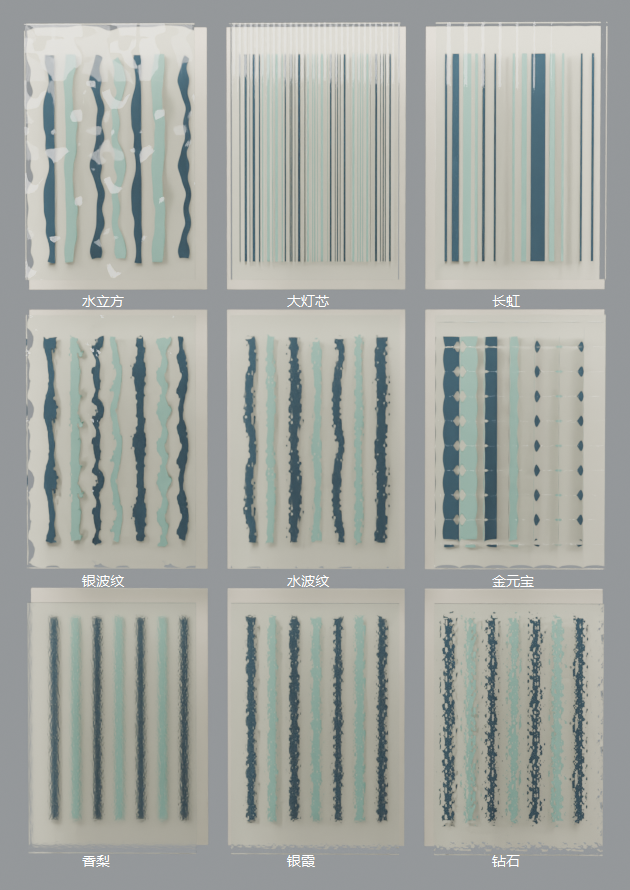

# 九款艺术玻璃 · 参考图与生产传递复核

日期：2026-11-03。范围为可调尺寸无框单片玻璃和九款光学法线花纹；不是固定品牌成品，也没有把原帖建议当作施工要求。执行者完成目视复核，用户尚未确认视觉还原度。

## 参考解读

原件及SHA256见 [资料清单](../../../assets/models/art-glass/asset.json)。实际查看用户三张附件；第1张九宫格识别九种花纹，第2／3张近景确认正面纹理差异、近无色边缘和8 mm文字标注。未获得第4张。

| 特征 | 参考与局部 | 观察 | 实现与未知 |
|---|---|---|---|
| 轮廓／厚度 | 三张原图 | 长方形平直四边，侧缘很薄，近景标注8 mm | 闭合毫米厚度板；样板宽高未知，不能从透视反推厂家尺寸 |
| 竖纹 | [第3张局部](reference-crops/stripes.png)，原像素裁框(20,255,1060,705) | 大灯芯比长虹更密，两者均竖向连续 | 同一周期函数、不同毫米节距；节距为照片估算 |
| 大波纹 | [第3张局部](reference-crops/waves.png)，裁框(20,990,1060,735) | 水立方形成大块扭曲；水波纹在大尺度上叠细纹 | 法线纹理表示，不宣称真实压花几何 |
| 格纹和颗粒 | 原图1／2 | 金元宝规则网格；香梨细，银霞更粗，钻石高光更碎 | 周期鼓面／确定性噪声；轮廓细节不等于实测扫描 |

尺寸依据：8 mm是样板标注；默认900×2400是软件起始值。IOR、节距、虚拟高度幅度和粗糙度为外观估算，参数及边界见 [模型文档](../../ART-GLASS.md)。

## 相机及阶段

样板以240×360×8 mm矩形并排3×3。透视相机垂直FOV35°、位置Three米制(.05,.7,2.7)、目标(0,.6,0)、1200×1200；固定背景竖条距离玻璃约80–90 mm。原照片相机与布光未知，只匹配正面略俯视的观察关系，没有宣称摄影机精确配准。样板取景不用于反推原图尺寸。

轮廓／结构：实际打开 [无花纹光学对照](optical-before.png)，检查九块平直矩形、厚度边缘及后方独立参照物。模型没有活动结构，复杂灰模拆解不适用；此处轮廓／结构合并为透明板光学补图复核。边缘保持直板，未将法线效果描述为实体凹凸。

材质：同几何、相机、灯光、曝光0、AgX、96采样。左上至右下顺序为水立方、大灯芯、长虹、银波纹、水波纹、金元宝、香梨、银霞、钻石。

| 轮次 | 具体差异与修改 | 修改前／后 | 结论 |
|---|---|---|---|
| 1 | 普通透射玻璃不能区分九种花纹；在同一几何正面嵌入法线贴图 | [无纹理](round-01/optical-before.png)／[首轮](round-01/optical-after.png) | 条纹、格纹和粗细颗粒可区分；银波纹／水波纹细纹过强，盖住大波纹 |
| 2 | 仅调整银波纹和水波纹：降低高频权重、恢复大尺度起伏，轻调粗糙度 | [首轮](round-01/optical-after.png)／[第二轮](optical-after.png) | 实际打开图后确认大尺度扭曲更清楚。照片中的不规则轮廓、密度和反光仍未精确复现，不能写为实物扫描或用户已认可 |

三款颗粒均为确定性程序近似；银波纹与水波纹没有对应厂家的表面高度数据。图片可用于布局外观比较，不以效果图验证夜间隐私、透光率或安全性能。

## 正式生产复核

| 检查 | 结论与证据 |
|---|---|
| 建模路线 | 参数化定制玻璃；固定成品作者GLB发布流程不适用。构造入口已登记model-profiles清单；浏览器预览和正式模型同源 |
| 生产尺寸／空间 | `test-art-glass`通过九款边界／法线／材质、最薄3 mm、非法输入、复制替换、旋转镜像、接触／0.1 mm重叠、高度分离／未知、四向净距与包含；118类×8变换的共用包络回归通过 |
| 保存与界面 | [桌面](desktop-properties.png)、[390px](desktop-narrow.png)、[三维](desktop-scene.png)；[结果](results.json)。真实打包EXE独立目录／缓存／端口，编辑、锁定、非法输入、撤销重做、v46保存刷新、HTTP读取、断网file生产GLB通过，正式源文件哈希未变 |
| GLB→Blender | [回读](blender-results.json)：桌面1100×6.5×2200及file默认900×8×2400 mm逐轴吻合；九款样板以家具ID和explicit:art-glass:pane识别；检查实际对象材质槽、非零面、贴图内嵌、法线连接及透射权重 |
| 渲染及下载 | [正式API结果](api-results.json)、[API实际PNG](api-render.png)。Blender 5.2.3 LTS，Scoop current，实际OPTIX／RTX 4070 Ti SUPER。PNG／BLEND／GLB下载通过，下载工程重开仍有九款花纹；受控样板工程另存后重开通过 |
| 不适用／未执行 | 无门轴、框架和五金；无制造型微几何或真实焦散验收。未执行全量检查、其他Blender版本／OS、既有全屋精修模板材质自动替换。未修改用户当前布置或原精修工程 |

## 可恢复产物

原始生产GLB、两轮对照、API下载工程和样板工程生成于 `output/art-glass-verification/`；收尾另保存到主目录 `output/art-glass-20261103/`。源码、原图和本目录证据进入Git；大型可重建BLEND／GLB保留本机，不作为浏览器加载依赖。验收脚本可重新生成。

适用增量：产品规则、window-lining共用规则、包络距离、工作区缓存、目录导航、Blender部件身份和本次专项；没有以增量通过宣称项目无剩余缺陷。
