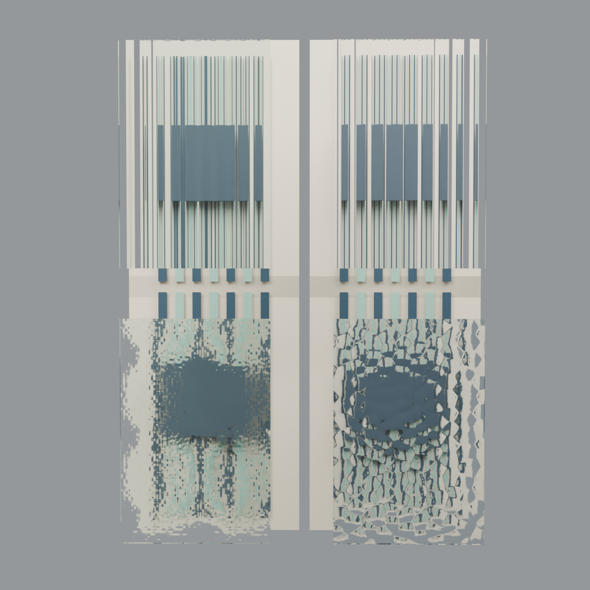

# 免费 Blendkit 玻璃材质试渲

2026-11-04。用户指定先使用免费素材，并在本机安装 Blendkit 插件。本次通过已安装插件自带的官方 `bk_client` v1.13.4 下载；接口逐项确认 `isFree:true`、`license:royalty_free`。匿名下载，无购买、订阅或用户凭据读取。素材与材质库保留本机，未把第三方原始贴图／BLEND发布到仓库。

## 下载与来源

| 材质 | 作者／来源 | 原始下载SHA256 | 内容 |
|---|---|---|---|
| Fluted Glass | Jonathan Ramos，[原始页](https://www.blendkit.com/asset-gallery-detail/a4306eee-0f2a-4ea6-ba79-2d0c77274aef/) | f6d514fbd7d04a83c1ac839f3dfdbca1b70436189be53700f7676cd89f94066c | 253799字节；512×512 DirectX法线，原节点含绿色通道反转 |
| Wavy Glass | Dai Kaku，[原始页](https://www.blendkit.com/asset-gallery-detail/f8fcc2d2-135c-4494-97a4-2a0ec975c34b/) | aee41e4f258dff13afe05f298e57e2c7a1453e8ecc0e281f22fa66629e3aae59 | 29168175字节；2048×2048底色、粗糙度、法线、高度，资料标注1米纹理尺度 |

使用边界按[官方授权说明](https://www.blendkit.com/docs/licenses/)及具体素材记录处理；免费并非CC0，本记录不宣称可将素材作为独立公开材质包再分发。原件在 `.local/art-glass-free-20261104/{fluted,wavy}/`，各附 `source.json` 和公开接口原始 `metadata.json`。下载链接中的临时签名未进入本记录或Git。

## 适配与实际检查

初次直接套材质实际出图后发现：长虹纹理为横向；水波纹直接用完整UV覆盖240×360 mm小样，造成过密。适配只作用于本次独立工程：

- 长虹：UV转90°，同时旋转切线法线XY通道，不能只旋转采样坐标；缩放1.25／1.875，约24 mm节距为本项目外观估算，非作者或厂家尺寸。
- 水波纹：按源资料1米纹理块，将UV缩放设为0.24／0.36；保留原法线及粗糙度。原位移节点强度0.05 m，实际材质模式为 **BUMP**，并非真实几何50 mm位移；试样将虚拟强度降至0.0006 m，不能表述为真实压花深度。
- 两款均替换生产玻璃的正面材质，背面／抛光边仍沿原模型；玻璃实体未细分或位移。长虹正面沿源IOR1.52，原背面1.5保持，因此该样片不是完整均质玻璃光学模型。

受控样片每块240×360×8 mm；左列当前自制材质，右列免费材质，首行为长虹、次行为水波纹。原生产几何、机位、光照、曝光和背景在左右列相同。先检查80 mm背景距离，再以330 mm深色参照物复核，不把两种距离混成同一条件。参考原照片取自 `assets/models/art-glass/references/samples-3.png`，原拍摄距离及灯光未知。

实际打开三轮图复核：方向和尺度校正后，免费水波纹形成更不规则、连贯的块状扭曲，较当前简化版更接近压花玻璃的视觉趋势；长虹改善有限，未宣称等同实物。背景距离显著改变扭曲幅度。没有提高“还原百分比”或以商家预览代替本机结果。

## 已通过与产物

- 本机Blender 5.2.3 LTS，Cycles实际OPTIX／RTX4070 Ti SUPER，128采样；见[结果](results.json)。240×360×8 mm生产板几何边界保持，实际工程另存后重开通过。
- `free-glass-materials.blend`仅含两个已标记的材质资产与所需节点／内嵌图像；重新加载核对两个材质、Asset标记和所有图片打包通过。未宣称Blender节点已自动传播到GLB／Furnish WebGL。
- 未改变当前正式方案、用户当前工程或插件配置；未替换Furnish默认预览材质。本次为外部免费材质下载、适配与Blender样片阶段。
- 未执行全量测试或既有户型精修模板替换。原正式工作区未提交修改继续保留。

本机产物位于 `output/art-glass-free-20261104/`：

| 文件 | 用途 |
|---|---|
| free-glass-materials.blend | 可通过Blender Append的Material目录复用，带内嵌图像 |
| free-glass-comparison.blend | 独立样片工程，保留当前／免费两列、相机和灯光 |
| 01-native-settings.png | 直接套用原始材质的第一轮 |
| 02-adapted.png | 方向与尺度校正后的近背景对照 |
| 03-distance-reference.png | 较远深色参照物对照 |
| reference-current-free.png | 实物／当前／免费三列排版图；不是同光照摄影配准 |

复现脚本 `scripts/verify/art-glass-free-blendkit.py` 读取上述本机原始素材和前轮 `output/art-glass-20261103/art-glass-samples.blend`，在后台独立工程执行，不打开或改写活动用户窗口。运行时禁用自动脚本；原始素材未随脚本发布。
