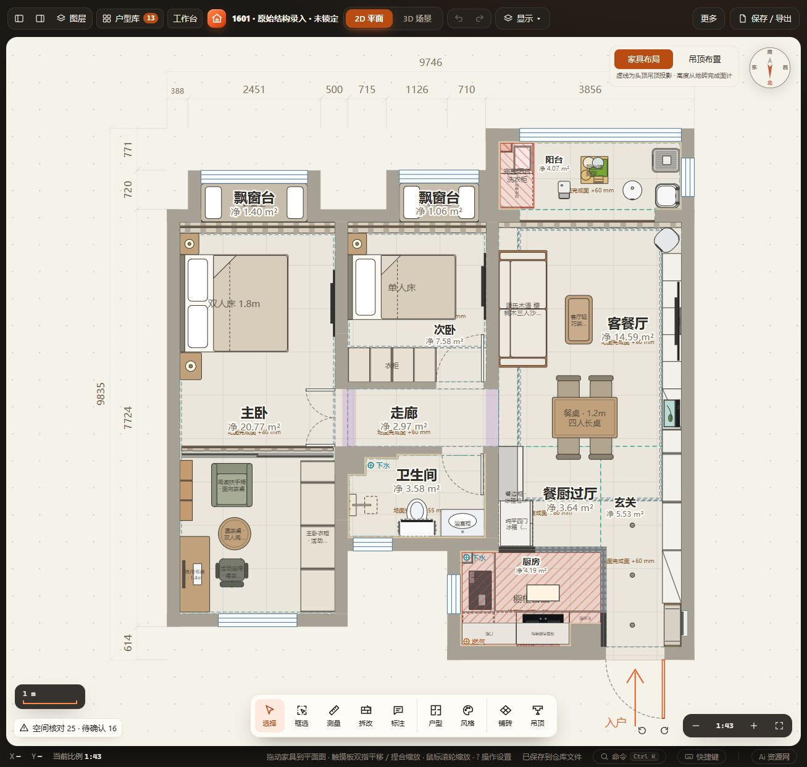
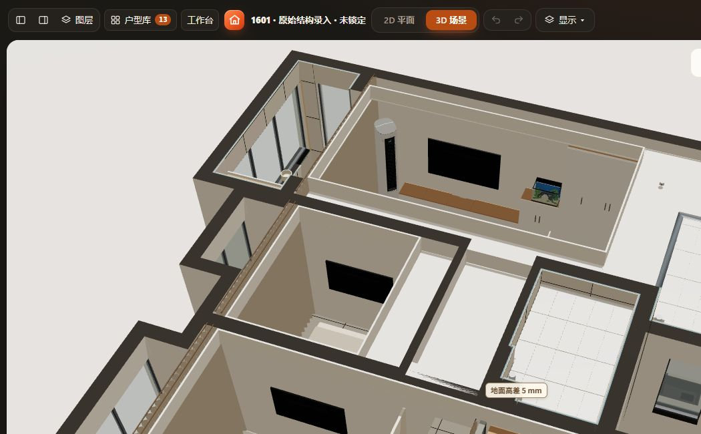

# 1601主卧入口对开门补录

用户截图箭头指向主卧与走廊之间的入口，并确认实际有对开门。复用[现有建筑门](../../DOUBLE-DOORS.md)，不新增家具或重做模型。

## 数据及依据

- 沿项目既有断口y5420–6486mm补门，洞口1066mm、两扇等宽各533mm；236mm墙厚沿北端原墙，主体墙没有平移或拆除。补齐宿主墙段以生成门洞与门头。
- 向主卧内开为本轮布局假设，用户尚未确认。高度沿模型2100mm、厚40mm示意值，不表示现场尺寸；实际门底／门槛未录入。
- 开门扫掠原与玻璃分隔相交，现玻璃门y6650、帘子y6540，均向北活动区移150mm；低书柜y7300，北移100mm避让分隔。其它67件家具不变。
- 新宿主墙将原连续物理房间分开；使用floorplan-core.fitZonesToWalls重配功能区parent、project-core.remapRooms/remapOpenings保留设置及旧门覆盖，功能区ID和轮廓不变。走廊原吊顶跨新增门头，将西边界收至x3939mm，用ceiling-core.setRegion同步生成构件；保留原部件ID、材质和截面。走廊面积减少约0.25m²，来自补录门墙占地。
- 当前与命名「1601」一致，补录前保留「1601 · 补主卧入口门前」。其它旧方案保持，不追溯改写原布置。

## 验证及范围

三套增量测试通过：test-double-doors、test-door-geometry、test-door-2d-refresh，覆盖真实生产网格和联动开合、旋转／门轴／开向及二维刷新。工作区校验、项目往返、三次家具恢复及数据保留通过，详见[checks.json](checks.json)。

HTTP正常载入、撤销重做、刷新恢复通过；属性实见对开门、1066mm、向内开。平面见双扇弧线，三维转向后见两门扇向主卧开启。当前模型开合是临时状态，不随方案持久保存。

本门无家具开启冲突；走廊吊顶无越界提示。全屋核对39→41项：新门底标高待确认一项；物理房间拆分后通道候选多报一项约101mm。原候选坐标／物理房间编号有变化，算法报告的是家具侧隙，未验证为唯一通道，不将候选当作门洞净宽。未增加豁免。门扫掠仍为现有二维扇形近似，不含门厚／五金完整运动碰撞。

未运行全量check、file://、窄屏、Blender渲染或施工安装验收，无源码或加载机制改动。现有玻璃门／帘子顶部封口、隔声／遮光尚未深化。

