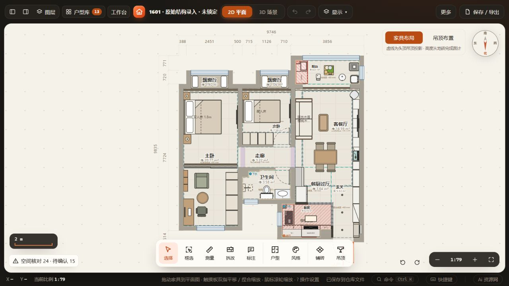
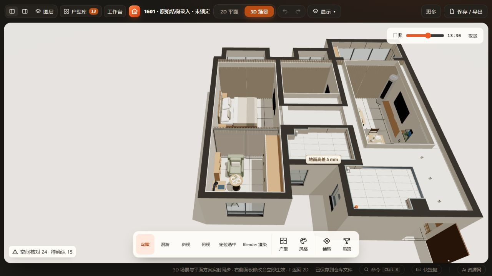

# 1601主卧两区试排

2026-10-29，用户授权继续调整。夫妇50–60岁，身高165/160cm；要猫休息、阅读、偶用桌和茶位，一人喝茶时另一人可睡觉。当前工作槽及命名「1601」均已应用；原布局另存「1601 · 主卧两区调整前」。

## 本轮布置

南侧飘窗一端保留原1.8m床。北侧活动区东墙为原2800×630×2300衣柜，西墙为1400×550偶用桌；书桌及办公椅总高仍未知，没有把模型默认高度写成实测。办公椅日常作第二把茶椅，办公时需移动到书桌。

Y52Y09书柜1115×230×750沿西墙放在阅读扶手椅旁，中间直径600、高650的通用圆桌作为茶位。桌高是布局假设，需结合实际座高和肘部试坐；通用模型附带餐具摆件，不代表茶具选品。衣柜正面至座椅／圆桌最突出处约898mm；这是静态布置净距，移动办公状态需重核。

床头南北两柜中，北侧改为500×400×500开放柜，一块350mm层板、18mm结构板、无踢脚，沿现有柜体生产构造器生成6块板。下格约464宽×364深×350高，为猫窝草案；板厚、垫子与猫是否愿意进入须后续确认，未制造厂家要求。床实际床垫面高未知，没有改写床总高。

睡眠区／活动区间先放2803.5宽、2340高玻璃双扇推拉门及遮光帘，分别y6500／6390mm。玻璃门没有地轨的设置只表示模型意图，五金承重与安装未定。完成面60mm，周边吊顶底绝对2400mm，中心顶绝对2700mm；门帘顶目前只到2400mm，中心顶部约300mm仍须封口深化。帘侧封口、玻璃门密封、空调／供暖、猫进出、灯光和烧水电源均未定，**不能据此宣称隔声、遮光或一睡一茶已实现**。日常通透／睡眠遮蔽是目标，当前截图帘子为关闭状态。

## 验证

- 仓库工作区校验、当前与命名方案相等、调整前快照、其它工作槽／旧方案、61件非本轮家具及建筑数据保留通过。
- 项目打包解包、三次家具恢复无漂移、猫柜6块实际板件通过。
- 本轮9个新增／修改对象空间检查（关闭通道扫描）仅2项高度未知：原书桌、办公椅；未发现本轮实体重叠和柜门开启冲突。全屋仍24项提示与15项待确认，未豁免。
- HTTP实际正常载入方案、保存、68→70件撤销重做、刷新恢复、二维／三维目视通过。结果见[checks.json](checks.json)。
- 未运行全量回归、file://、窄屏、Blender渲染及声光测试；无源码、加载机制或格式变化。

