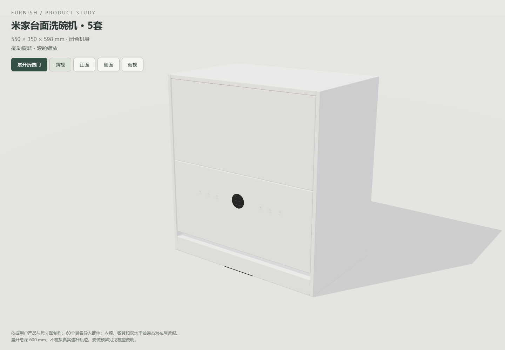
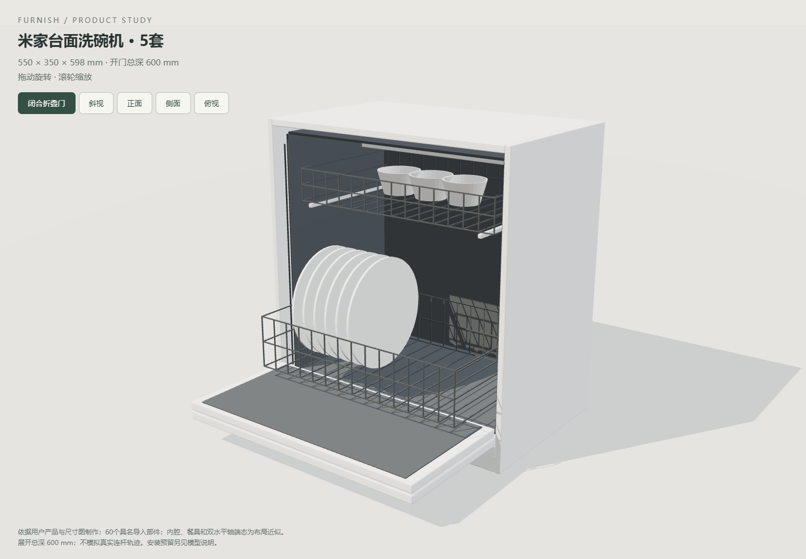
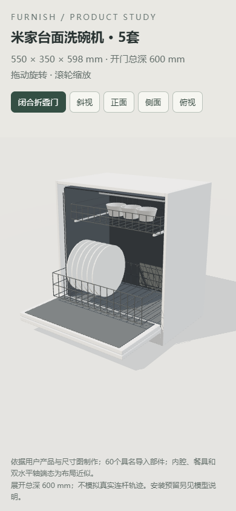

# Blender米家双片折叠门增量验收

2026-10-29。用户选择米家台面5套款，非通用单片下翻门。Blender 4.5.15 LTS、Edge真实WebGL，测试使用隔离副本，不改真实方案。尺寸依据与边界见[模型契约](../../DISHWASHER-BLENDER-FOLD.md)。

## 已通过

- 独立Blender建模／GLB重导入发布：60个具名网格、3个运动父节点、水平X轴、上片嵌套父子关系、闭合几何及来源哈希。
- `test-blender-dishwasher-asset.cjs`：源哈希／角色、实际生产顶点与数值实体逐件一致，闭合／展开与旋转镜像、刚性非等比改尺寸、门片／箱体及两片互相的端态穿插、100mm方向测距、完整预留闭合仍检查、价格配色与空间确认、60个稳定身份。标称、700×420×750、50×50×50以及550×1000×100草模覆盖。明确拒绝中间连杆参数。
- `test-dishwasher-project-v32.cjs`：当前／命名方案v32、旧缓存回退、三次恢复、浏览器客户端存档及仓库实际读写。
- 增量Node：`test-dishwasher`、`test-dishwasher-clearances`、`test-blender-fridge-motion`、`test-fridge-project-v31`、`test-furniture-solids-cache`、`test-furniture-solids-coverage`、`test-furniture-production-solids`、`test-enclosed-boundary-distances`、`test-cabinet-interior-distances`、`test-product-rules`、`test-product-plan-outline`、`test-project`、`test-project-validation`、`test-project-recovery`、`test-workspace-cache`、`test-repository-storage`、`test-repository-workspace`、`test-autosave`、`test-snapping`（均为tests下同名.cjs）。
- HTTP／断网file生产入口：700×420×750mm、900mm离地、开关折叠门、锁定、撤销重做／刷新、v32保存及开关两态60部件生产导出；正面／斜视／390px预览目视检查。摘要见[浏览器结果](summary.json)。
- 原洗碗机及安装条件浏览器用例：真实目录新增、尺寸／离地、0值与非法输入、复制／替换、项目下载上传及命名方案、200／650／50／>80mm、1mm开启占用、台面孔洞、未知高度、撤销／刷新、窄屏。见[兼容结果](compat-browser-result.json)。
- 生产开关GLB在真实Blender回读：60个v3稳定部件和材质，底轴位置固定、上下片世界旋转90°／90°且轴水平；上片枢轴距底轴313.545mm与编辑后的门长一致，见[Blender结果](blender-result.json)。这不是中间连杆验证。
- 门轴负例：父轴移10mm、子件反向补偿以保持闭合外观，发布器拒绝 `Hinge pivot/closed transform changed: lower`，上一有效运行资产哈希保持，见[拒绝记录](rejected-hinge.json)。

## 未执行与边界

未运行全量 `scripts/check.cjs` 或遍历历史生成预览；未验证真实连杆中间路径、磁吸／五金限位、施工、水电、软管、荷载或旧精修材质迁移。两端态之间直接插值会穿插，因此未作为生产能力发布。完整开启核对是资料和模型范围内的保守预留，非连续精确碰撞。箱体生产板件保留空腔；单个篮筐／餐盘网格的数值截面保守，不推定篮内可用空腔。
