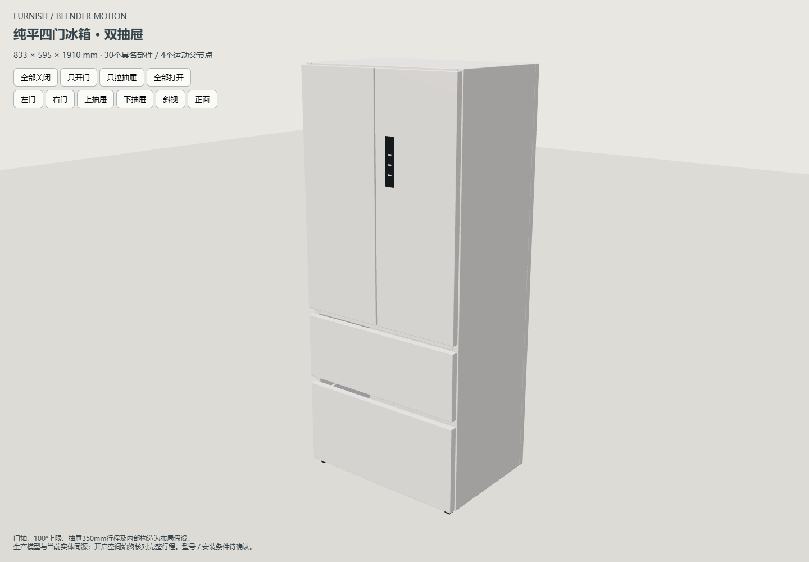
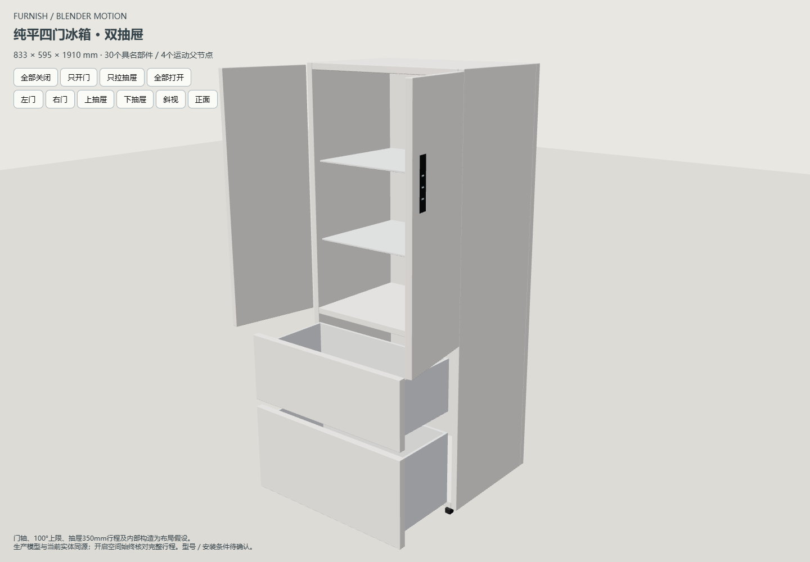
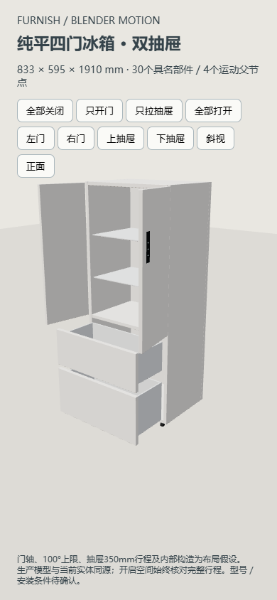

# 冰箱活动部件增量验收

2026-10-29，Blender 4.5.15 LTS，Edge真实WebGL。生产模型及假设见[契约](../../FRIDGE-BLENDER-MOTION.md)。以下检查在隔离工作区执行，未替换真实装修数据。

## 通过

- 独立Blender建模、30网格／4父节点GLB重新导入发布、来源哈希与稳定身份核对。
- `test-blender-fridge-motion.cjs`：四字段限制／默认／替换／粘贴、改尺寸后刚性门轴、生产顶点与数值实体一致、当前实体碰撞／100mm方向测距、闭合仍检查完整开启空间、旋转镜像、高度分离／未知梁高、核对记录失效、代表中间姿态自碰撞。修复下抽屉底板与固定箱底穿插后重新发布再测。
- `test-fridge-project-v31.cjs`：当前／命名方案格式31、缓存31与旧缓存回退、仓库真实读写、三次恢复无漂移。
- `test-fridges`、`test-shared-appliance-model`、`test-blender-bookcase-asset`、`test-product-rules`、`test-product-plan-outline`、`test-snapping`、`test-project`、`test-project-validation`、`test-cabinet-opening-3d`、`test-cabinet-interior-distances`、`test-enclosed-boundary-distances`、`test-tea-bar`、`test-furniture-production-solids`、`test-furniture-solids-coverage`、`test-furniture-solids-cache`、`test-furniture-recovery`、`test-project-recovery`、`test-recovery-storage`、`test-autosave`、`test-workspace-cache`、`test-repository-storage`、`test-repository-workspace`、`test-server-startup`（均为tests下同名.cjs）。范围为受影响规则、模型、空间、加载和恢复链路。
- `verify-blender-appliance.cjs --fridge`：HTTP及断网file均通过。属性改尺寸1200×800×2200mm，左90°／右70°、上100%／下40%，锁定、撤销重做、刷新、完整扫掠定位、生产30部件导出、正面／斜视／窄屏检查通过；结果见[摘要](summary.json)。SE2和Y52Y09同一验证器回归通过，分别导出29／12部件。
- 生产开／关GLB在独立Blender回读：30个v3稳定部件，材质存在，门轴固定、90°／70°绕竖轴旋转；800mm深草模上下抽屉位移470.588／188.235mm，见[真实Blender结果](blender-result.json)。
- 负例：将左门父节点移10mm、子网格反向补偿保持闭合外观，发布器以 `Hinge pivot/closed transform changed: left` 拒绝，旧运行资产哈希不变；见[拒绝记录](rejected-hinge.json)。

## 未执行与算法边界

未运行全量 `scripts/check.cjs`，未遍历历史预览；未穷举四运动部件任意组合的自碰撞，未验证旧精修Blender工程材质接管。扫掠采用补足采样误差的保守凸包，平面接触沿现有5mm容差，空角可能误报。门轴、内部结构、100°上限、参考350mm行程未获厂家资料确认；五金、密封、散热、施工及实物精度均未验收。
