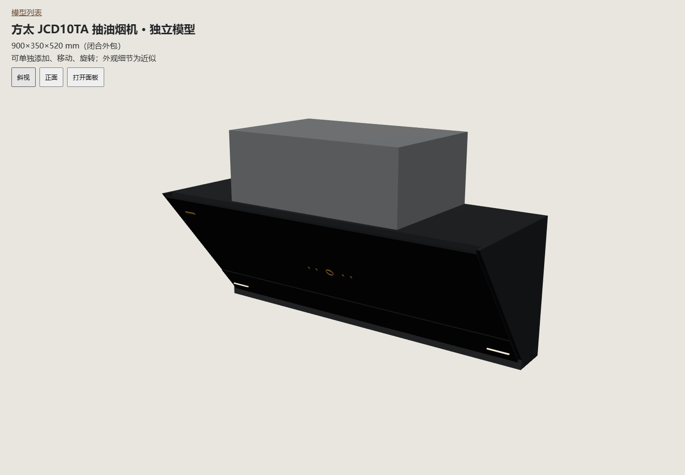
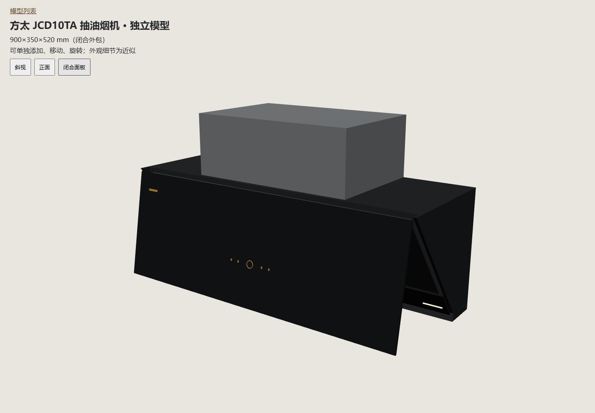
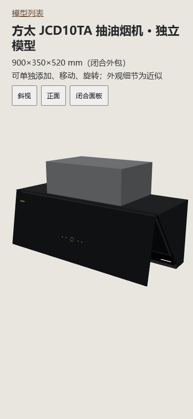

# JCD10TA上翻面板增量验收

2026-10-29，Blender4.5.15 LTS与Edge真实WebGL。来源、尺寸及算法限制见[契约](../../HOOD-BLENDER-MOTION.md)。测试在隔离副本执行，未写真实装修方案。

## 已通过

- 独立Blender建模、27具名网格／1水平轴、自包含GLB回读、部件尺寸／闭合位置／父子绑定、控制环实际采样边界、来源哈希和离线资产发布。
- `test-blender-hood-asset.cjs`：标称、1080×420×624及515高独立罩尺寸；闭合／25%／50%／75%／全开代表姿态，真实Three与数值顶点逐件一致、刚性拟合、7随动／20固定角色非空计数、竖向剖面自碰撞、完整扫掠包含实际顶点、旋转镜像、100mm方向测距及稳定部件身份。闭合与全开都不碰的“中间路径障碍”仍被完整扫掠检出；已知高度分离排除，未知梁高pending。
- `test-hood-project-v33.cjs`：当前／命名方案v33、旧缓存回退、三次恢复及仓库客户端实际存档读写。
- 增量Node：`test-fotile`、`test-hood-geometry`、`test-hood-bay`、`test-hood-bay-modules`、`test-hood-cavity-clearance`、`test-hood-cavity-details`、`test-product-rules`、`test-product-plan-outline`、`test-furniture-production-solids`、`test-furniture-solids-coverage`、`test-furniture-solids-cache`、`test-enclosed-boundary-distances`、`test-cabinet-interior-distances`、`test-cabinet-opening-3d`、`test-project`、`test-project-validation`、`test-workspace-cache`、`test-repository-storage`、`test-repository-workspace`、`test-project-recovery`、`test-autosave`、`test-snapping`（均为tests下同名.cjs）。旧实心分段断言改为生产部件检查；柜位穿板探针改为实际后壳位置，不以中空区推定实体。
- `verify-blender-appliance.cjs --hood`：HTTP／断网file真实WebGL、1080×420×624mm、1315mm离地，开合、锁定、撤销重做／刷新、v33、扫掠定位、27件生产开关GLB导出、正面／斜视／390px检查。见[浏览器摘要](summary.json)。
- 实际Blender回读两个入口导出：27个v3稳定部件和材质，水平轴位置固定，转动约48.36°；装饰罩、下部玻璃与接油槽不随面板移动。见[真实Blender结果](blender-result.json)。
- 负例：轴心移10mm并反向补偿子件以保持闭合外观，发布拒绝 `Hinge pivot/closed transform changed: panel`，上一运行资产哈希不变。见[拒绝记录](rejected-hinge.json)。
- 既有 `hood-geometry`、`fotile`、`fotile-previews` 浏览器用例通过：HTTP／file的独立分段输入、尺寸约束、开关、锁定、撤销／刷新、3D缓存和窄屏，以及灶具／烟机各自独立预览。共用资产验证器的洗碗机、SE2、冰箱入口回归通过。源码语法、主入口模块／普通脚本共享作用域和本地依赖、旧v31／v32恢复及服务正常重启测试通过。
- `hood-bay` 浏览器流程通过：增加／修改柜位、居中／齐底、旋转镜像、门板开合保存／撤销／刷新及窄屏移除／撤销。历史脚本更新为先展开当前已折叠的模板、预览显示及窄屏设置后再操作。四项既有流程结果见[兼容验收](compat-browser-result.json)。

## 主线汇总

隔离结果为 `output/playwright/blender-hood-6naQZF`。主目录快进汇总后再次通过烟机资产、v33和独立分段尺寸测试；8766后端在无Blender作业时按既有指纹机制正常刷新，当前指纹及预览HTTP检查通过。建模技能已备份、更新并通过官方校验及本地引用检查。已普通推送main，已合并试点分支删除；当前主工作树、验证产物及其它对话工作树保留。主目录原 `projects/workspace.furnish.json` 未提交修改逐字节保持，未进入本任务提交。

## 未执行与边界

未运行全量 `scripts/check.cjs` 或遍历历史生成预览。轴心、−0.18rad、侧壁和内部结构为布局近似，不证明真实限位／五金、风管、电源、施工和安全间距满足。扫掠为补偿采样误差的保守凸剖面，当前薄斜面截面也可能保守误报；不是逐三角面连续精确碰撞。未穷举所有极端尺寸组合或验证旧精修工程材质接管。
