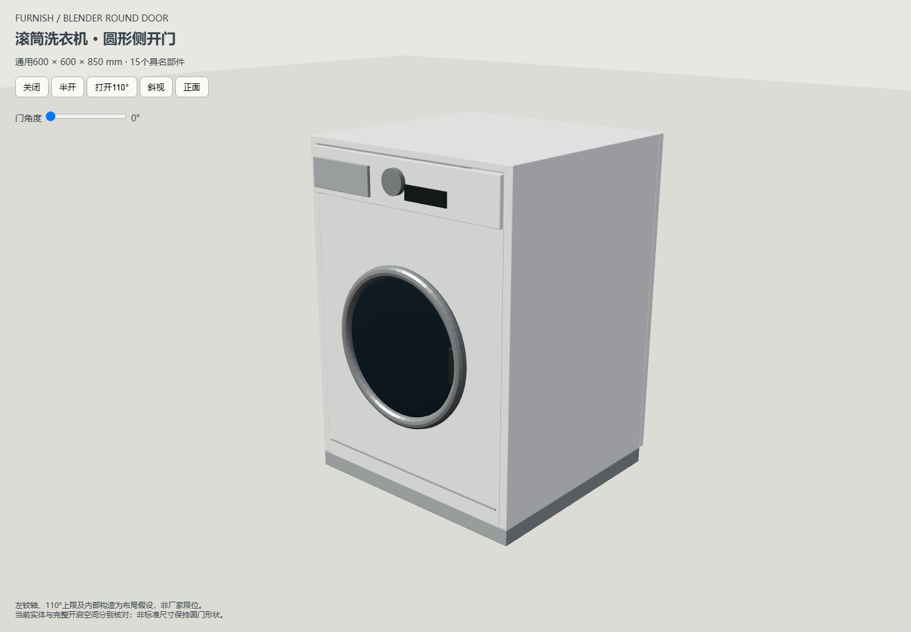
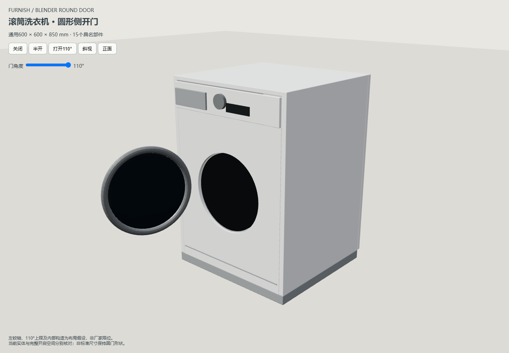
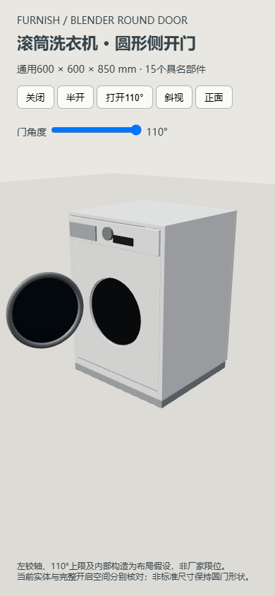

# 滚筒洗衣机圆门增量验收

2026-10-29，Blender4.5.15 LTS，Edge真实WebGL。通用型号600×600×850mm来自既有库；左轴／110°及内部结构是布局假设。详见[模型契约](../../WASHER-BLENDER-MOTION.md)。隔离验收未写真实装修数据。

## 已通过

- 独立Blender建模／GLB重导入，15具名网格、1竖轴、3随动／12固定件、部件身份和闭合尺寸、圆环内外径、投入口通孔及来源哈希。
- `test-blender-washer-asset.cjs`：600×600×850、750×700×1000、450×900×650、50×50×50；0/27.5/55/82.5/110°，真实Three与数值顶点逐件对比、圆门长宽、实际圆孔顶点及闭合／打开射线、自碰撞、复制／同类替换与跨类清理、稳定身份。旋转镜像、100mm方向测距、当前碰撞／高度分离、12片完整扫掠包含实际顶点、仅中间路径障碍、顶部外包空角及未知高度保守判定通过。
- `test-washer-project-v35.cjs`：当前／命名方案v35、v34旧缺省不补角度、旧缓存回退、三次恢复、仓库客户端实际存档读写。
- 既有洗衣相关Node：`test-laundry-stack`、`test-laundry-catalog`、`test-laundry-resize-vessel`、`test-laundry-basin-joins`、`test-laundry-cabinet`、`test-laundry-area`、`test-laundry-integrated`、`test-laundry-notch-closure`、`test-laundry-back-alignment`；共用 `test-shared-appliance-model` 扩展洗／烘分别作为上层的8组连接层，浏览器普通脚本与Node真实几何／缓存材质一致。
- 增量空间／数据：`test-cabinet-opening-3d`、`test-furniture-production-solids`、`test-furniture-solids-coverage`、`test-furniture-solids-cache`、`test-enclosed-boundary-distances`、`test-cabinet-interior-distances`、`test-product-rules`、`test-product-plan-outline`、`test-snapping`、`test-project`、`test-project-validation`、`test-project-recovery`、`test-workspace-cache`、`test-repository-storage`、`test-repository-workspace`、`test-autosave`、`test-window-coverings`（以上均为tests下同名.cjs）。仓库夹具改为按内置方案实际所需版本初始化，不把含新洗衣机的方案强行断言为v2；所有旧版本原样恢复存档仍验证。
- `verify-blender-appliance.cjs --washer`：HTTP／断网file、750×700×1000mm、离地200mm、角度110°、锁定／撤销／刷新、v35、扫掠定位、15部件开关GLB导出、正面／斜视／390px目视通过；见[浏览器摘要](summary.json)。初次受限沙箱Edge启动失败后，独立后台浏览器实测通过。
- 原洗衣柜目录、改尺寸／台上盆及台盆拼接HTTP／file用例通过，含真实项目下载上传、洗衣机跟随／保留、撤销刷新和窄屏。旧脚本适配当前折叠设置后执行；见[兼容结果](compat-browser-result.json)。
- 生产开关GLB在真实Blender回读：15个v3稳定部件，三件门体共用固定竖轴转110°，实际最低点200mm与浏览器记录的安装基准一致，离地没有重复叠加；见[Blender结果](blender-result.json)。
- 负例：轴心移10mm、子件反向补偿使闭合外观不变，发布拒绝 `Hinge pivot/closed transform changed: door`；外包不变但投入口封死，发布拒绝 `Circular drum opening is missing or filled`。两次均保留有效运行资产哈希。见[轴心拒绝](rejected-hinge.json)和[通孔拒绝](rejected-aperture.json)。
- 先前五类资产的Node专项通过，共用浏览器验证器的烟机／洗碗机HTTP和离线入口回归通过。改动JS／Python语法、主入口普通脚本共享作用域／模块和本地依赖、服务正常重启测试通过。洗衣柜关联后的门角度、上层烘干机高于圆门扫掠也已核对。

## 合并主线复验

合并最新次卧挂衣柜成果后，文档插入冲突保留双方记录，柜体核心自动合并。`test-wardrobe-hanging`、共享三维开启、v35恢复、共用家电／8组叠放及圆门专项通过；主入口作用域和柜内量距通过（1374块生产板件）。洗衣机HTTP／离线生产流程再次通过，隔离结果 `output/playwright/blender-washer-iavYFM`，见[合并后摘要](merged-summary.json)。初次完整证据及真实Blender回读使用 `blender-washer-lvARsM`。技能已备份、更新并通过官方校验与本地引用检查。

主目录快进汇总后再次通过v35、洗烘叠放和次卧挂衣柜测试；最新衣柜方案文件逐字节保持。8766后端无Blender作业时按既有指纹机制正常刷新，当前指纹和圆门预览HTTP检查通过。已普通推送main，主目录工作区干净并与origin/main一致；已合并试点分支删除，当前主工作树、验证产物和其它对话工作树保留。

## 未执行与边界

未运行全量 `scripts/check.cjs` 或遍历历史预览。没有厂家型号／铰链限位、管线、振动、承托／叠放施工合格结论。12片圆柱外包及凸包扫掠保守，非逐三角面连续精确碰撞；单件凹面框数值截面可能填实孔，不承诺机器内可用空腔。未验证旧精修Blender工程材质自动迁移。
