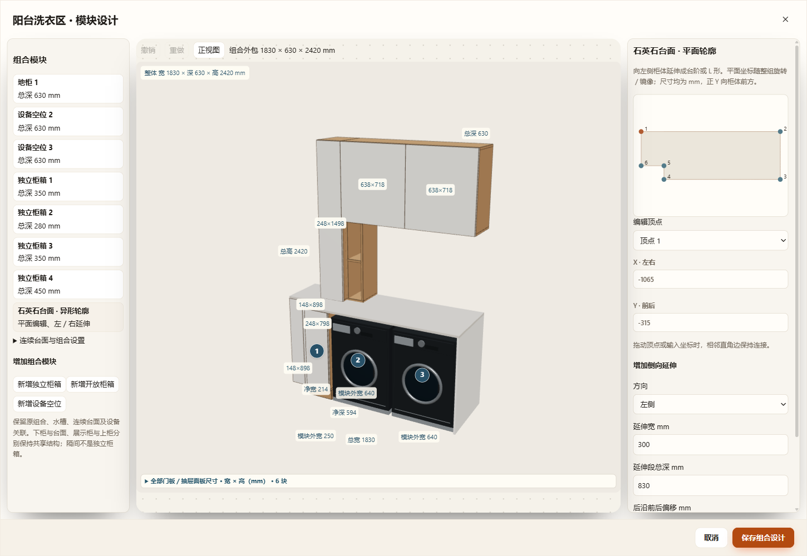

## 后续纠正：只保留唯一乐高编辑器

用户明确指出此前两套界面不符合要求。本阶段移除独立组合编辑API及旧普通柜／厨房弹窗实现，两个历史入口仅转发到 `FurnishCabinetBuilderUI.open`。所有类型共用 `mountShell` 和 `libraryItems`；原生配方在内部适配，左组件库、中生产预览、右结构树／属性、全屏／默认正视／显示选项与保存统一。独立柜箱直接安装部件、修改板厚与逐扇门角，不跳转第二个编辑器。台面、水槽、设备位和原结构数据保留。没有新增持久字段，格式仍为v79。

最终三入口专项：HTTP 37项、断网file 37项、同EXE隔离桌面38项，包含旧储物柜、洞洞板柜与L厨房的唯一入口／取消不改数据、内联组件安装、逐门扇编辑、台面拖点及保存恢复；桌面111个生产GLB网格一致。原乐高编辑器41项交互回归通过；共享核心相关增量及语法检查通过，未运行全量检查。已实际查看最终桌面图，核对为同一组件库／预览／结构树／属性布局。

[三入口结果](one-editor-results.json) · [原乐高交互回归](one-editor-builder-regression.json) · [统一后的阳台界面](unified-lego.png)

运行目录：`output/desktop-verification/cabinet-assembly-Sjq02E`、`output/desktop-verification/cabinet-builder-interaction-DEz0zi`。以下保留此前阶段的历史验收记录，其独立组合界面及嵌套跳转流程已取消。

# 洗衣区／餐边柜新编辑器及异形石英石台面验收

2026-11-08。功能与数据范围见 [组合编辑契约](../../CABINET-ASSEMBLY-EDITOR.md)。正式方案未用于测试编辑；测试从 `D:\1601装修\Furnish项目\workspace.furnish.json` 复制到独立源码／工作文件／缓存／端口，桌面沿 `scripts/launch-desktop.cjs` 发现的同一打包 EXE。未改 Electron 安全设置。

## 已通过

- `tests/test-cabinet-assembly.cjs`：12组独立柜箱对齐／偏移及库复用、8组原生餐边柜对齐与实际板件、洗衣区独立地柜深度及非法台面穿出拒绝；新增组件柜、双设备空位、侧高柜／开放格／吊柜；v79当前／命名／仓库／缓存往返、三次恢复不漂移、旧缺失冰箱深度固定；名称不清空间确认、内嵌组件规则及闭合复用。
- 同一测试另验异形台面顶点、扩展面积、真实台面实体、非法自交／孤岛原子拒绝、延伸段真实侧柜及柜顶接触；0／37／90° × 镜像下，台面高度内探针命中、台面以上探针不误撞。
- `test-cabinet-editing-audit`、`test-cabinet-builder`、`test-cabinet-builder-upgrade`、`test-sideboard-board-edges`、`test-cabinet-back-components`、`test-laundry-integrated`、`test-laundry-notch-closure`、`test-laundry-resize-vessel`、`test-laundry-back-alignment`：本次相关增量回归通过。其中原组件柜144组生产组合、72段门生产扫掠、120组背板参数及24组独立抽屉姿态沿原测试通过。
- `node tests/test-cabinet-back-components-ui.cjs --assembly-only`：HTTP 28项、断网 `file://` 28项、同 EXE 隔离桌面29项。包括两类新入口、原生配方保留、独立深度／板厚／前沿偏移、嵌套草稿、台面侧向延伸及精确坐标、撤销重做、窄屏、保存刷新与取消。
- 补充真实鼠标拖动后的最终 `--assembly-only --desktop-only`：30项通过。生产石英石网格的延伸外沿及向下射线标高与核心轮廓、台面顶一致；正式应用 GLB 导出后读取各网格 accessor 和变换，与三类柜体生产对象逐件对照，111个柜体／台面网格，最大世界边界误差0mm。不是只检查总包络；没有将配方中的设备模型计入这111件柜体网格。

[三入口逐项结果](three-entry-results.json) · [最终桌面及拖点逐项结果](desktop-pointer-results.json)

三入口记录：`output/desktop-verification/cabinet-assembly-9IMKHe`。最终桌面记录：`output/desktop-verification/cabinet-assembly-Tm2ri9`。一次此前的桌面运行界面检查通过，但末尾源文件哈希保护失败：正式窗口在验收期间于23:16:32正常保存。正式文件中没有测试家具ID；因此改用 `.local/cabinet-assembly-20261108/source-snapshot.furnish.json` 固定快照复验，最终运行及源快照哈希保护均通过，没有停止用户编辑或覆盖正式文件。

- 原组件柜 `--builder-interaction-only --desktop-only` 41项交互回归通过，见[结果](builder-interaction-results.json)，运行目录 `output/desktop-verification/cabinet-builder-interaction-ZQ0hwH`。

## 目视与参考能力

已实际查看宽屏餐边柜、洗衣区台面编辑及390px窄屏截图，确认三栏滚动、控件、台面转折、柜箱分层及两台已放置设备显示。参考图只用于验证组合能力，示例尺寸均为软件验收值，没有作为现场／厂家尺寸写入用户方案。

[用户原始参考图](user-reference.png) · [餐边柜新界面](sideboard-modern.png) · [窄屏台面顶点编辑](worktop-narrow.png)

## 未执行与边界

- 未运行全量 `node scripts/check.cjs`，只检查上述改动模块、调用方、保存恢复、生产实体与三入口。
- 未进行 Blender 重开或石材加工／施工验收；本次为已有参数化生产路线的新编辑及轮廓能力，没有新增 Blender 资产。
- 直角轮廓之外的曲线、倒角、石材接缝、悬挑承托、承重与开裂风险未建模。原餐边柜横向共享隔间不是独立柜箱；新增组件柜才拥有独立板厚和柜箱内部结构。
- 新设备空位不自动添置设备，第二台设备可以按场景位置放入并在组合预览显示；原 `laundryHostId` 自动跟随关联仍沿已有首个设备位语义，本轮未扩展为多个自动关联设备。
- 未修改正式装修方案，也未提交原已有的 `projects/workspace.furnish.json` 修改。仓库只有main本地分支；五个既有分离工作树均仍有忽略资料，其中一个另有未提交修改，已检查并保留，没有清理其用户资料。
