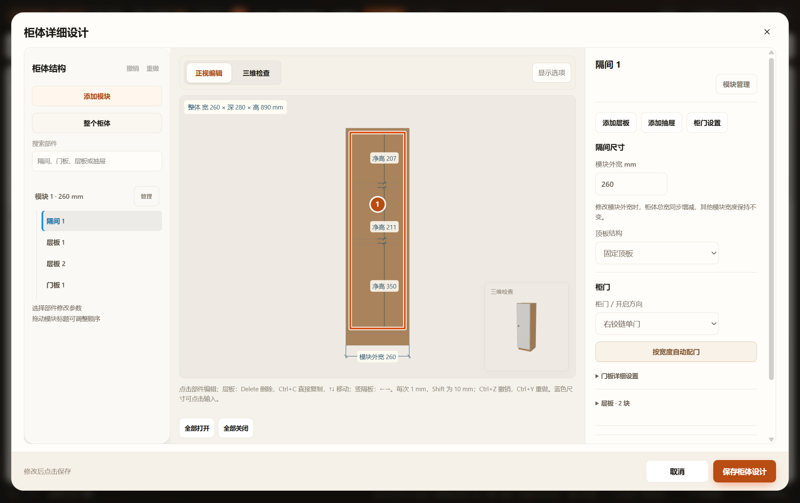

# 隔间常用配门面板验收

## 范围

仅调整普通柜体隔间参数的组织、说明和留白，复用既有字段、表单节点、事件委托和保存。柜门方向与按宽度配门直接显示；配门后保留隔间选中；层板／抽屉分别折叠显示数量，多隔间抽屉复制移入抽屉组。分隔板保留高级入口。

## 已通过

- `node --check src/ui/cabinet-editor.js`、桌面验收脚本语法检查。
- `node tests/test-cabinet-part-inspector.cjs`：真实生产门扇／抽屉运动与项目往返。
- `node scripts/verify-browser.cjs cabinet-bay-inspector cabinet-editor-completion cabinet-part-inspector cabinet-setting-inheritance`：隔离 HTTP 新面板、原有 HTTP／file 离线综合与部件流程、设置继承。最终记录：`output/playwright/verification-qjRGNW/results.json`。
- 新面板覆盖无门配门、切换左右铰链、门板材质／把手控件、折叠状态、保存、取消、撤销重做、刷新恢复、层板与空抽屉组访问、390px 对话框横向溢出检查。
- 同一打包 EXE，复制 `D:/1601装修/Furnish项目/workspace.furnish.json`，独立源码、缓存与端口；源文件哈希不变。保存至副本后刷新，避免 Electron 原生离页确认阻塞自动化。记录：`output/playwright/cabinet-bay-inspector-AKx1v8/summary.json`。
- 实际打开桌面与窄屏截图：门板入口可见、隔间卡片冗余边框已移除；窄屏沿原上下滚动布局，仍须向下滚动到参数区。

## 目视证据

## 未执行与边界

未运行全量检查、未改正式方案、未验收实机触屏。新面板独立流程在 HTTP／EXE 验证；原有综合与部件流程含断网 file。移动端整体工作台原有纵向结构与预览工具栏拥挤不在本轮重构范围。门板覆盖范围、空间碰撞与配门尺寸规则未改变；无新持久字段／缓存语义／加载脚本。
