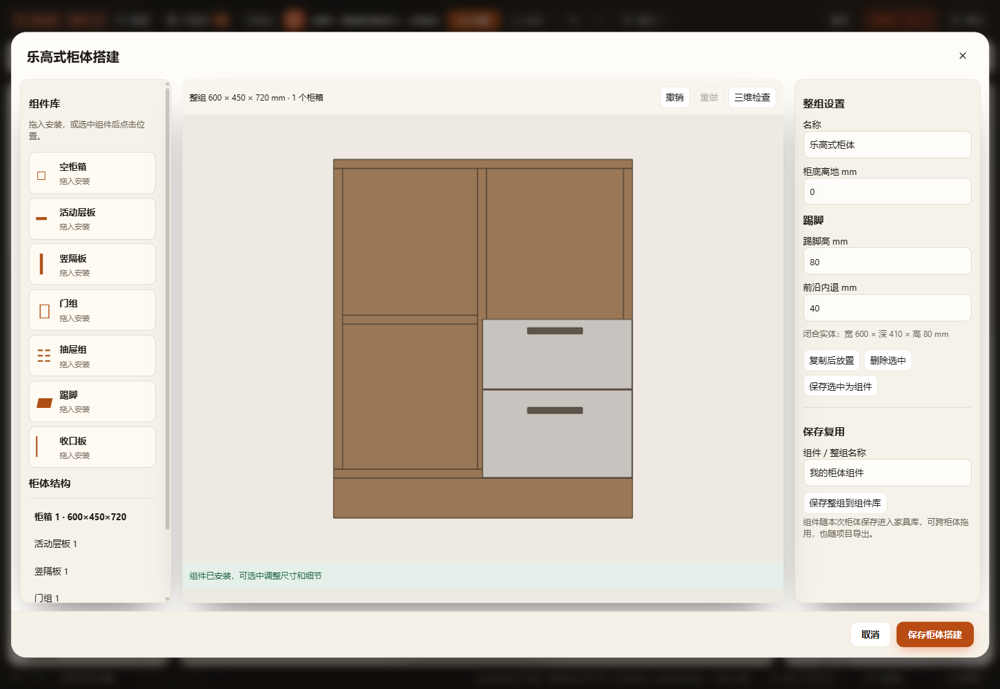
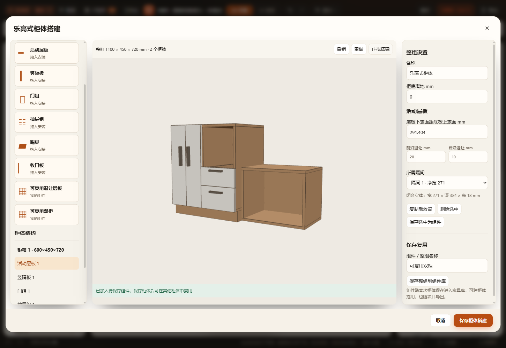
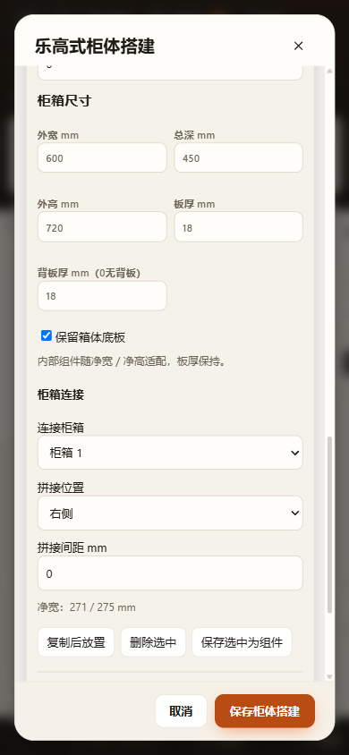

# 乐高式柜体搭建验收

2026-11-08。第一版闭环范围见[搭建契约](../../CABINET-BUILDER.md)。新持久结构为cabinet.version=2，含新树的项目最低v72；无旧柜转换或正式用户方案改写。

## 已通过

- `test-cabinet-builder.cjs`：144种板厚／深度／左右上下连接／旋转／镜像组合，生产Three实体尺寸、数字板件与世界坐标；20种实际门组姿态逐顶点检查完整扫掠，覆盖单开、对开及上下翻、不同深度和高度、离地偏移。实际导出snapshot逐件身份唯一，插入较低层板不重命名原层板。
- 无底真实设备空腔正例、底板／侧板负例、等于／低于板面接触阈值、不同高度及未知高度；结构编辑原子失败、不支持字段拒绝、非法ID／循环／净宽、锁定、NaN、空组合拒存。组件跨柜移动保留ID，组合复制重分配ID，收口按最近侧／顶吸附，复用保留连接间距。
- 当前／命名方案／家具库v72项目往返，工作区／缓存72，复制、替换、连续三次恢复无漂移；结构变化使空间确认失效，价格／颜色保留。保存组件参数与示例结构严格一致；主库条目保留柜体类型。新增入口没有改变已有产品的默认资料与参考价格。
- 17项受影响回归套件结果见[incremental-results.json](incremental-results.json)，包括既有上下柜／局部结构／共享构造、生产模型／开启／尺寸、目录导航／柜体目录、项目恢复、工作区／缓存及厨房。仓库版本接口另以隔离本机服务运行 `test-repository-version-compat.cjs` 通过；18个改动JavaScript语法与git diff --check通过。
- HTTP、断网file://、同一打包EXE的独立根目录／profile／端口完成真实原生拖放：从主家具库进入空白搭建器，拖入柜箱及组件，修改尺寸和退让，拒绝重复门组且保留数据，草稿撤销重做，组件实际拖动、保存选中／整组、应用撤销重做、取消、刷新及跨柜复用。
- 三入口均通过正式生产场景的 `View3D.blenderScene()` GLB导出，检查实际家具ID下所有网格有唯一builder组件身份；不是仅独立构造器或JSON序列化检查。[三入口记录](three-entry-results.json)。最终HTTP与桌面另补实体读数回归：[HTTP](final-http-results.json)、[桌面](final-desktop-results.json)。
- 实际查看桌面正视／三维、390px窄屏截图：组件库、完整右侧参数栏、不同高深柜箱及保存复用入口可见，无横向溢出。初次截图发现右侧属性被窄弹窗裁切，已扩大工作区后重跑查看；没有把早期截图标为最终通过。

三入口正式源使用冻结副本；运行前后源哈希相同，见[快照记录](source-snapshot-result.json)。源文件不含测试对象「乐高验证柜」。成功受管运行副本、缓存和冻结文件已清理，JSON与截图保留；失败调试目录保留。仓库原有projects/workspace.furnish.json未提交修改继续保留。

## 既有失败与未执行

`test-catalog-browsing.cjs` 有一项与本次无关的既存失败：宠物列表期望固定5项，当前目录实际8项（增加猫砂、猫水碗、喂食架）。用未修改HEAD a501b176的catalog源码和测试通过独立Module/VM复现同一失败。没有修改宠物产品或放宽该测试；新入口的目录导航及既有产品资料／价格保持检查通过。

未运行全仓check.cjs、实体触屏硬件验收、独立Blender回读／渲染、五金／承重／施工校验。桌面及浏览器预览和正式GLB验证分别成立，不将GLB导出成功称为Blender回读通过。第一版为直线柜箱连接与内部组件，保留独立柜箱侧板；跨柜并板、转角与任意三维自由连接不在本轮能力内。

