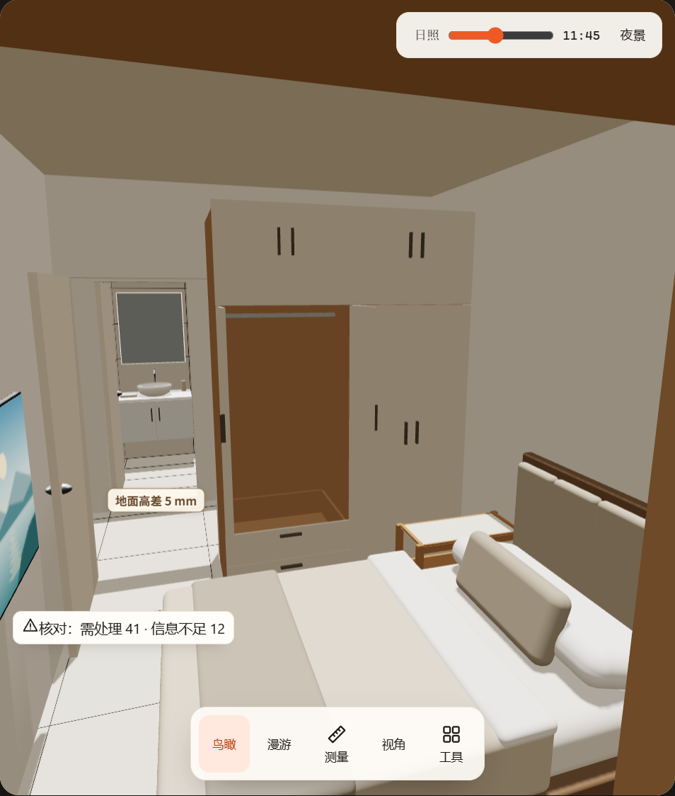
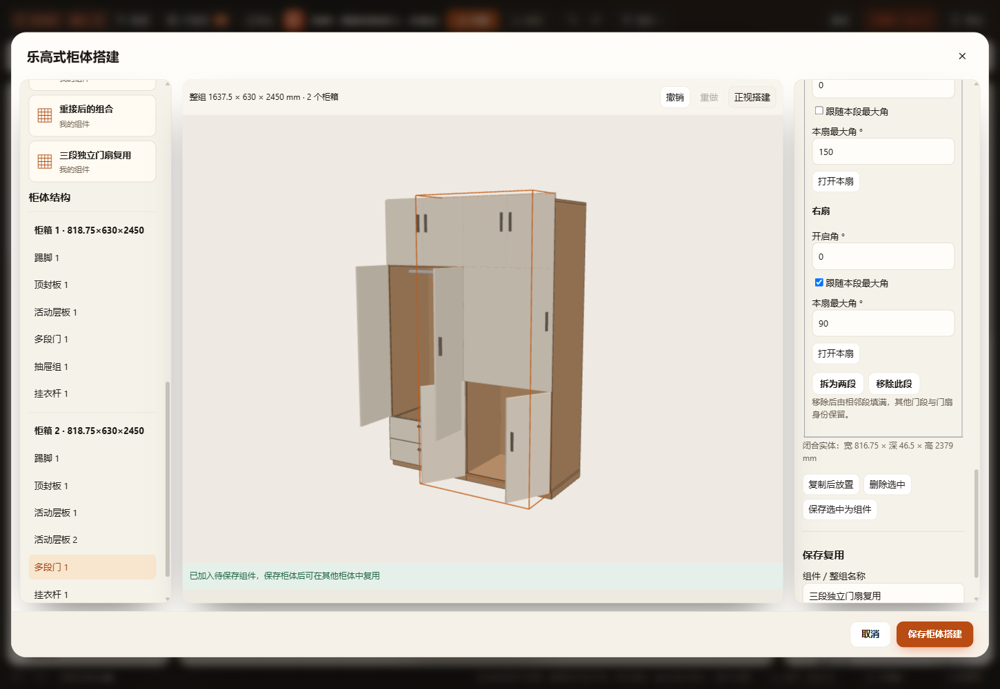
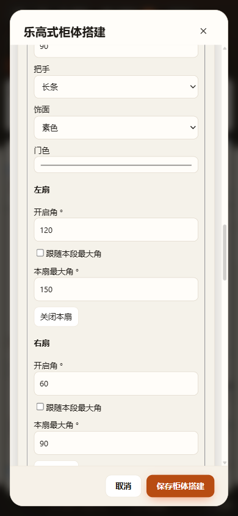
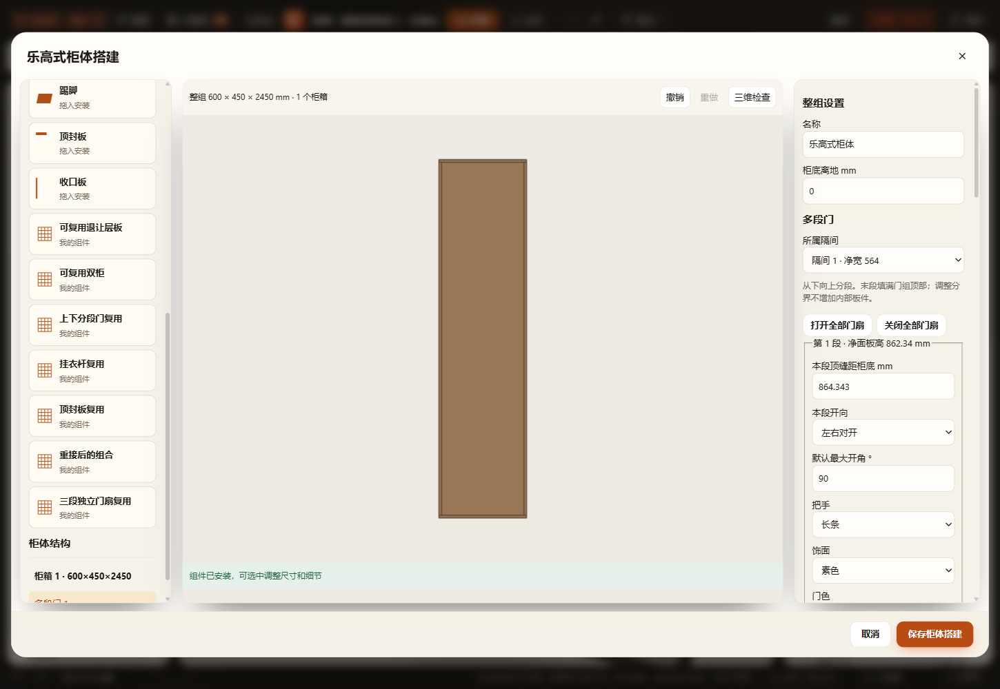

# 多段门、逐门扇开合与次卧衣柜试点

2026-11-08。基于1018b233继续参数化柜体搭建，未增加资产、脚本加载项或保存通道。工具箱会话确认无共享文件或Git占用；先前柜体标注会话已归档，未唤醒或改变归档状态。用户原有项目修改保留。

## 交付行为

- `multiDoor` 支持1–12连续门段，各段单扇或对开双扇；各段开向、外观和默认限位独立，每扇有稳定ID、当前姿态及可覆盖／恢复继承的1–180°最大角。保存／复用关闭姿态并保留限位，复制重分配所有层级ID，移动保留ID。
- 分界以距柜底mm编辑、按门组有效范围比例保存，末段覆盖到顶部；面板扣两端1mm边缝后至少60mm。拆分、移除及开向改变保留仍存在的门扇身份；不自动新增内部板件。
- 新建单段门、上下门和多段门统一使用新结构，旧保存组件可显式转换。补查修复旧单段门转换时状态引用被清空的问题，五种开向转换逐板等价；原上下门也有转换等价回归。
- 生产门片、把手、轴心、当前实体和完整扫掠共用同一构造。每段／每扇身份贯穿预览点击定位、场景点击、GLB和数字实体；翻门的单扇扫掠也携带leaf身份。降低限位只夹紧本扇，关闭不缩小完整开启核对。
- 新kind最低v74；基本组件和上一轮新组件保持原最低格式。`multiDoorRule=1`仅加入使用该能力的空间输入，价格／颜色／饰面及无关组件柜不额外失效。当前、命名方案、组件库、工作区及离线缓存沿原链路。

## 正式副本

正式窗口最初有玄关柜未保存草稿，MCP拒绝复制；保留草稿，用户处理并允许继续后才重读、复制。通过专用MCP创建“组件柜试点 · 次卧衣柜多段与逐扇开合”（dmw7b9vxu），源方案“组件柜试点 · 猫窝床头柜与囤货柜”（dmw796ybo）保留v1次卧衣柜。正式文件仍由原应用保存，未直接改正式JSON。[MCP回执](mcp-receipts.json)记录复制、升级、试开与恢复，均为 `applied:true / persisted:true`。

| 项目 | 升级前后结果 |
|---|---|
| 家具身份 | fmv3wzkb515，名称／中心4757.75,4975／旋转180°保持 |
| 完成外尺寸mm | 1637.5×630×2450 |
| 独立柜箱 | 2箱，各外宽818.75、净宽782.75 |
| 闭门口径净深mm | 594，扣18背板和18门板 |
| 顶部 | 箱体2400＋封板50，门顶2440 |
| 原层板 | 左1786，右884/1786，均保持原底板基准 |
| 挂衣杆 | 3根，杆心离柜底902/1804，宽778.75、截面25保持 |
| 生产板件／当前姿态 | 48件，逐件包络、轴心、限位及运动相位等价；实际Three顶点含把手等价 |
| 原门段与状态 | 保留上下两段，共8扇；左柜下部两扇90°，其余关闭 |
| 逐扇限位 | 第二柜下段左150°/右90°，上段左150°/右继承90°，其余90° |
| 其他家具 | 165件逐字段相同 |

实际正式副本试开：左柜下部37.5°／关闭，右柜下部120°／60°，生产场景目视确认分别运动后恢复原姿态并保存（12:15:24）。试点不任意新增门缝；三段和更多分段的编辑另在隔离副本验证。

只读命令 `node scripts/verify/verify-cabinet-builder-wardrobe.cjs --out output/cabinet-builder-multidoor-20261108/wardrobe-verification.json` 从实际保存文件读取源方案与副本：48件板件及当前相位一致；完整扫掠仅归一冗余共线点及高度带表达后相同；3个100mm测试块的四向／上下净距一致，无碰撞。测试块位于柜底相对高度600、300、1200mm，属于合成探针，不代表已建模衣物或真实收纳净空全部通过。[完整数值及源文件哈希](wardrobe-verification.json)。验证前后文件哈希一致。

两次Furnish空间核对均为同一项：第一分区抽屉拉出后前方800mm操作区被单人床占用；没有新增问题，未移动床或自动确认。此处比较针对衣柜，并非全案零缺陷结论。

## 验证范围

- 新增 `test-cabinet-builder-multidoor`：90种开向／旋转／镜像／根箱、顶箱、侧箱配置中的324片实际门扇姿态，含不同深度350/600、180mm离地及不同的非整数角；各片顶点处于自己的完整扫掠，最大角与当前角逐扇读取。
- 覆盖稳定身份、拆并／移动／组合重接复用、当前姿态和限位互不覆盖、60mm等于／低0.001mm边界、12段上限、错误门扇和重复ID拒绝、仅本扇夹角、规格关闭姿态、v74项目／命名／库／工作区／缓存及重复恢复；源次卧衣柜与新树的实际Three几何和生产实体等价。
- 其余27个适用回归通过：builder、builder-upgrade、components、details、model、dimensions、top-closure、section-doors、leaf-limits、tiers、opening-3d、opening-volume-model、interior-distances、shelf-clearances、independent、cabinet-catalog、cabinet-preview；catalog-navigation；project、project-validation、project-recovery；repository-workspace、repository-version-compat、workspace-cache；kitchen、kitchen-u；furnish-mcp。连同新增用例共28个相关回归。
- HTTP、断网file、同正式EXE隔离工作目录／端口／缓存的完整UI通过；分别50、50、52项，含实际拆成三段、逐扇开角及限位、模式改变撤销重做、390px窄屏、保存刷新、跨柜拖入、场景逐扇动作及正式GLB每扇唯一身份。[三入口结果](ui-three-entry.json)。单段显式转换修复另由最终桌面增量复验覆盖，[结果](ui-desktop-final.json)。
- 变更JS语法和diff检查通过。未运行全仓 `scripts/check.cjs`；没有独立Blender回读、厂家五金／衣物／承重验算。实际生产Three、GLB及正式桌面分别核对，不以序列化相同证明实际姿态正确。

每段目前单扇或左右对开，不含任意横向多扇、折叠／推拉连杆、转角、自身多门干涉求解和加工孔位。特殊配方柜、多列独立抽屉或未知结构仍拒绝静默转换。原床与抽屉操作区冲突需要后续实际布置调整。
