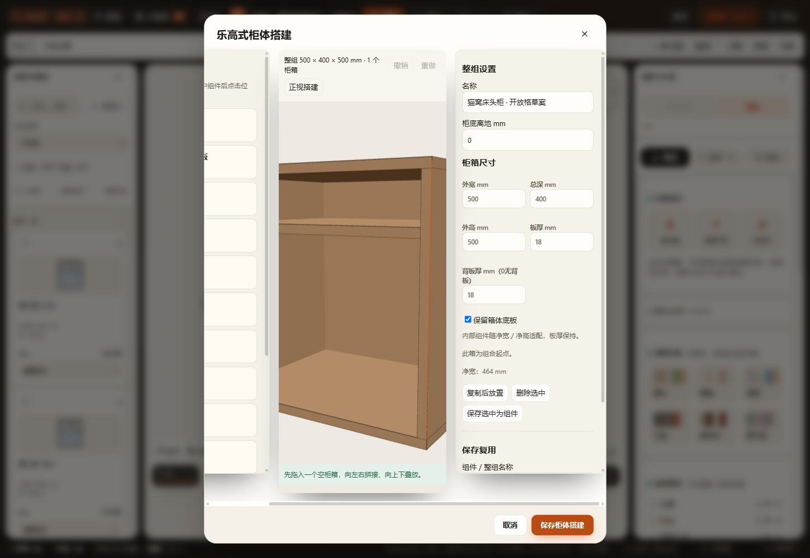
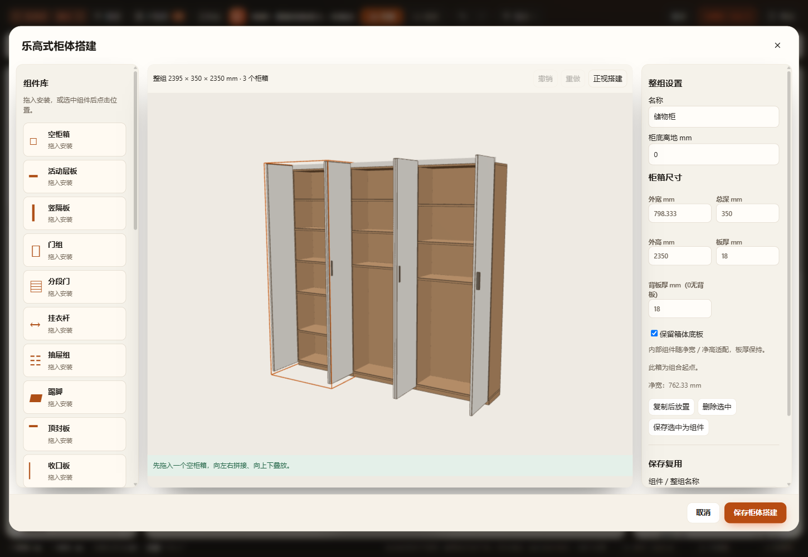
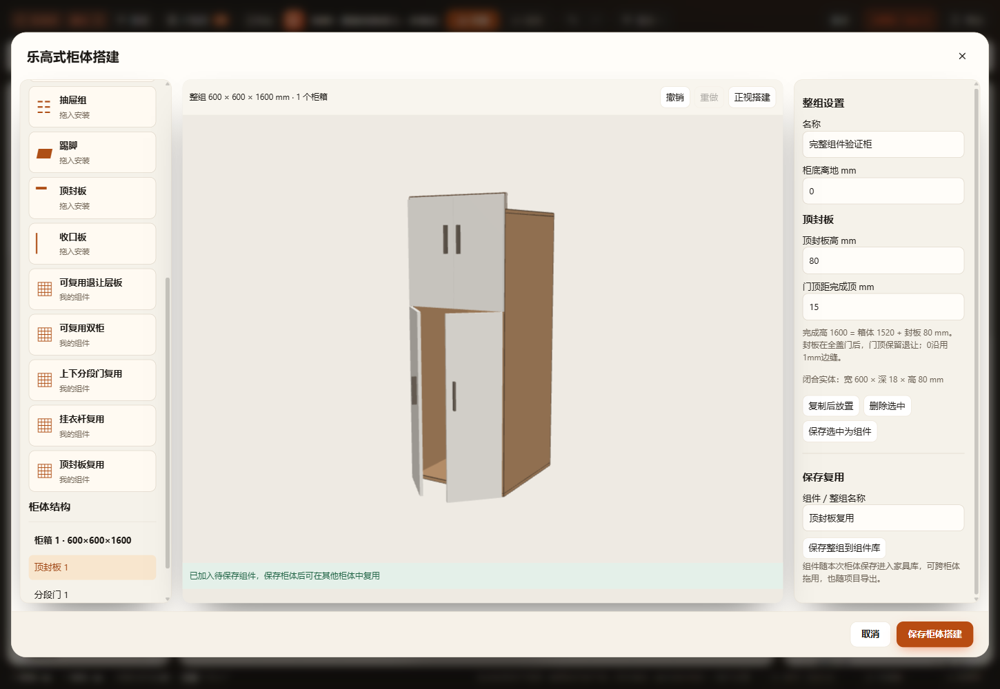
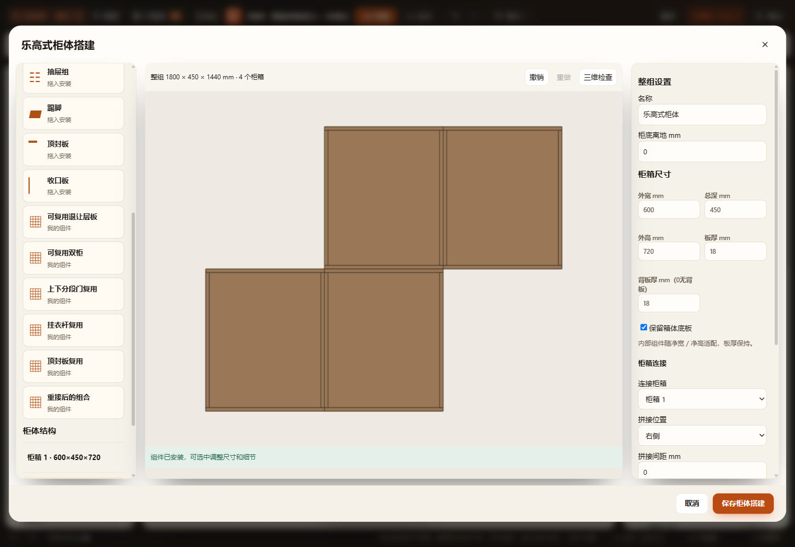
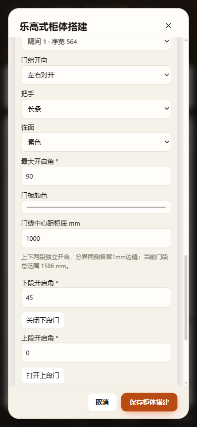

# 组件柜重接复用、新组件与真实方案试点

2026-11-08。定制柜体继续参数化，调用同一生产门／板件构造，未重建独立预览模型。相关两个会话均确认无共享文件修改或Git占用；保留霜山放平提手476280cf及用户原有工作区修改。

## 已交付

1. 重接后父箱在数组后面的合法树，保存／拖入会按连接依赖实例化；重分配柜箱、组件及隔间引用，保留间距，拒绝时原数据不动。
2. 顶封板闭合完成高、箱体高与门顶退让；上下两段门有独立状态及实际完整扫掠；挂衣方杆可改安装高、深度、截面及端隙，实体参与碰撞。踢脚内退现在传到实际生产板件。
3. 新组件沿原库、草稿撤销、应用mutate、项目／命名方案／工作区／恢复缓存保存；新种类最低v73，基本v2仍v72。保存组件／柜箱／组合统一关闭运动状态。
4. 显式升级入口与MCP `cabinetUpgrade:true` 只转换能完整表达的普通storage/book配置，不保存旧模板、columns或兼容标记；未知和不能表达的结构明确拒绝。原ID、安装语义、采购资料和有效参考价保留，取消不写入。

## 正式副本结果

通过Furnish专用MCP复制并进入“组件柜试点 · 猫窝床头柜与囤货柜”（dmw796ybo），原方案“客厅囤货柜 · 三等宽柜与高件分区”（dmw56lad4）仍是原v1柜。正式保存位置由当前应用返回，未直接改其JSON。两柜批量配置回执 `applied:true / persisted:true`，保存时间11:11:59；其余164件家具逐字段相同。原文件之外的仓库 `projects/workspace.furnish.json` 未纳入提交。

| 核对 | 猫窝床头柜 | 囤货柜 |
|---|---|---|
| 外宽×总深×完成高mm | 500×400×500 | 2395×350×2350 |
| 独立柜箱数 | 1 | 3 |
| 隔间净宽mm | 464 | 各762.333 |
| 闭门口径净深mm | 382（无门） | 314（扣18背板及18门板） |
| 生产记录板件数 | 6→6 | 44→44 |
| 层板位置 | 距底板上表面350，原净高350/96 | 三列原非等距层板保留，见JSON |
| 顶封／门顶 | 不增加门或封板 | 箱体2300、封板50、门顶2340 |
| 当前开合及完整空间 | 原开放格，无门扫掠 | 原六扇90°状态及六个完整扫掠相同 |

只读验证器从**实际正式保存文件**读取原方案与副本，比较生产板件、当前运动相位／轴心、完整开启多边形及高度范围；24件柜内物品的四向及上下净距相同。命令：`node scripts/verify/verify-cabinet-builder-pilots.cjs --out output/cabinet-builder-upgrade-20261108/pilot-verification.json`。[结果](pilot-verification.json)包含源哈希，执行前后文件哈希一致；不是仅对手写序列化样例比较。

MCP针对两柜的空间核对升级前后均为1项：储物柜与“心相印卷纸 · 第2层9卷（合计27卷）”（fmw579qb34）原有实体重叠，未新增开启或净距问题。保留原摆放和未确认状态，本次未移动卷纸来隐藏提示。正式桌面生产场景已实际取景查看两柜；下方为同EXE隔离副本设计器截图。

## 增量验证

- `test-cabinet-builder`：144种生产组合、20种放置门扫掠、板件身份／导出、真实空腔与持久链。
- `test-cabinet-builder-upgrade`：重接复用和隔间ID重映射；两件真实输入与共享隔板转换逐板等价；30种开向／旋转／镜像配置中的72片门板顶点分别位于本段完整扫掠，含不同非整数开角及180mm离地；封板、踢脚内退、挂衣杆实体；杆与退让层板接触及0.001mm穿入边界；拒绝缺失隔间、重复或超界组件；v73项目／命名／库／工作区／缓存及重复恢复。
- 其他23个适用回归通过：柜体components、details、model、dimensions、top-closure、section-doors、tiers、opening-3d、opening-volume-model、interior-distances、shelf-clearances、independent、cabinet-catalog；catalog-navigation；project、project-validation、project-recovery；repository-workspace、repository-version-compat、workspace-cache；kitchen、kitchen-u；furnish-mcp。合计25个相关回归，不是全仓检查。
- HTTP、断网file和正式EXE的隔离工作目录／端口／缓存通过实际拖放、两柜显式升级、取消／撤销重做、刷新、组件保存再拖用、重接组合再拖入、390px窄屏；正式生产场景GLB包含封板／挂衣杆／分段门且身份不重复，场景动作只改变所选门段。[三入口33项/入口](ui-three-entry.json)。最后增加的杆边界检查由增量核心测试和最终桌面复验覆盖；[最终桌面MCP与UI](ui-desktop-final.json)另含真实批量保存、同requestId回执及一次撤销。
- 改动JavaScript语法与 `git diff --check` 通过。没有运行全量 `scripts/check.cjs`，没有新增Blender资产或做独立Blender回读；本轮参数化生产GLB已验证，不能称为制造或渲染整链路全量验收。

## 边界及后续

分段门当前限上下两段、两段共用开向和最大角；不包含任意多段、逐门扇不同开角或自动补中间结构板。挂衣杆为方杆布局实体，未包含支座／衣物／衣架预留和承重校验。没有转角、任意三维自由拼接、自动跨箱并板及五金加工孔位。特殊配方柜、独立门扇差异或多列独立抽屉仍应保留原结构，直到能完整表达且逐板验证后再升级；本轮没有增加运行时旧树兼容分支。原卷纸重叠仍需下一次实际布置调整。
