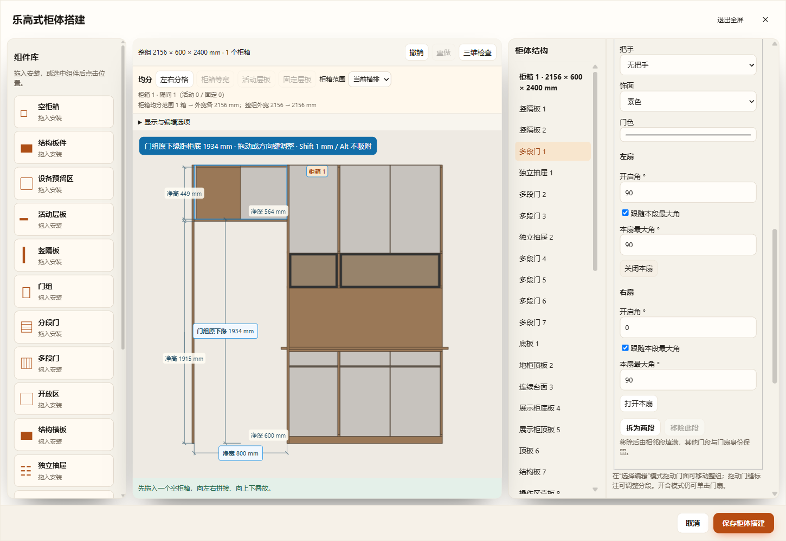
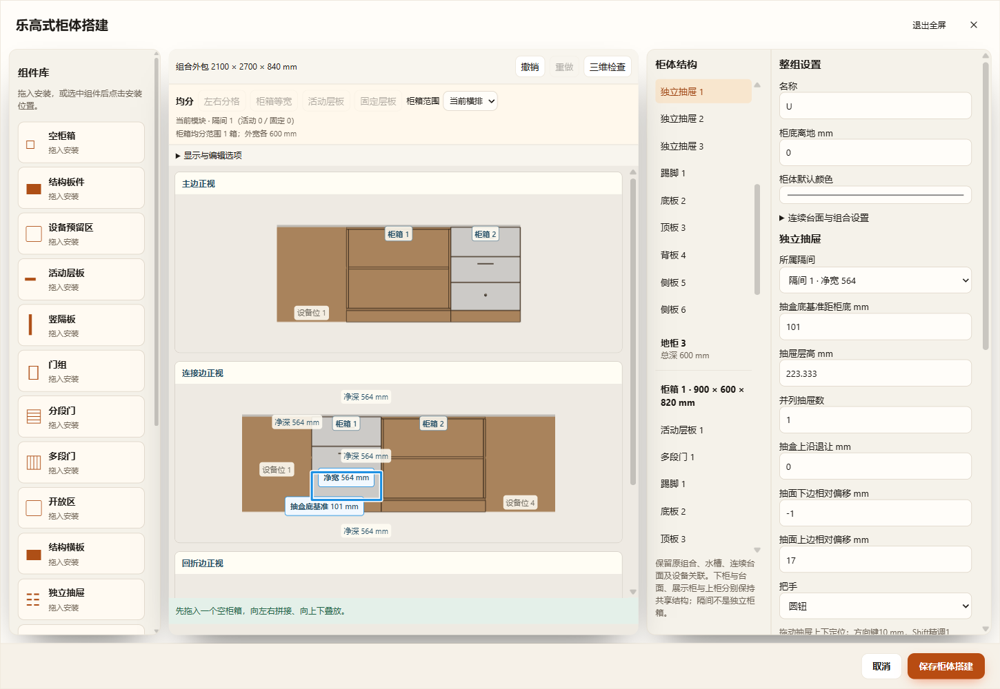
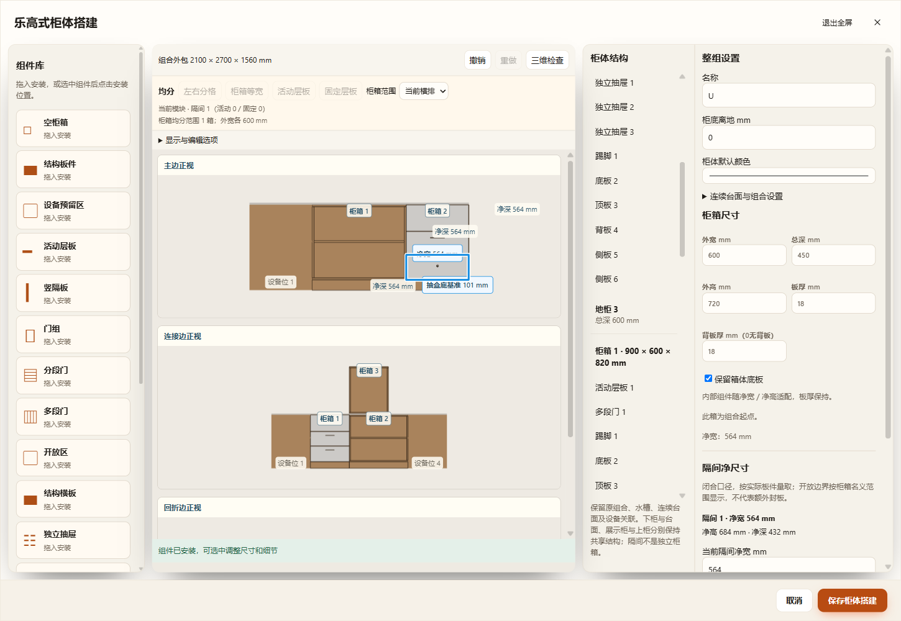

# 原柜真实组件化与唯一编辑器补齐

范围：餐边柜专用分层结构、一字／L／U 厨房原模块、原有特殊柜体、原模块之间的组件转移。正式用户方案没有写入；桌面测试复用同一打包 EXE，使用独立源码目录、数据副本、端口和配置目录。

## 实现

- 普通旧柜入口只生成可取消的 v2 草稿；不能转换时明确报错，取消旧参数编辑回退。厨房保留宿主台面、转角、孔洞和设备关系，所有非设备空位的原模块保存真实 `structure.cabinet` v2 树；包括末端薄柜。
- 标准组件可精确表达时继续使用标准层板、隔板、门、抽屉。分层餐边柜、特殊门扇、浅抽屉、洞洞板等复杂原构造从生产构造器读取实际物理形状，保存到所属真实组件的 `profile`。保存数据没有旧模板配置；生产不再执行旧模板。
- `board` 是有实际宽高深和位置的板件；`deviceBay` 只保留设备预留位，不生成封板。原冰箱位的对齐和净距接口继续可用。书柜板件继续使用原 Blender 板件资产，浴室柜保留类型及盆、龙头、镜柜的生产路径。
- 原轮廓的层板／隔板／门／抽屉可以选择、移动、删除、复制、复用及开合；修改门型／门段／饰面／把手、抽屉列数／构造、活动上盖藏线槽或层板形状时，由所选标准组件重新构造。后续[板厚统一](../cabinet-profile-thickness-20261109/README.md)已取消原框架的整箱板厚／背厚限制：实际原板按柜箱厚度及接合面联动，台面与五金保留独立尺寸；底／顶板仍按实际板件管理。标准柜箱继续支持底／顶板开关。
- 跨原模块拖动沿同一个放置控制器，源删除与目标插入是一个草稿历史项；冲突 ID 重新分配，目标既有组件不改名。L／U 正视分边映射回原模块身份；鼠标点选、组件手势、净距标注和绿模预览使用同一映射。修正隐藏总览画布拦截鼠标、分边点选串柜以及抽屉背板被当成前门导致净深为零的问题。
- 新的形状、独立板件、通用厨房组件树及附属柜箱最低 v81；旧阳台标准组件仍保持 v80。项目当前／命名方案／组件库、工作区、恢复、离线缓存均识别 v81。材料与板件名称不进入形状空间指纹；形状、动作和碰撞输入继续进入指纹。

## 验证

- `test-cabinet-complete-lego.cjs`：180 组原模板开闭、旋转、镜像与厨房组合的实际生产实体一致；实际原板和门抽编辑、跨模块转移、附加柜箱、冰箱关系、重复恢复及 v81 往返。
- `test-cabinet-profile-production.cjs`：21 模板的 42 组闭／开状态，逐网格真实 Three.js 世界顶点和材质一致；上下不同分格的旧分层柜一致。只读扫描项目副本，213 种去重后的现有配置全部保留生产实体，源文件哈希未变化。
- `--complete-lego-only`：HTTP、离线 `file://`、同一桌面 EXE，使用真实界面字段和鼠标跨模块拖放；验证一次撤销同时恢复两端、原组件保存、刷新，以及 L／U 各边实际网格点选的模块身份。
- 桌面生产 GLB：餐边柜与 U 形厨房共 185 个网格，逐板身份唯一、数量一致，导出和生产世界包围盒最大误差 0 mm。
- 增量回归覆盖原阳台 v80、搭建、升级、层板与净空、门段、尺寸调整、抽屉、背板、开启空间、组合放置、L／U 转角、吊柜与隔板；没有用全量检查替代这些专项检查。

## 边界

生产几何与视觉顶点一致分开核验。开启扫掠由实际活动板件采样，按最大半径补偿采样误差；翻门保留竖向截面，通道仍为保守预留。不能据此宣称现场五金行程、管线或所有空间冲突均无问题。

未知未来字段／未知生产几何拒绝转换，保留原记录，不回退旧编辑器。固定导入 OBJ 不迁移成定制柜。复杂原框架已由独立板件表达，整体宽深高适配与逐板尺寸编辑可用；其整箱板厚／背厚现已直接联动实际生产板件；具体尺寸链、v82 兼容与适用边界见[后续验收](../cabinet-profile-thickness-20261109/README.md)。底／顶板仍选择对应实际板件编辑。

## 最终留档

- 三入口最终运行 `cabinet-complete-lego-eCcNf5`：HTTP 40 项、离线 file 40 项、桌面 41 项通过；含真实转角边新增柜箱、台面承托高度、源模块点选、跨模块拖放及 GLB。[完整结果](three-entry-results.json)。
- 原阳台与普通柜 14 类共用控件回归：60 项 HTTP 通过，`cabinet-unified-details-NussQX`。[结果](laundry-shared-controls.json)。
- 未执行项目全量检查或 Blender 回读；本次已经核对实际 Three 生产顶点／材质及生产 GLB，二者不替代现场确认。

