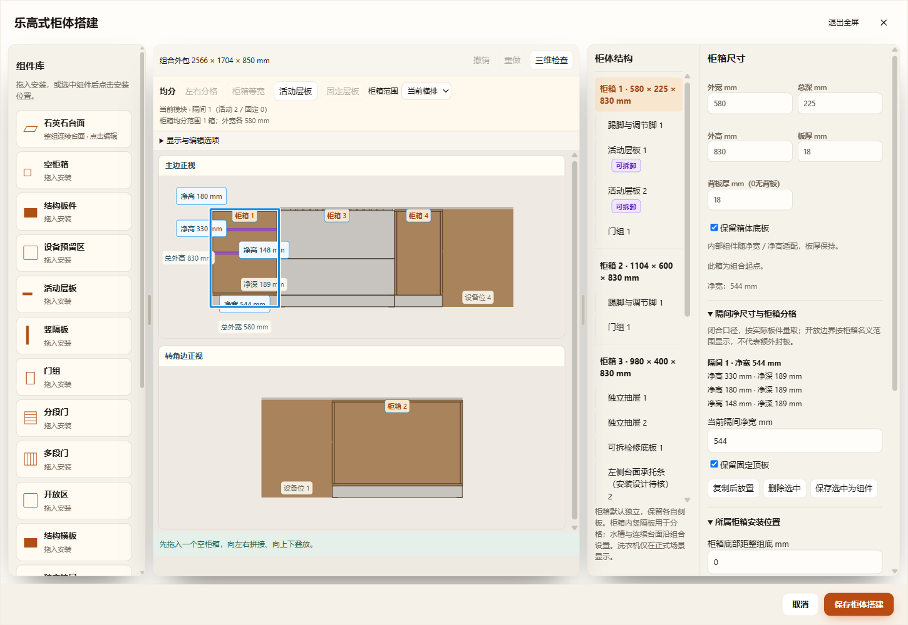
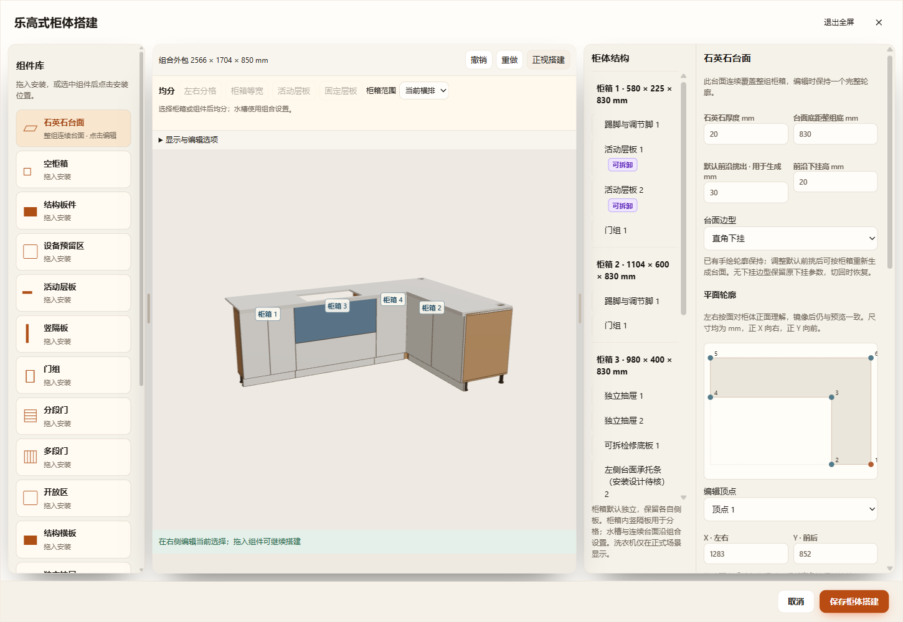
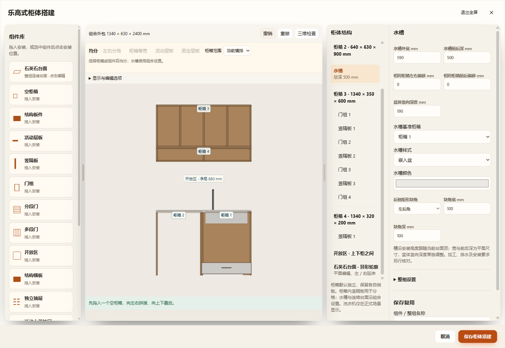
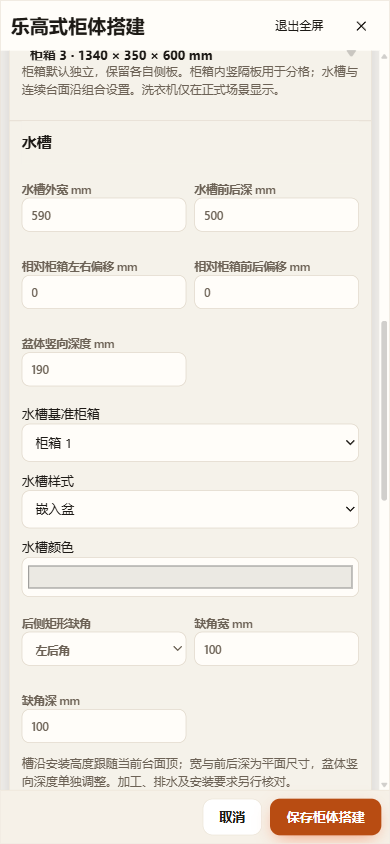

# 厨房与阳台柜编辑复查（2026-11-13）

范围为当前共享柜体编辑器、厨房／洗衣区适配器、其生产模型及保存恢复。使用当前1601配置的只读副本和隔离夹具；正式窗口存在待保存编辑，本轮没有刷新正式窗口或改写正式装修文件。

## 发现与修复

| 项目 | 原问题 | 本轮行为 |
| --- | --- | --- |
| 尺寸标注 | 当前范围在未选中柜箱时仍显示所有柜箱净尺寸，深度反复重叠 | 默认仅当前选择；未选择时保留柜箱名称导航，选组件时只显示组件尺寸；当前柜箱相同隔间净深去重。显示选项仍可选择全部或关闭 |
| 独立燃气灶 | 自动台面开孔仅发现水槽；柜箱固定顶板也只处理水槽孔 | 已在当前台面上的独立灶具沿型号开孔尺寸扣除石材和固定顶板，关联设备仍沿原安装接口；错误高度／台面外负例不扣孔 |
| 内嵌水槽 | 宽、前后深、左右／前后偏移、基准柜箱、盆体竖深与缺角入口缺失 | 同一选择属性中补齐，台上盆切换清除不适用缺角并沿已有台上盆默认深度约束；取消／撤销恢复原数据 |
| 附属柜箱 | 原吊柜／开放柜／新增柜箱缺少自身默认颜色入口 | 可单独改色，也可删除覆盖沿用整组色；实际生产继承色与界面一致 |
| 抽面外观 | 门可改色，抽屉组、独立抽屉及活动上盖抽屉无法改色／饰面 | 三种组件统一素色／木色与颜色覆盖、恢复默认；抽屉组增加原有把手选择。生产只处理抽面，硬件及内箱保持 |
| 连续台面 | 原字段已有边型、下挂和出挑，现行编辑器入口遗漏 | 当前台面属性提供相同字段；默认出挑用于显式重新生成，已有手绘轮廓保持。停用台面前须先停用内嵌水槽，界面说明承托约束 |
| 整组与吊柜 | 原形状、各边默认柜深、自适应避让、附属柜启用入口遗漏；吊柜被标为地柜且出现石材厚度 | 补回已有适用字段；厨房形状切换保留关联模块重映射及撤销；吊柜使用自身高度标签，不提供石材厚度 |
| 厨房设备空位 | 改用途时误读洗衣区字段，且提供不适用于厨房的开放柜用途 | 按宿主产品能力列用途，空位可实际转为组件柜箱，并可撤销恢复 |
| 浅柜 | 原物理组件允许50mm深，部分界面与独立安装校验仍从150mm起 | 范围集中在产品规则，保留物理框架的浅柜按50mm，标准新柜仍按150mm；100→80mm实际编辑与保存验证 |
| 编辑状态 | 每次数值修改使折叠区重置；相同值可能形成空撤销步骤 | 同一选择保留折叠状态，切换选择回到对应属性上下文；相同数据不新增历史 |
| 抬高与停用 | 抬高柜预览中的独立灶具未换算标高；停用水槽的校验临时强制启用可触发无台面错误 | 邻接设备在生产边界换算一次；校验读取停用部件时不改变其启用状态 |

## 开孔及支撑边界

TH36B夹具仍使用既有型号开孔660×350mm，未改变厂家参数。扣孔覆盖生产石材、原模块固定顶板以及新增附属柜固定顶板，数值实体使用同一孔环和高度。下层隔板、抽屉、五金与不相交支撑条保持实际实体，须继续做设备碰撞检查，不能通过清空整个柜内来掩盖冲突。

截图中的两根短条是原配置明确命名的“左／右侧台面承托条（安装设计待核）”，80×340×18mm；本轮保留其身份及位置，检查孔外实体仍存在。支撑接合、燃气／散热净距、承重与加工可行性未作施工认证。

## 数据契约

抽面可选`color`／`finish`以及抽屉组显式`handle`由`product-rules.cabinetBuilder.drawerAppearance`声明，最低格式v89。旧缺失沿原外观，新建不自动物化，恢复默认删除覆盖。当前／命名方案、组件库、项目、仓库与离线缓存继续原链路；配色不改变空间签名，完整外观配置仍进入生产缓存。

设备开孔构造更新使用派生`deviceOpeningRule=2`更新适用厨房空间核对语义，无新几何持久字段或旧数据批量迁移。嵌入水槽及柜箱其他输入沿既有字段、草稿和最终一次`mutate()`。

## 验证

- `test-cabinet-editor-audit.cjs`：三种抽面真实生产材质、硬件负例、几何／空间实体不变、重置／错误字段、v89项目／命名／库与缓存、盆体和缺角、附属柜继承色、浅柜及停用水槽／台面抬高恢复。
- `test-kitchen-hob-opening.cjs`：24组一字／L／U、旋转／镜像及0／120mm抬高；真实石材与两类柜顶射线、孔外边缘、数值实体、错误标高／台面外负例。
- `test-cabinet-editor-audit-ui.cjs`：HTTP、离线file、同正式打包EXE隔离桌面；真实字段应用、折叠、台面启停及承托提示、形状撤销、抬高预览、取消、应用撤销／重做、v89保存刷新、390px窄屏及正式生产GLB导出几何回读。
- 相关核心回归：builder、service-details、plinth-color、kitchen-worktop、kitchen-added-worktop、assembly、assembly-position、complete-lego、native-independence、parameter-parity、drawer-assembly、editor-completion、profile-thickness、profile-opening-rules、profile-production与net-depth。
- 原搭建器HTTP与14类统一属性对照HTTP回归。

以上检查通过。三入口每个35项检查，见[result.json](result.json)；完整运行目录`output/desktop-verification/cabinet-editor-audit-V5HHu6`，三份正式GLB保留在该目录。既有编辑体验三入口回归为`cabinet-editor-experience-pk0hyO`，原搭建器HTTP为`cabinet-builder-7WnaXz`，14类统一属性HTTP为`cabinet-unified-details-bl3kqr`。受影响20份JavaScript语法及diff检查通过。

未运行全项目`check.cjs`；未执行Blender工程回读，本轮正式GLB通过独立三角网格读取并射线检查孔洞。自动检查不代表没有其他编辑缺陷或施工问题。
