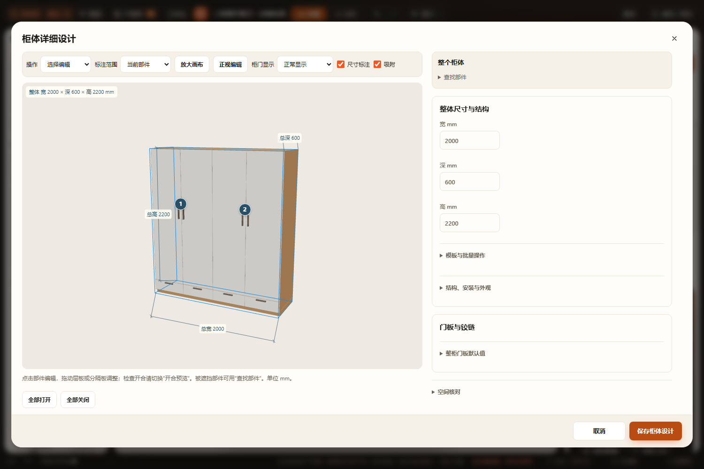
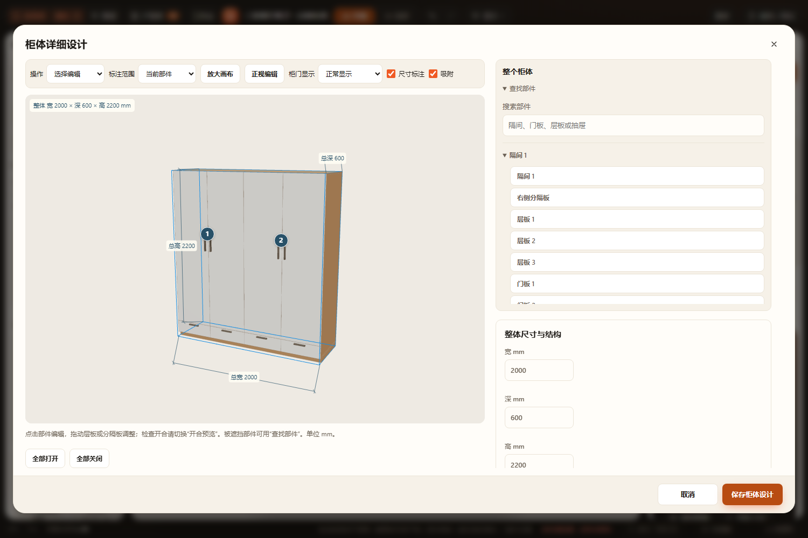
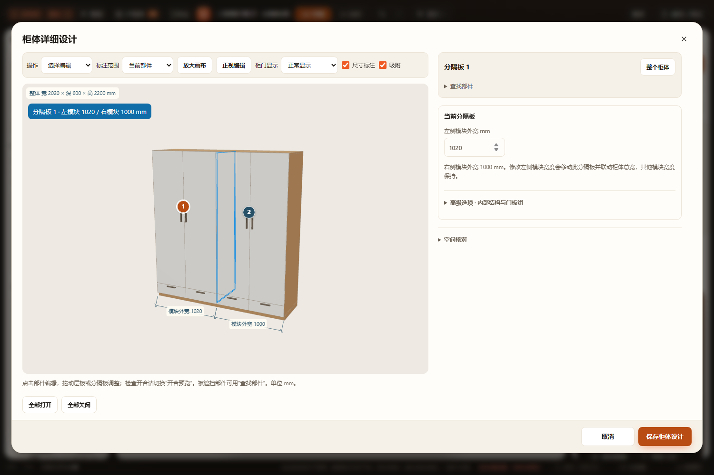
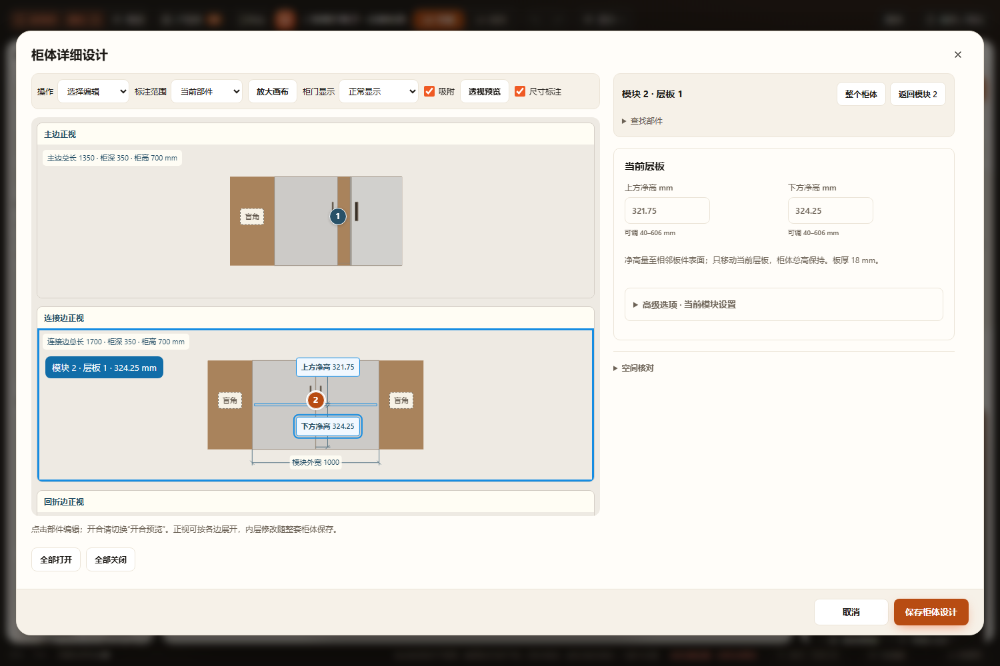
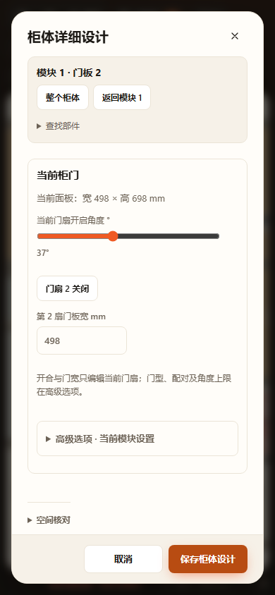

# 柜体详细设计统一收尾 · 2026-10-28

## 完成范围

- 整柜先尺寸，隔间／模块先自身参数，模板、批量、结构及外观分别折叠；分隔板有独立身份与左右模块尺寸。
- 可搜索、可收起的分组部件列表，与预览、当前参数及返回上级联动。
- 默认选择编辑；开合预览才通过真实画布点击打开门扇／抽屉。面板按钮及全部开关保留。
- 默认当前部件标注，全部尺寸用于检查完整尺寸及面板清单；桌面可放大画布，保留参数区。
- 厨房父级门扇、抽屉及层板采用同一面板方式。层板右侧／图上净高共用生产基准，支持地柜与吊柜，L／U 展开按全局模块身份回写父草稿。
- 末端薄柜有自己的尺寸和开合入口；保留结构／洗衣柜附属柜沿独立内层编辑器及父草稿保存。

## 已通过

- [node-results.json](node-results.json)、[node.log](node.log)：69 个柜体／厨房／洗衣柜／玄关柜相关 Node 测试文件，66 通过，3 项基线失败见下节。新增 144 组一字／L／U、地／吊柜、旋转镜像净高编辑，验证阈值／越界、真实板件、相邻模块保持、旧默认不物化、复制／替换清理、当前和命名方案及重复恢复。
- [final-focused.log](final-focused.log)：最终修改后的预览真实射线、编辑／开合模式（门和抽屉）、厨房预览、内层身份、结构／表单及恢复专项复验。
- [browser-results.json](browser-results.json)：最终完整流程和原对象专项，HTTP 与断网 file:// 均通过。
- [related-browser-results.json](related-browser-results.json)：完整流程、当前门扇／抽屉、原对象、设置继承及层板净高五项专项，HTTP 与断网 file:// 均通过。
- [kitchen-layout-results.json](kitchen-layout-results.json)：新增复验厨房地柜、U 形吊柜、完整洗衣柜和基础洗衣柜，1500×1000／1280×720／390×844，单参数区滚动、控件尺寸、草稿／取消、保存／撤销／重做／刷新与内层编辑均通过，两种加载方式。
- 完整流程覆盖整体／高级选项、搜索 Enter 不保存、分隔板独立改宽、大画布、当前／全部标注、真实画布点击选择／开合、模块门扇独立角度、三边正视图净高输入、地柜层板、末端薄柜、未失焦输入、非法值拦截、保存取消与恢复。
- 改动的生产 JS、浏览器助手／脚本和测试通过 node --check，git diff --check 通过。桌面整体、部件列表、分隔板、三边层板和窄屏截图已目视。

浏览器日志分别见 [完整流程](cabinet-editor-completion.log)、[原对象](cabinet-object-inspector.log)、[当前部件](cabinet-part-inspector.log)、[设置继承](cabinet-setting-inheritance.log)、[层板净高](cabinet-shelf-clearances.log)和[厨房布局](kitchen-layout.log)。使用隔离副本、临时浏览器配置和静态服务，不写用户方案。

## 三项基线失败

使用改造前 `29d0317` 的厨房核心替换本轮核心，在独立 Node 进程再次运行同一测试，均复现同样失败；证据：[baseline-failures.json](baseline-failures.json)、[baseline-failures.log](baseline-failures.log)。

| 测试 | 失败位置与内容 |
|---|---|
| test-kitchen-outer-edges.cjs | 第 25 行，远处有限墙段吸附断言，实际 1、预期 0 |
| test-kitchen-run-handles.cjs | 第 23 行，远处有限墙段吸附断言，实际 1、预期 0 |
| test-kitchen-resize.cjs | 第 30 行，测试环境未注入 FurnishProducts，产生 ReferenceError |

本轮没有修改这些测试或外框／边长吸附算法，不把它们记作通过。未运行全量 check.cjs、实机触屏或 Blender。净空继续受既有生产板件、五金和空间算法边界限制，不代表施工／承重确认。

## 数据与收尾

沿既有可选 shelves／doorLeaves／drawerOpen／endExtensions，不新增字段名或项目版本；缺省结构保持，显式编辑才写入原数组，沿一次 mutate、原撤销／自动保存／项目通道。视图、搜索和折叠仅为会话状态。用户原有 workspace.furnish.json 未提交修改保留；吊顶完成面提交 29d0317 由另一聊天独立完成，本轮不夹带其文件。

