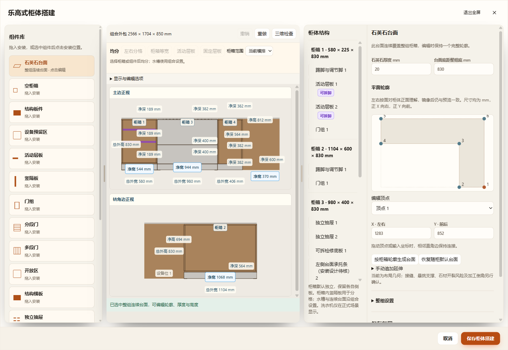
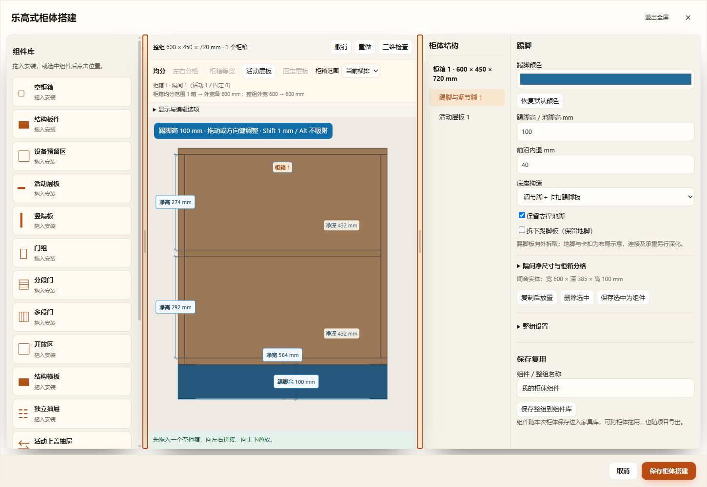
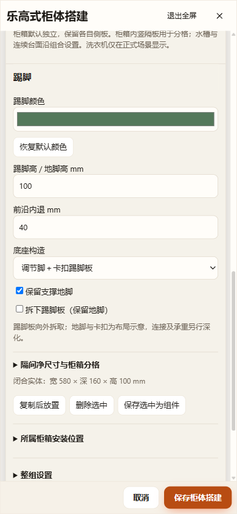

# 柜体组件编辑体验（2026-11-12）

用户截图提出五项问题：连续石英石台面未在组件库出现、厨房入口缺失、踢脚不可改色、三栏宽度固定、组件属性被整组设置挤到下方。

## 实现范围

- 厨房及洗衣区的左侧组件库均显示“石英石台面”。点击选中同一整组连续台面，右侧优先显示厚度、底部标高和平面轮廓，复用既有顶点／生成／恢复接口；不向每只柜箱重复添加石材。普通厨房的异形轮廓持久化及 L／U 形生成由同期台面专项完成，见 `CABINET-ASSEMBLY-EDITOR.md`。
- 新建踢脚、调节脚模式的可拆踢脚板，以及原厨房实际保留的踢脚板件共用颜色控件。旧板件按生产元数据 `cabinetSection=plinth` 识别，不依赖名称。不改变结构身份或几何；支脚、卡扣和其它板件维持原材质。可恢复默认颜色。
- 两条分界支持指针拖动和左右方向键（10px，Shift 1px）。双击任一分界恢复默认；本机偏好 `huxing-cabinet-panes-v1` 记住组件库和右侧区域宽度。拖动限制预览及属性最小宽度，窗口改变时重新约束。760px 及以下继续堆叠并隐藏分界。
- 当前选择属性在右侧顶部。整组设置折叠保留在下方；组件选择时隔间净尺寸／柜箱分格和所属柜箱安装位置折叠，避免混淆组件与父柜箱。柜箱选择时净尺寸默认展开。更换选择回到属性顶部，同一选择的数值编辑保留滚动位置。

## 持久化与边界

`cabinetBuilder.plinthAppearance.formatVersion=88`；显式 `components[].color` 仅允许踢脚组件及保留为原形状的踢脚板件，严格接受六位十六进制颜色。新建和旧缺失不补字段，恢复默认删除覆盖。原组件复制、跨柜转移、组件库、规格清理、当前／命名方案、仓库和项目恢复链继续复用。配色进入原完整三维配置缓存；空间签名排除颜色，纯配色不使空间确认失效。

分栏为本机显示偏好，不进入装修数据或撤销历史。连续台面仍受整组宿主和已有轮廓校验约束；石材加工、支撑、倒角和承重不在本次交互改进范围。

## 增量验证

- `test-cabinet-plinth-color.cjs`：三类踢脚的真实 Three.js 生产颜色、硬件负例、几何／身份／实体及空间签名不变，恢复默认和错误颜色拒绝，v88 当前／命名／组件库／项目／仓库／缓存与重复恢复。
- `test-cabinet-editor-experience-ui.cjs`：HTTP、断网 file 和同正式打包 EXE 的隔离桌面；台面共用入口及厚度，踢脚改色／恢复，分栏指针／键盘／宽度记忆，草稿及应用撤销重做、保存刷新、正式生产 GLB 配色，取消与390px窄屏。
- 原搭建流程 `test-cabinet-builder-ui.cjs --http-only`，以及核心 `test-cabinet-builder.cjs`、`test-cabinet-service-details.cjs`。

以上检查均已通过。完整三入口结果见[result.json](result.json)，原始运行目录 `output/desktop-verification/cabinet-editor-experience-KZcVvn`。旧搭建器 HTTP 回归为 `cabinet-builder-6eg9lO`；原生尺寸独立 HTTP 回归为 `cabinet-native-independence-vm4YGl`。另通过项目输入校验、恢复和仓库版本兼容专项；受影响生产脚本语法与 diff 检查通过。

未运行全量检查，未执行 Blender 工程往返（本次仅颜色与编辑交互，正式生产 GLB 材质已核对）。桌面使用同一正式打包 EXE、独立源码／缓存／项目副本；测试运行器核对源项目散列不变，未修改正式装修文件。

