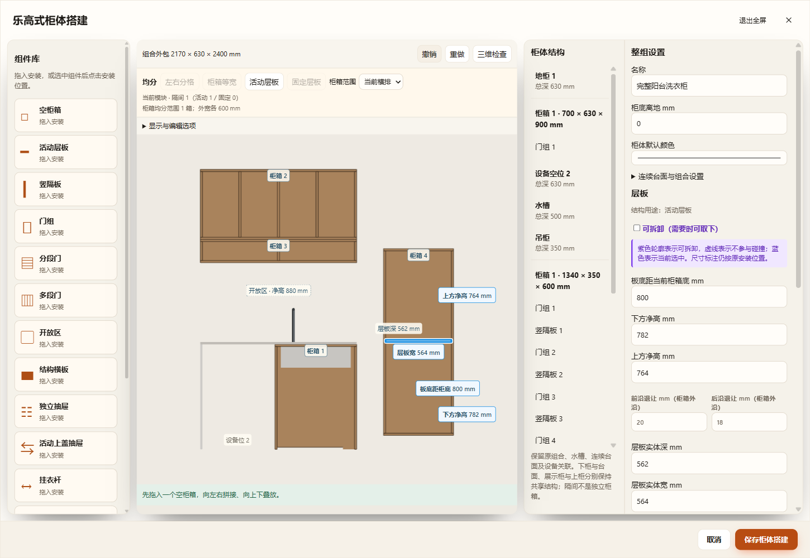
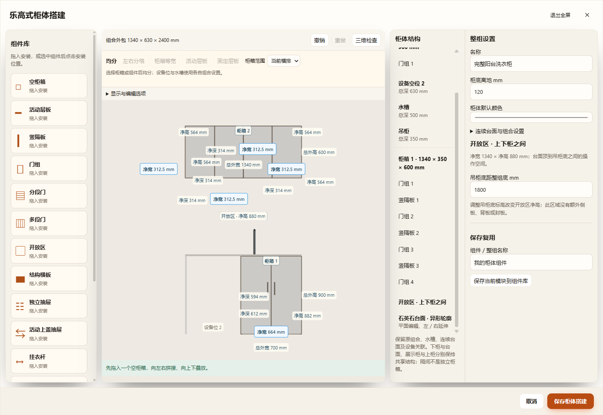
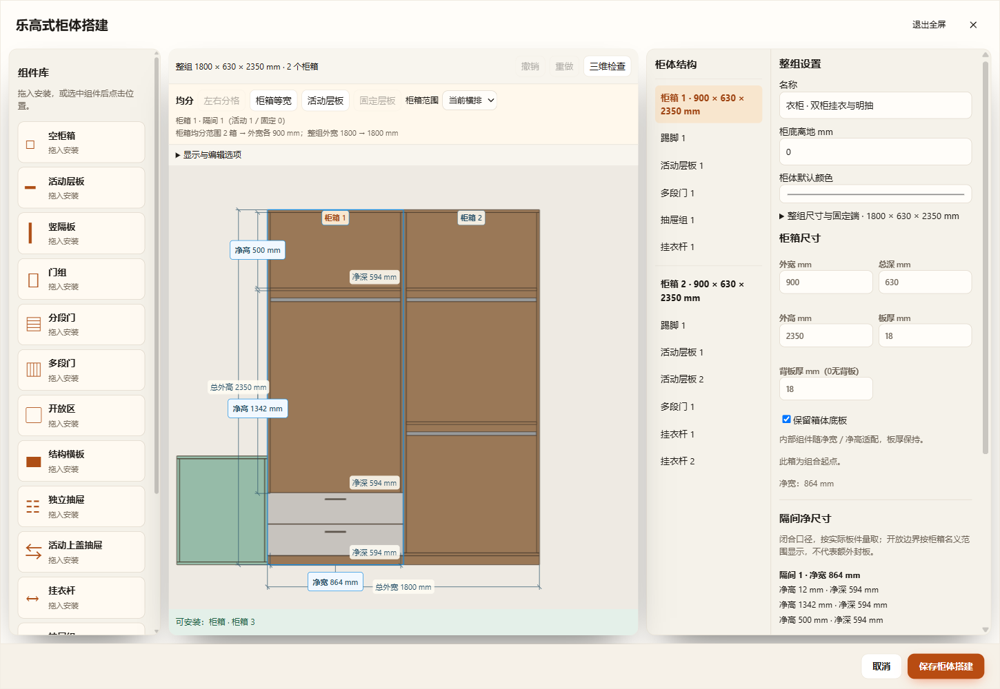
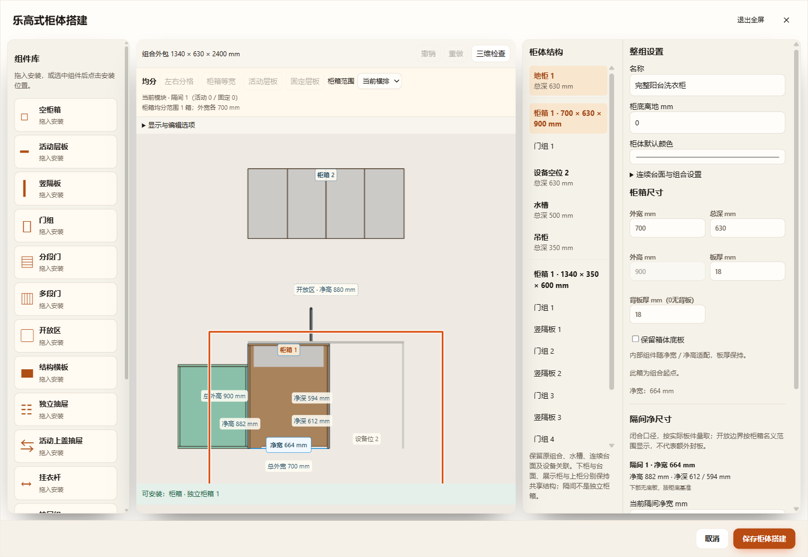

# 乐高编辑器交互与细节对照

2026-11-09。此前统一仅复用了外壳与组件数据，阳台仍有独立拖放、简化属性和旧预览标注；用户提供的绿色预览缺失及四处界面批注均属实。本轮按实际行为修正，不以标题或截图相似代替组件能力。

## 逐项审视

| 范围 | 修正及验证 |
|---|---|
| 空柜箱拖放 | 共用placement控制器、B.drop/B.insert求解、前视投影和production ghost。普通与阳台空箱都使用600×450×720mm缺省；目标按鼠标命中，支持侧边与上下吸附，不再固定创建在默认吊柜位置。 |
| 工具栏 | 相同workspaceTools生成撤销重做、正视／三维、四类均分、操作模式、标注范围、门板显示、吸附、全部开关及空间核对。原宿主的功能约束另行适配，无法适用的均分有明确状态。 |
| 柜箱编号与尺寸 | 共用矩形柜箱标签与componentDimensions；设备位使用独立文字。相同组件使用相同净宽／净高／净深、层板标高与门缝编辑入口，不再沿旧模板的圆形模块号与门板清单表达组件柜。 |
| 开放区域 | 台面顶与原吊柜底之间派生开放区净高、选区和编辑上柜底标高；不开启用户关闭的原开放柜，不凭空添加侧板／背板／层板，不将开放操作区当作设备空位或额外独立柜箱。 |
| 结构树与属性 | 共用componentTree、componentInspector，包含活动／固定／开放区边界板、可拆卸和碰撞标记、板形与退让、隔板净宽、门段／逐扇限位、抽屉逐层／逐列、顶封板、挂衣杆、收口及复制／删除／复用。移除阳台简化组件表单。 |
| 布局与显示 | 所有编辑器使用同一栅格、侧栏宽度、嵌套结构分隔和窄屏规则，移除阳台重复圆角／边框及阴影；修复选中板件轮廓的实际矩阵投影，开放区净宽按两位小数显示；共用自动门板显示与1.25倍正视留白。修复镜像组合取景中心。 |
| 手势与键盘 | 共用componentGesture，实际板件拖动和方向键／Shift精调走B.adjustComponent。原模板监听器不再截获组件手势；原吊柜点击开合按其组件归属路由，不误控制地柜；Enter只应用输入，不误保存整组；Delete不传入主布置删除。 |
| 数据与实体 | 原箱保持位置和实际板件，新增箱的预览／保存位置一致；相对整组底标高与安装抬高分别处理，组合自身高不重复计入安装抬高。草稿历史同时恢复模块与组件选择，沿用原mutate、组件库、项目及生产构造；无新字段／格式／加载依赖。 |

## 适用范围与宿主语义

柜体编辑入口仍只有FurnishCabinetBuilderUI.open。原生组合适配只承载专用宿主的数据与约束，共用编辑控件、标注、手势及放置机制。厨房／餐边柜专有水槽、连续台面、冰箱位等参数仍按其产品规则提供，不能因外观统一而把共享结构拆成虚构独立箱。

洗衣区原地柜高度受连续台面底标高控制，相应单箱高度项禁用并标明调整位置；地柜总深仍受连续台面范围限制。原生模块内柜箱可使用共有连接，独立新增模块保存其本身位置；当前跨原生模块移动组件应使用复制后放置，同模块树拖动保留身份。保存复用明确为当前组件模块，不将专用石英石／水槽误存为普通箱组件。关闭的原开放柜仍保持关闭。原旧柜无损转换范围继续此前记录，超出范围明确拒绝，不回退旧编辑器。

## 验证

- 核心：test-cabinet-placement-parity覆盖24组侧／上／下放置、旋转／镜像、安装抬高、默认尺寸和背沿、原板件位置不漂移、真实组件／复用双箱、非法悬停原子拒绝及项目往返。组件柜144组、升级72组扫掠、原洗衣柜与组合增量通过。
- --placement-only：真实鼠标悬停时截取衣柜／阳台绿色预览，核对源不变、松手位置、一次撤销重做、保存刷新以及选组件待放置和Esc取消。
- --unified-details-only：14类实际组件分别在普通柜与阳台打开，比较完整控件、工具栏／显示选项和真实保存后的组件树；真实生产层板投影定位鼠标，验证拖动、一次撤销重做和Shift方向键1mm精调；开放区净高／撤销、矩形标签与侧栏样式检查。
- --assembly-only：原地柜和吊柜增删层板、隔板、门和抽屉；真实石英石轮廓拖点、保存刷新、窄屏及正式生产GLB逐网格对照。

各入口结果与最终截图随本目录归档。所有测试使用独立源码／方案／缓存／端口，同一打包EXE；正式用户方案与已有未提交工作区文件保留。未运行项目全量检查，未执行Blender回读；已有参数化模型生产GLB按受影响组件验证。

## 最终运行记录

- 普通乐高完整HTTP：254项通过，`cabinet-builder-JKoRTQ`，见[结果](ordinary-full-ui-results.json)。历史升级测试改为当前直接打开乐高草稿，已删除的旧弹窗不再作为测试前提；原几何／状态／恢复断言保留。
- 拖放对照三入口：各18项，`cabinet-placement-parity-VwvjQg`，见[结果](placement-three-entry-results.json)。
- 组件与细节三入口：各60项，`cabinet-unified-details-vsChCj`，含门板显示、紫色可拆卸／忽略碰撞、实际层板轮廓、安装高度分离和原吊柜点击开合，见[结果](details-three-entry-results.json)。
- 最终原组合桌面50项，189个正式GLB网格与应用模型逐件世界边界最大差0mm：`cabinet-assembly-ZjaFve`，见[结果](assembly-desktop-export-results.json)。

