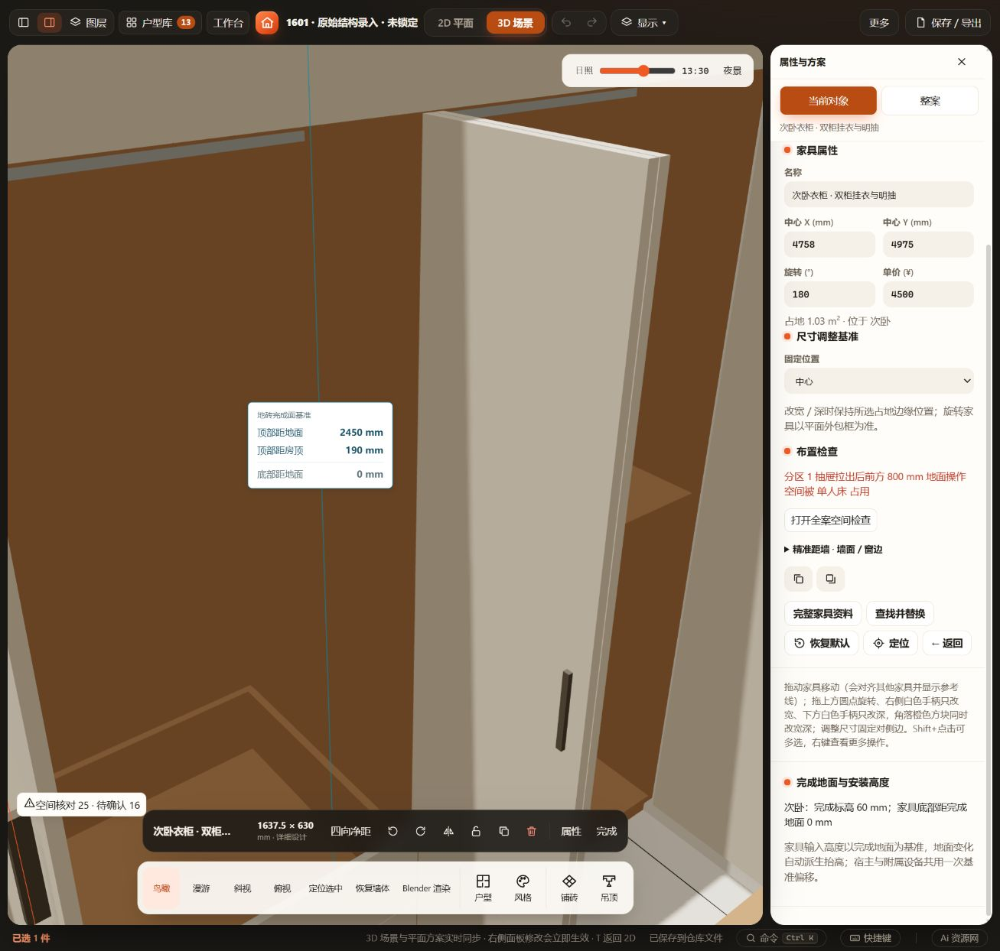
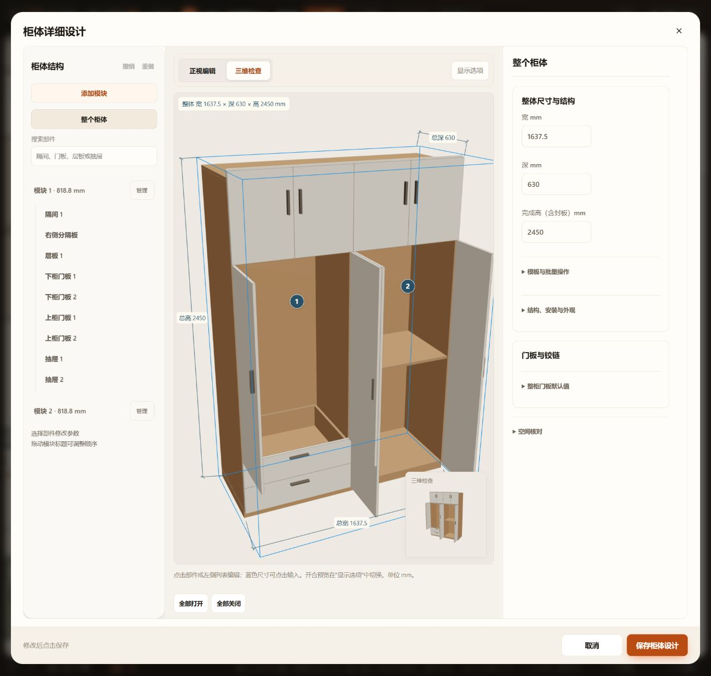

# 相邻侧开柜门验收

2026-10-29。用户指出次卧中间两扇门开启后重叠。原铰轴在柜箱分界线及门板厚度中心；改为门板正面边角，并补偿子对象深度，关闭尺寸和立面不变。沿用每边1 mm门缝，90°时相邻18 mm门板间隔2 mm。该值是模型假设，不是厂家五金要求。

生产柜体、详细设计预览与完整侧开扫掠共用同一有限板厚姿态。空间确认使用派生 `finite-thickness-hinges-v1` 标记，无持久字段变化。没有编辑当前用户项目的柜体配置、2450 mm高度或开合状态。

## 已通过

- `test-cabinet-adjacent-hinges.cjs`：实际生产门板，12/18/25 mm板厚，共享／独立柜箱，0/30/60/90°，旋转／镜像，90°间隔2 mm，关闭尺寸保持，当前板件包含于完整扫掠，项目往返。
- 相关回归：`test-cabinet-model`、`test-cabinet-door-settings`、`test-cabinet-opening-3d`、`test-cabinet-custom-fronts`、`test-cabinet-independent`、`test-wardrobe-hanging`、`test-cabinet-dimensions`、`test-cabinet-interior-distances`、`test-generator-part-identities`、`test-kitchen`、`test-kitchen-door-pairing`（均为 `tests/` 下 `.cjs`）。
- `node --check`：cabinet-core、kitchen-core、cabinet-model；修改差异空白检查。
- HTTP当前次卧及详细设计3D预览目视：门板分别显示厚度，中间不重叠。当前柜体与任务前备份配置一致，实际面坐标见[checks.json](checks.json)。

## 范围

未运行全量检查，未重测直接打开文件或窄屏（加载机制及UI结构未变）。完整侧开扫掠仍是角度采样的保守凸包；未新增真实铰链连杆、自身干涉、多门动态求解或实物安装验收。现有用户项目未提交修改保留，不包含在本次源码提交中。
