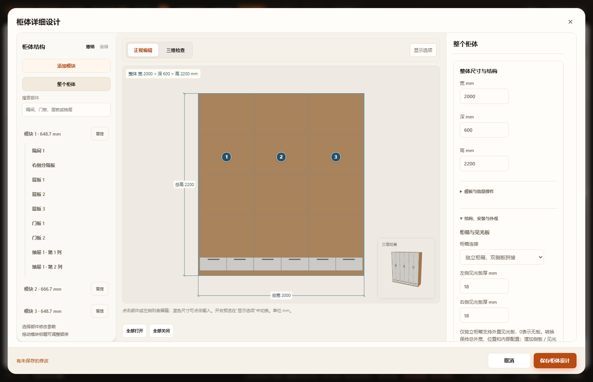
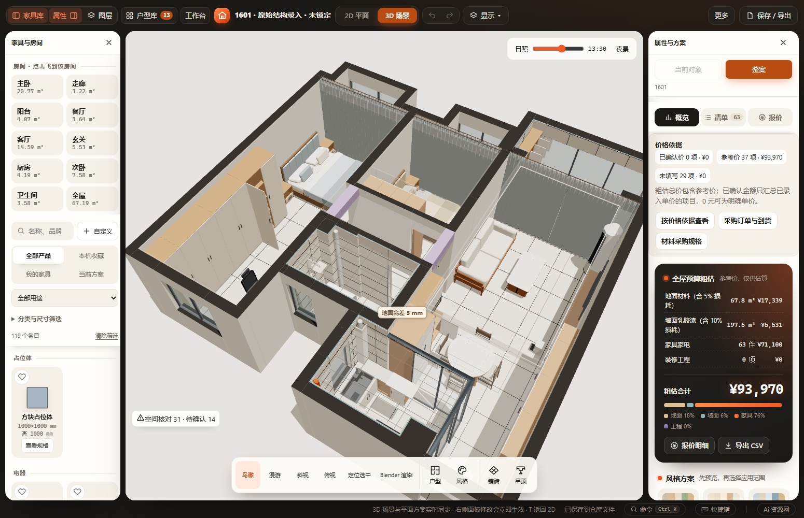

# 独立柜箱与当前1601验收

2026-10-28。用户明确同时改进软件建模／编辑器，并调整当前1601；旧房DXF只提供实际生产结构参考。源码仍为原普通脚本，未新增加载依赖。详细规范见 [第9节](../../CABINET-DESIGN-STANDARD.md#9-已实现的独立柜箱与1601调整2026-10-28)。

## 已通过

- 44个相关Node测试文件：柜体核心／生产模型／预览／门抽／模块／实际净距、家具实体与恢复／复制／图例、项目／命名方案、采购、产品能力、缓存、仓库HTTP存储及自动保存。见 [逐项结果](node.json)。新增 `test-cabinet-independent.cjs` 覆盖96组结构场景：0／单侧小数／双侧见光板、四种模板、旋转／镜像、等于／低于范围、非法输入、固定及联动改宽、模块增删排序、旧记录不变、重复恢复、复制替换、当前／命名项目v26。
- 原恢复测试的指针VM遗漏已导入的产品核心，初跑报 `FurnishProducts is not defined`；补注入真实 `R` 后单独复验通过，未改生产指针逻辑或降低断言。仓库存储测试需要回环HTTP，已在具备本机网络权限的运行中通过。
- 真实Three.js几何验证旧案2295mm尺寸链、三箱六块18厚侧板、两块18厚见光板、顶底／背板分箱、全局层板编号及数值记录器一致；几何浮点容差为0.0001mm，仅用于测试。
- 独立结构另覆盖8组实际旋转／镜像的柜内方向测距、外部40mm间隔、完整包含、板面接触与0.001mm穿入、见光板实体及局部重叠、高度分离与未知高度；沿共用实体接口，无设备类型空腔豁免。
- `cabinet-independent` 与原 `cabinet-workspace` 两项浏览器专项均通过HTTP／断网file://：未改旧柜保存不变、模式／板厚、生产预览、非法值阻止保存、取消、会话与应用撤销重做、自动保存与刷新、第三箱层板编辑归属、390px无横向溢出。
- 当前63件家具的真实1601工作区另做HTTP／离线恢复、生产场景和刷新无漂移检查。三组柜体158个生产网格身份有效、无非有限几何，真实GLB编码420892 bytes，接受v3同步协议；本次仅验证编码及隔离发布接口，未连接真实Blender。
- 修改源码语法、文档相对链接、Git差异检查；桌面、窄屏和当前方案截图已目视检查。恢复副本与当前数据分开验证，所有其他户型、原有命名方案、家具库及非家具工作字段保持。

## 当前方案的具体调整

保持原家具编号、位置、宽深高、旋转／镜像、颜色、价格、层板高度、抽屉及门型／开合；每个现有模块转换为一只独立柜箱。独立结构增加自身侧板占宽，内部净宽相应扣除。下表显示到0.1mm，持久化仍保留原小数精度。

| 家具 | 总宽×深×高 mm | 柜箱数 | 转换后各箱净宽 mm | 各箱外宽 mm |
|---|---|---:|---|---|
| 衣柜 `fmv3w4m2a4` | 4161×630×2450 | 4 | 553.4／1155.6／1155.6／1152.4 | 589.4／1191.6／1191.6／1188.4 |
| 衣柜 `fmv3wzkb515` | 1637.5×630×2350 | 4 | 377.9／368.9／368.9／377.9 | 413.9／404.9／404.9／413.9 |
| 收纳柜 `fmv5bl44k1` | 2250×350×2350 | 3 | 414／864／864 | 450／900／900 |

当前见光板均为0：尚无当前房屋的设置位置资料，不复制旧房两侧18mm。厨房、玄关专用组合、餐边柜、浴室柜、电视柜及其他60件家具保持。原有未提交的最新工作区编辑完整保留在调整前基线及命名方案中，并随此次当前方案保存；没有回退到Git旧数据。

命名方案 **20261028 · 独立柜箱调整前** 已在正式应用中登记并刷新读取，内容与操作前完整工作布置逐字段相同。本机文件副本：`output/cabinet-independent/applied-baseline.furnish.json`，该私有产物留在本机；项目自带的命名方案可直接恢复。

窄屏见 [390px编辑器截图](mobile.png)。

## 保留问题与未执行项

- 三柜聚焦空间检查前后均7项且内容相同：主卧衣柜、次卧衣柜、收纳柜分别有既有吊顶相交；次卧四只抽屉的800mm地面操作区被单人床占用。此次没有修改柜高、床位或吊顶来消除这些问题。不是施工安装通过结论。
- 全场景GLB另因 `architecture:|explicit:aluminum:backing` 重复标识失败；用调整前完整工作区副本也复现同一错误。柜体专项导出通过，不代表全场景导出已修复。
- 未运行全量 `scripts/check.cjs`、实机触屏或真实Blender。未增加五金孔、封边加工、承重／支承连接、现场安装检修校核；独立箱体不自动解决层板跨度和五金承载。
- 现有专用分层柜不接受通用结构转换。通用前后退让、挂衣杆、门板下延、独立收口／顶封板仍在规范的后续范围内；本轮未宣称这些能力已经上线。

机器摘要见 [本轮结果](summary.json)。本机详细浏览器输出在 `output/playwright/verification-t8RKyS`，实际三柜导出和完整恢复输出在 `output/playwright/saved-workspace-XVNUKg`；它们是验收产物，不是应用依赖。
