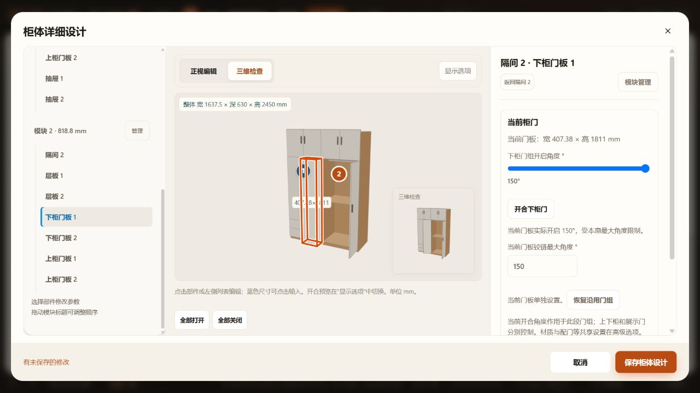
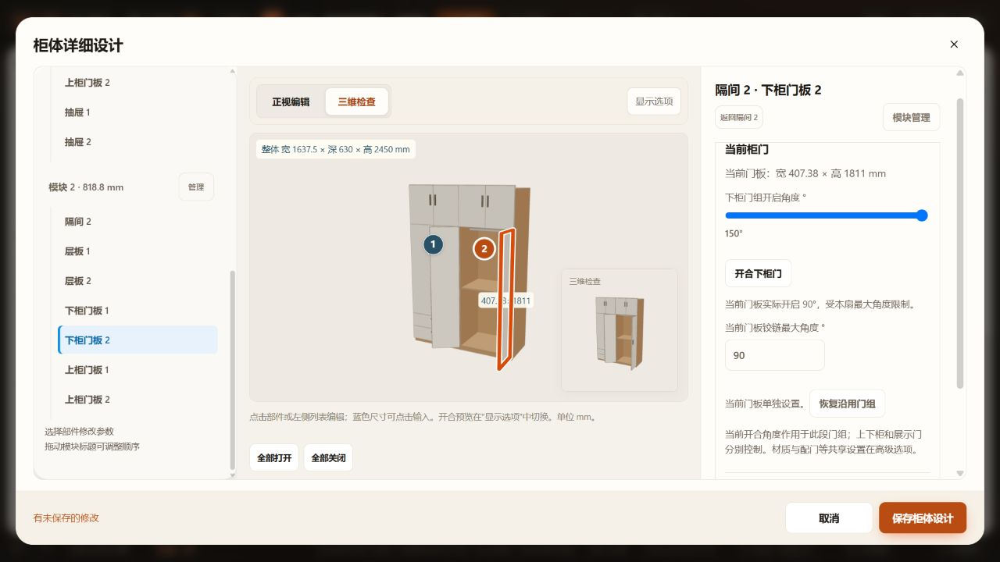
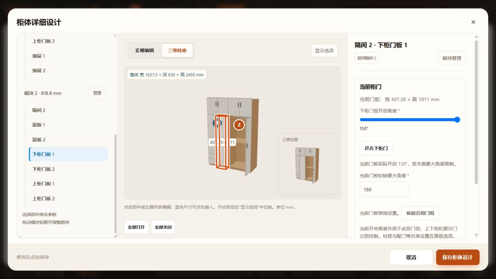

# 逐扇铰链最大角度验收

2026-10-30。依据用户标注图，在当前2450 mm次卧双柜中，将第二柜箱下柜左扇上限设150°，靠墙右扇上限设90°。数值为用户设计要求，不作为厂家五金规格。定制柜体沿参数化生产，不涉及新资产或加载脚本。

## 已通过

- 新测试 `tests/test-cabinet-leaf-limits.cjs`：实际生产门板150°／90°，上／下门段隔离，旋转／镜像实体包含于各自完整扫掠，关闭不缩小最大核对，1／180°边界与非法值，继承与清理，普通尺寸调整，玄关／分层餐边／冰箱顶门／普通柜／吊柜及展示上翻，厨房模块适配，空间输入、规格保留、v37当前／命名方案三次往返。
- 18项相关回归：cabinet-adjacent-hinges、cabinet-opening-3d、cabinet-custom-fronts、cabinet-preview、kitchen-preview、repository-workspace、repository-storage、workspace-cache、work-state、spatial-review-cache、cabinet-door-settings、cabinet-model、wardrobe-hanging、cabinet-opening-volume-model、kitchen、kitchen-door-pairing、canvas-render-cache、furniture-solids-cache，均为 `tests/test-*.cjs`。
- HTTP界面：逐扇输入、同值单独设置、恢复继承、草稿撤销／重做、组开合时分别停在自身上限、实际角度说明、三维目视、保存文件及刷新重开恢复。磁盘v37数据及生产板件开度见[current.json](current.json)。仅家具库保留逐扇限位时也通过v37门槛验证；11个修改脚本语法及差异空白检查通过。
- 保存前触发一次并发文件保护；没有强制覆盖。重开最新文件后重放两扇上限，和重放前副本相比其它家具及全部16份命名方案一致。当前项目原有未提交修改保留。

## 范围与边界

上下分段与展示门沿用组开合控制，独立的是各扇最大角度；普通门和厨房原逐扇开合保留。空间核对使用最大值而非当前姿态；未增加真实五金连杆、实物墙边余量或多门自身干涉求解。未运行全量、窄屏专项或file直接打开。首次本地保存回归因沙箱回环网络权限失败，授权在回环端口重跑后通过，不作为功能失败遗留。
