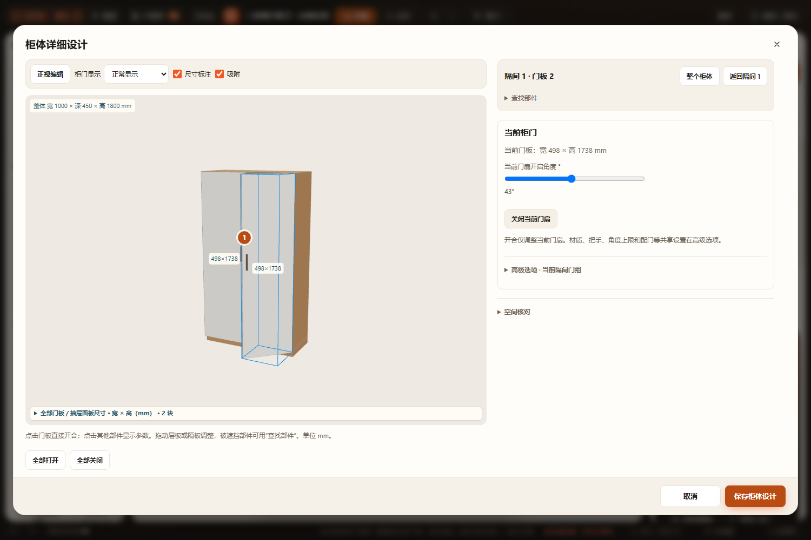
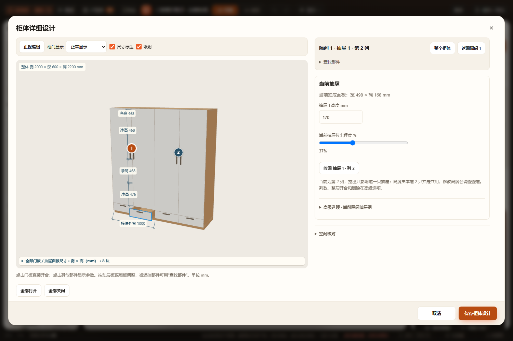
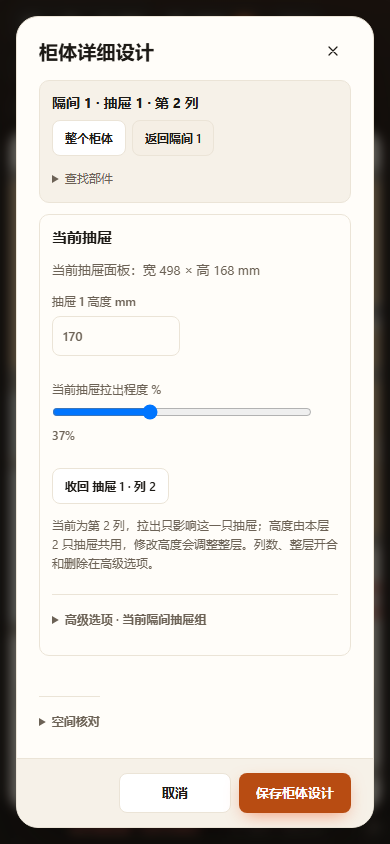

# 当前柜门与抽屉属性验收 · 2026-10-28

## 完成范围

普通柜体和内层独立柜体的柜门／抽屉：当前生产面板尺寸、开合及当前层高优先显示，隔间共享设置折叠。部件列表细分门段／抽屉列，预览高亮匹配同一个部件。普通门使用原 doorLeaves、抽屉使用原 lanes；上／下柜与展示门继续原分段共享开合，同层并排抽屉高度共享，并在面板说明范围。上盖抽屉展示走线留缝与开合。

## 已通过

- [node.log](node.log)：18 个相关 Node 测试文件。新增实际生产门轴与抽屉行程、选中门扇／列及其他部件保持、最大扫掠和采购不变、边界／越界、不可变编辑、项目及重复恢复。复验原层板、分段门、配门、材质继承、模型、开启体积、柜内实体等。
- 改动生产 JS、测试与三份浏览器脚本通过 node --check；git diff --check 通过。
- [browser-results.json](browser-results.json)：最终当前部件与原对象专项；[related-browser-results.json](related-browser-results.json)：四项相关专项的整体验收结果。每项包含 HTTP 和断网 file://。
- [cabinet-part-inspector.log](cabinet-part-inspector.log)：逐扇角度、逐列拉出、部件切换提交、共享角度更新逐扇状态、全部关闭、未修改保存无漂移、保存／取消、一次撤销／重做、刷新、空高度拦截、上下柜与展示门、上盖抽屉、减少列数后继续编辑、390px 无横向溢出。
- [cabinet-object-inspector.log](cabinet-object-inspector.log)：旧柜升级及重复保存、原层板、门／抽屉、厨房和洗衣柜内层取消、窄屏及无页面错误。
- [cabinet-setting-inheritance.log](cabinet-setting-inheritance.log)：高级设置恢复沿用／单独设置、显式同值、材质和颜色回退、厨房、保存／撤销／刷新。
- [cabinet-shelf-clearances.log](cabinet-shelf-clearances.log)：原层板上下净高和图上输入的完整恢复回归。
- 桌面门／抽屉和窄屏截图已目视检查：主参数清楚、高级选项折叠、控件无横溢出。

## 范围与未执行

未运行全量 check.cjs、实机触屏或 Blender。没有修改加载机制／持久字段，沿原草稿、mutate、缓存和项目。厨房父级功能模块未重排，独立内层柜体已覆盖。尺寸为生产面板尺寸；制造、承重、五金和自身干涉仍遵守原算法边界。

浏览器在隔离副本、临时配置与静态服务运行，不写主目录用户方案。既有 projects/workspace.furnish.json 修改继续保留。

