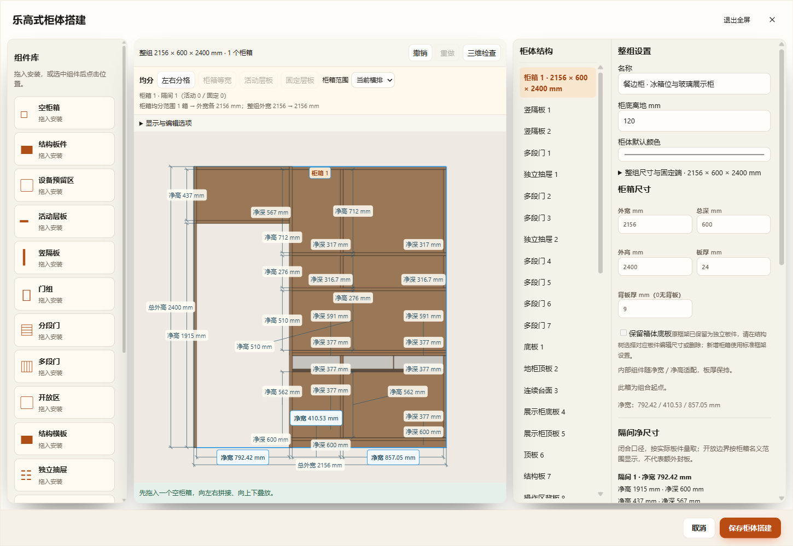
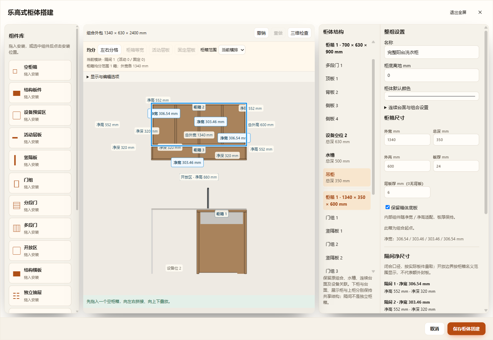
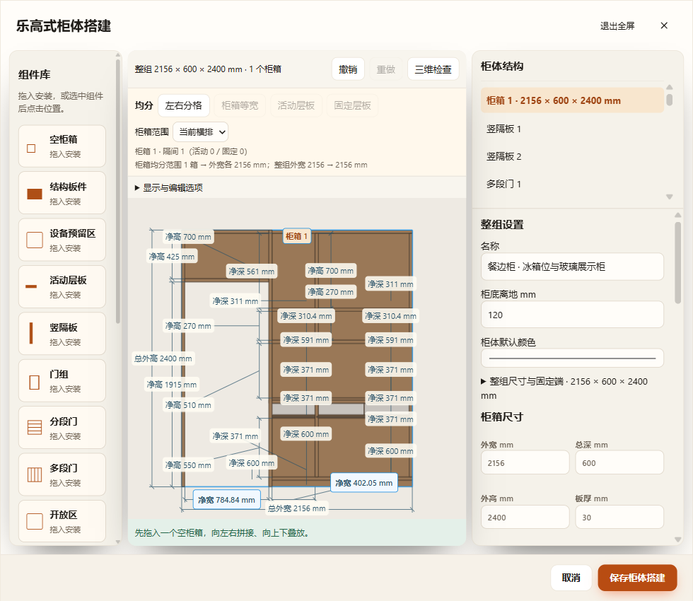

# 原柜柜箱板厚统一

本次取消原地柜、吊柜和餐边柜的板厚／背板厚度限制。普通组件柜与旧柜转换后的实际柜箱共用同一属性和 `Builder.update`；不调用旧模板恢复参数。正式用户方案没有写入。

## 行为与尺寸链

- 柜箱板厚仍采用共用范围 12–30 mm，背板 0–50 mm；每个柜箱独立，外宽、外深、外高和安装离地不因改厚改变。内分格沿普通柜箱的比例语义调整，板件端面跟随实际接合面。
- 原有特殊板件保留其轮廓、孔洞、材质、身份和开合状态；侧板、隔板、层板和门抽实体改变厚度。抽屉底板、滑轨间隙、灯条、石英石台面等独立尺寸保留，不按整件拉伸。玻璃门框保留源模型金属边框尺寸及门厚的挤出偏移，不将某个案例的 18／20 mm 当作通用默认。
- 背板独立改变厚度，背沿固定；0 实际移除实体，保留物理轮廓以供恢复。原无背板且用户明确增加背厚时，按当前柜腔添加实际背板组件。删除的柜板不会因一次普通改厚自动复活。
- 修改后记录生产形状的物理基准和厚度轴，连续改厚再改回不累计漂移；直接改组件尺寸后更新基准，保留用户编辑。基准不含旧模板配方。原电视柜顶端固定板随板厚保持顶面标高，修复改厚后越界的问题。
- 使用原有草稿历史／保存链。新联动记录属于 profile v2，最低项目／工作区／离线缓存版本 82；旧 v80／v81 实例仅打开时保持原几何，实际修改板厚才写入新记录。颜色、名称和历史物理基准不加入空间指纹；当前实体、隐藏背板状态和动作仍参与。

## 已通过

- `test-cabinet-profile-thickness.cjs`：21 类原模板、252 组厚度和开合状态；旋转／镜像／离地、反复回改、背厚 9→0→25→18、台面独立、抽屉接合及共同行程、相邻箱独立、修改组件后再改厚、尺寸与板厚同时修改、当前／命名／组件库／重复恢复和 v82。另覆盖原板厚 12／20／30 的玻璃门框。
- 只读项目副本的 213 种去重现有配置，逐柜箱修改 24 mm 板厚和 9 mm 背厚后校验实际实体；源副本字节保持一致。
- HTTP、离线 `file://` 和同一正式 EXE 的隔离源码／数据／端口／配置目录：原餐边柜 24／9、原阳台地柜 30／9、吊柜 24／6；字段启用、真实预览几何、撤销重做、保存、刷新、980 px 窄屏实际改厚、预览可用列及重新进入同一编辑器。目视发现并修复 app／workflow 两处全局 `main` 窄屏网格规则误伤柜体预览，将规则限定到主应用直接子节点。实际截图见下方。
- 桌面正式 GLB 对原餐边柜和阳台组合逐网格核对：103 个网格，身份唯一、数量相等，导出与生产世界包围盒最大误差 0 mm。
- 增量回归：原组件化 180 组、真实 Three 顶点／材质 42 组、原洗衣区、普通搭建 144 组、整组尺寸 132 组、编辑、开放区 36 组、多段门 324 组、背板 120 组、抽屉接合、三维开启空间、仓库版本和离线缓存。

未运行项目全量检查或 Blender 回读。实体／导出一致不代表现场五金、承重或加工方案已经确认。原特殊框架的底／顶板仍由实际板件组件管理，本次统一的是每个柜箱的板厚与背厚。

[三入口结果](three-entry-results.json)与[最终桌面逐板导出结果](desktop-final-results.json)。

