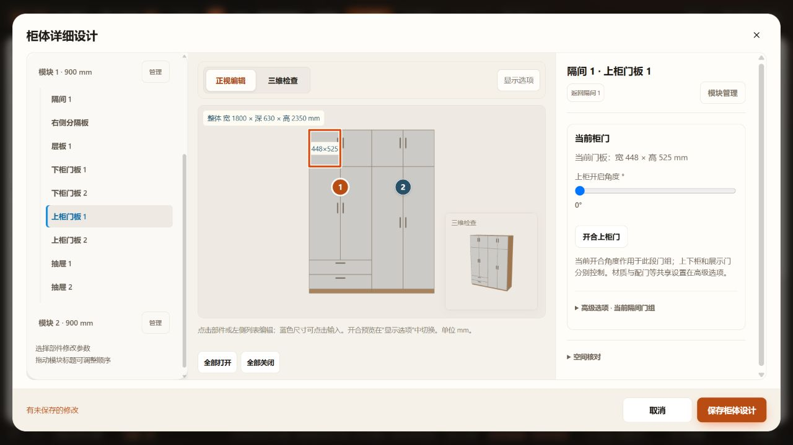
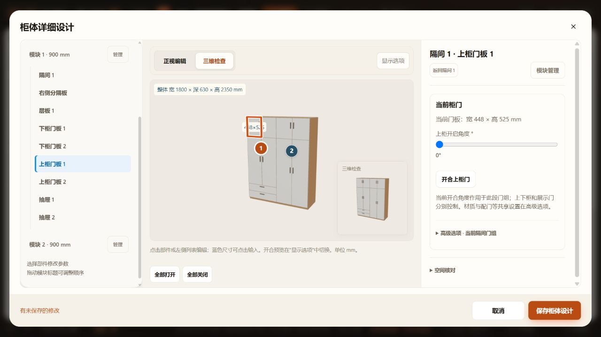

# 柜体选中边框增强

2026-10-29。浅色门板上原蓝色WebGL线过细。保留原BoxHelper包围框几何，逐帧投影其边到独立SVG层，以3 CSS px橙色线、6 CSS px白色底边替代WebGL线。支持正视／透视，线宽不随相机缩放缩小；SVG不接收指针，清除选中及销毁预览时清理。

未改变生产模型、参数、开合、持久字段、加载机制或撤销通道。选中范围仍是原世界轴对齐包围框，不代表新增精确轮廓选择。

## 验证

- 已通过：`node --check src/render/cabinet-preview.js`、`tests/test-cabinet-preview.cjs`、`tests/test-kitchen-preview.cjs`、差异空白检查。
- 已通过：HTTP临时页双柜挂衣模板的门板选中，正视／三维视图可见橙色粗框与白色底边。临时草稿取消，未提交验证模板到用户方案；原页面未保存草稿未刷新或修改。
- 未通过：额外执行 `tests/test-preview-generation.cjs` 在第36行 `fridges/preview.html missing production module` 断言失败，该断言要求生成冰箱预览包含 `appliance-model.js`；本次不改该生成器或冰箱模块。
- 未执行：全量检查、file直接打开及窄屏专项；无加载或持久数据变化。
- 验证临时页出现仓库恢复副本无效提示，加载的是旧缓存；故截图采用未保存的双柜挂衣模板，只用于确认高亮表现，不作为当前1601布置证据。原用户页面保持现场。

