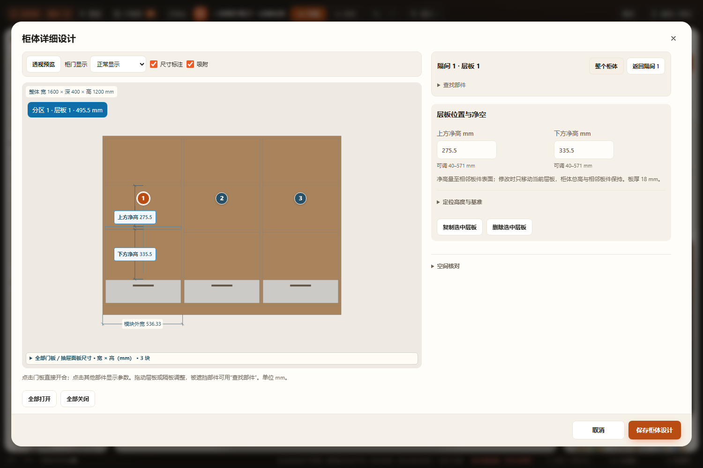
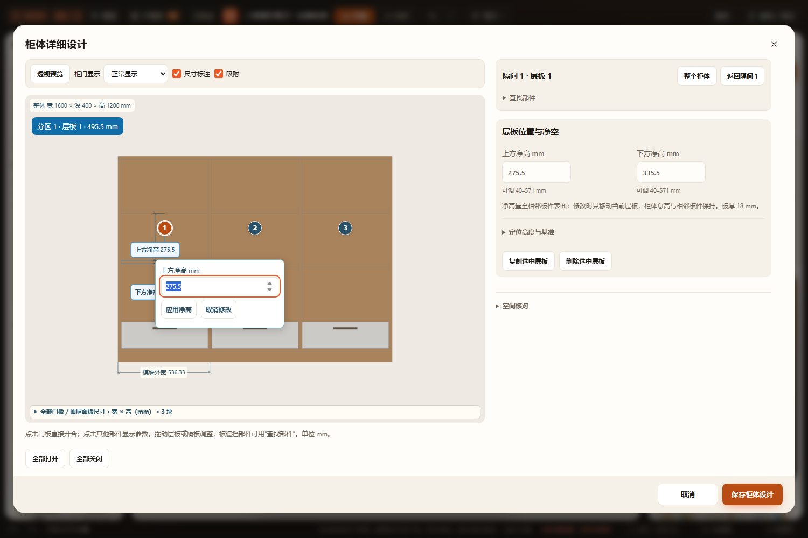
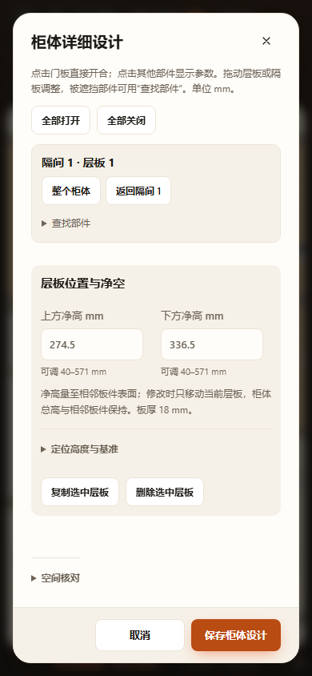

# 层板属性与净高编辑验收 · 2026-10-28

- 实现：普通柜体部件面板聚焦；上方／下方净高直接输入；图上点击、Enter／空格进入输入，Enter 应用，Esc 取消。
- 口径：相邻板件表面净距，按现有储物分层；板厚另计。小数毫米保留，仅持久化原层板高度，无项目迁移。
- Node：[node.log](node.log)，13 个相关测试文件通过；390 次跨模板编辑与严格范围、特殊分层、旋转镜像、项目及重复恢复；实际生产层板表面与编辑值一致。
- 浏览器：[browser-results.json](browser-results.json)、[browser.log](browser.log) 和 [object-inspector.log](object-inspector.log)。隔离目录、临时浏览器配置与静态服务，不写用户项目；HTTP 与断网 file:// 均通过。覆盖右侧与图上输入、上下联动、相邻层板／总尺寸保持、空值／越界拦截保存和切换、未提交图上有效值保存、取消、一次撤销／重做、自动保存刷新、390px 无横溢出及图上操作。
- 语法：改动的三个生产 JS、新增测试、两份浏览器脚本通过 node --check；git diff --check 通过。
- 目视：桌面属性面板、图上浮层与 390px 面板已检查，输入与范围可读、上级入口可见。
- 未执行：全量 check.cjs、真实触屏和 Blender。没有修改加载机制，额外验证的 file:// 是离线使用回归。
- 边界：厨房父级功能模块的独立层板面板仍为原入口；净空复用已有空间分层，不是施工、五金或承重确认。原精确定位／拖动的整数毫米行为保留。

