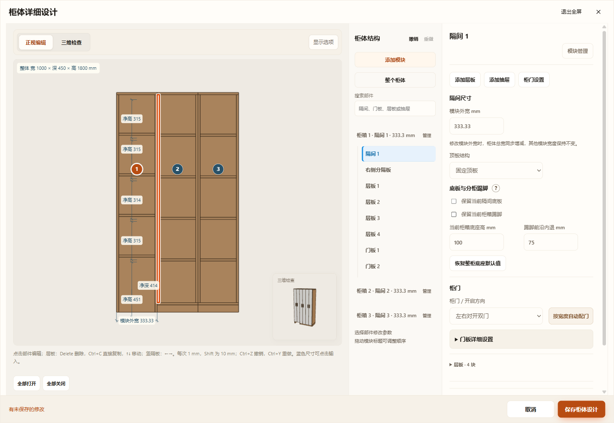
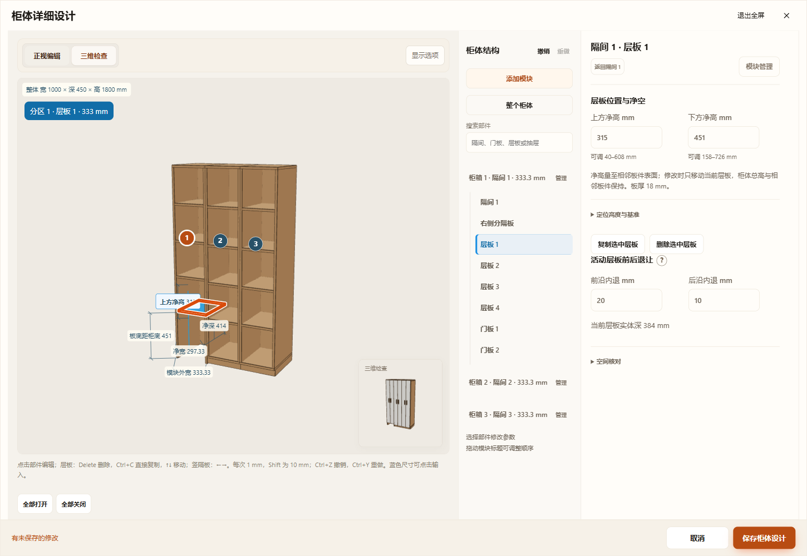
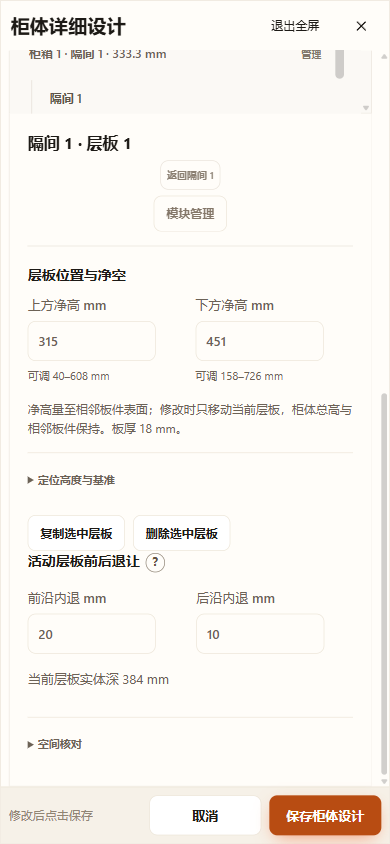

# 柜体升级第四、五阶段验收

2026-11-07 开始，2026-11-08 完成。实现契约见 [局部结构](../../CABINET-LOCAL-STRUCTURE.md)。本轮采用增量验收，没有运行全仓 check.cjs。

## 已通过

| 范围 | 验证 |
|---|---|
| 新结构生产 | `node tests/test-cabinet-details.cjs`：216种共享／独立／混合柜箱、高0／100／250、踢脚有／无、底板有／无、旋转0／37／90、镜像；实际Three板件、柜内数字实体及世界坐标；204块各模板／背厚活动层板 |
| 局部实体与空间 | 实际踢脚高度／内退、无底开口仍保留侧背板、剩余底板抵住落地隔板而不穿入板厚；设备穿底板负例／无底正例／残留侧板负例／高度分离；层板最小实体深等于1mm／低于1mm；固定结构板拒绝活动板退让 |
| 编辑与恢复 | 分箱／合箱冲突原子拒绝，增删／复制／排序迁移踢脚；层板复制／删除／手工列表映射；无底净高至实际柜底；高度缩放；v70当前／命名／库／工作区／缓存；仅上柜含字段格式判断；重复恢复、复制与替换清理；历史开关集中转换含上柜 |
| 确认 | 新底板／踢脚／逐层退让改变checkFingerprint；价格／采购／颜色不改变；沿完整配置缓存，无新缓存机制 |
| 组合基线 | `test-cabinet-composition.cjs`以e793cddc的核心与生产模型为基线：378拓扑比较，正式项目796份普通／厨房派生／洗衣附属柜配置，逐顶点、世界矩阵和稳定部件身份相同；[结果](baseline-result.json) |
| 共用依赖 | 105组件配置、432抽盒配置／1584抽盒、120背板配置、108上下柜配置、24分柜配置、36同深上下箱配置；模型／门设置／净深／显式编辑／全宽抽屉／设计升级／尺寸标注回归通过 |
| 厨房 | straight／L／U、角柜／薄末端、角部层板、项目恢复回归通过；本轮没有增加厨房逐模块无底编辑字段 |
| 项目与保存 | project、project-validation、project-recovery、repository-workspace、repository-version-compat、workspace-cache；12个改动JavaScript语法检查通过；git diff --check通过 |
| UI三入口 | Chrome HTTP、断网file://、同一打包EXE的独立根目录／profile／端口通过保存、取消、应用撤销重做、草稿撤销重做、刷新、窄屏及恢复后生产板件；[三入口结果](ui-results.json)；上下柜编辑额外HTTP回归通过 |
| 目视 | 实际查看桌面底板／踢脚设置、选中活动层板正视／三维与390宽窄屏截图，界面输入可见，第一箱无底／无踢脚与其余箱保留结构符合设置 |

正常三入口证据目录 `output/desktop-verification/cabinet-details-8dv6Ue`；补充桌面三维截图及同流程验证 `cabinet-details-SHOOta`。成功测试的运行副本、缓存及冻结源副本由受管清理器清理，截图和JSON保留。源文件的冻结副本及运行前后正式文件哈希见[快照记录](source-snapshot-result.json)，均为0cc254fb…；正式方案不含测试对象details。仓库用户项目未提交修改原样保留。

## 调试记录与未执行项

初次沙箱HTTP因本机端口权限被拒绝，提升后同用例通过；早期选择器按“分区”查找而界面名称为“隔间”，已修正；桌面恢复按稳定对象深比较，避免JSON键排序造成字符串假失败。一轮三入口功能全部通过后，末尾正式源文件哈希与开头不一致，检查正式文件无测试ID；保留原证据 `cabinet-details-st8GKB`，随后以冻结副本重跑三入口及正式源哈希均通过。测试过程中发现的实际无底净高与落地隔板相邻底板接缝问题已补生产规则和回归。

没有进行独立Blender下载工程回读／渲染、全仓检查或厂家施工验证。正式导出验证使用生产Blender-export.snapshot的逐部件身份；不把它描述为Blender回读通过。底座参数和活动层板退让为软件设计范围，不判承重、通风、五金、灯带检修或设备安装是否满足施工要求。历史别名仅在输入边界消费；专用结构、当前同深stackedBoxes功能及非柜体产品历史恢复仍保留，不宣称仓库已无历史分支。

