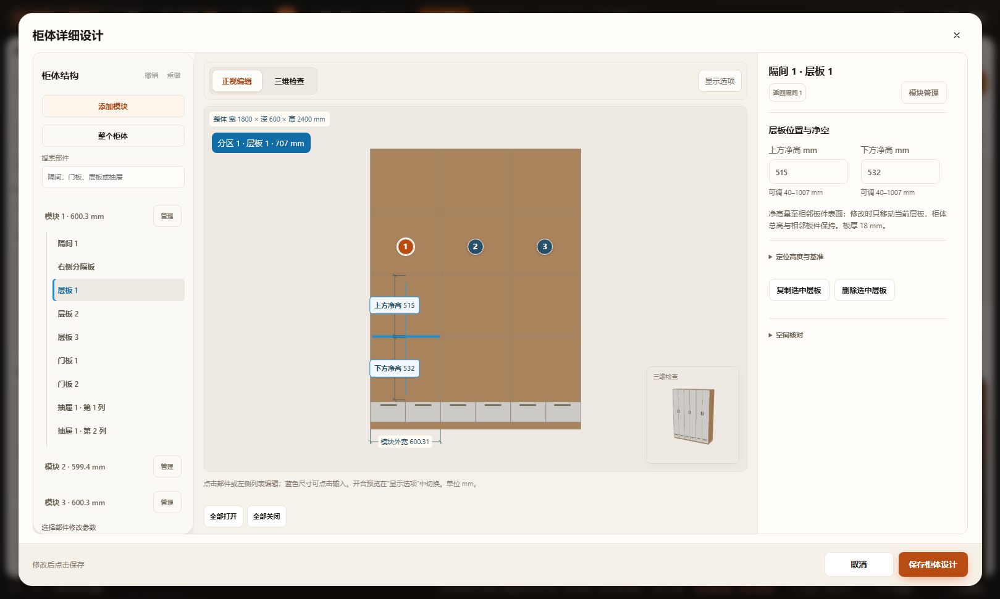
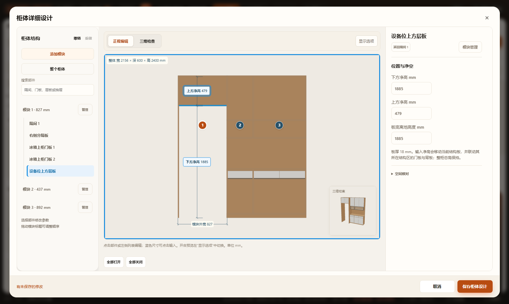
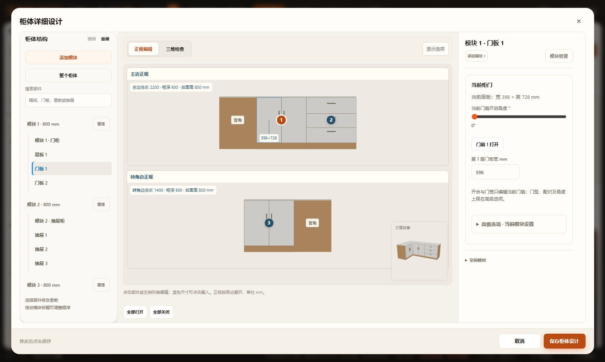

# 柜体三栏工作区验收 · 2026-10-28

## 完成范围

左侧常驻结构列表，中间正视编辑／三维检查，右侧当前对象属性，右下角独立生产三维视图。普通柜、厨房地柜／吊柜、L／U 展开及整体洗衣柜共用布局，专用结构保留自身约束。

模块管理可新增、复制、删除、选择插入／移动位置及拖动排序；预览整柜和各模块宽度，选择总宽联动或固定总宽。厨房按原模块映射关联设备，删除前说明解除关联，影响锁定设备时拒绝。设备位上方层板等结构板可直接选择、输入净高或点击图上标注。

## 通过与未通过

- [Node 结果](node-results.json)：71 个柜体／厨房／洗衣柜／玄关／餐边柜测试文件，68 通过，3 项为原有基线失败。新增 80 组模块操作覆盖固定／变化总宽、顺序、内部结构、所在边、索引映射、锁定、项目往返及不可变输入；实际生产设备位层板的下表面与原控制参数一致。原有 144 组厨房净高及真实板件回归继续通过。
- 七项浏览器专项均有 HTTP 和断网 `file://` 通过记录：工作区、当前柜门／抽屉、对象检查、继承设置、层板净高、完整编辑链路及厨房布局。[结果汇总](browser-results.json)列出各项最后通过的日志来源。独立视图标签增加后再次覆盖工作区、当前门扇／抽屉、继承、对象、层板、完整流程及布局；最后的 36px 标签按钮修正复验工作区及布局。
- 工作区专项实际验证模块新增、固定总宽复制、删除、真实拖动排序、会话撤销／重做、取消、保存后应用撤销／重做、刷新恢复、设备位上方层板图上修改、展示区下层板上方净高（含小数）、厨房当前属性和窄屏。
- 厨房布局专项覆盖普通地柜、U 形吊柜、完整及基础洗衣柜，1500×1000、1280×720、390×844；桌面没有外层重复滚动，可见按钮至少 36px，输入及底部按钮 40px，窄屏无横向溢出。各专项监听浏览器异常。
- 修改脚本语法、`git diff --check` 通过。设计全图及属性局部已目视对照，见 [design-qa.md](../../../design-qa.md)。

三项未通过项与 [上一轮基线留证](../cabinet-editor-completion-20261028/README.md#三项基线失败) 相同，本轮未更改相关吸附算法或测试：

| 测试 | 原有失败 |
|---|---|
| test-kitchen-outer-edges.cjs | 第 25 行远处有限墙段吸附断言，实际 1、预期 0 |
| test-kitchen-run-handles.cjs | 第 23 行相同有限墙段吸附边界 |
| test-kitchen-resize.cjs | 第 30 行测试环境缺少 FurnishProducts |

没有运行全量 `scripts/check.cjs`、真实触屏或 Blender。本轮是柜体编辑与相关数据链路的增量检查，不代表整个项目无剩余缺陷。

## 数据与收尾

没有新增持久字段、项目版本、加载脚本或构建依赖。模块操作仍修改原 columns／modules；结构板修改原 sideboard 参数；历史、视图、搜索、折叠和宽度策略仅在本次会话内。最后一次保存沿原 mutate、自动保存、项目导出／恢复及应用撤销通道。

浏览器测试使用隔离副本、静态服务和临时配置，不向真实方案写入测试家具。原有 `projects/workspace.furnish.json` 修改保持未提交；未新建工作树或临时分支，其他聊天的三个既有工作树保留。

