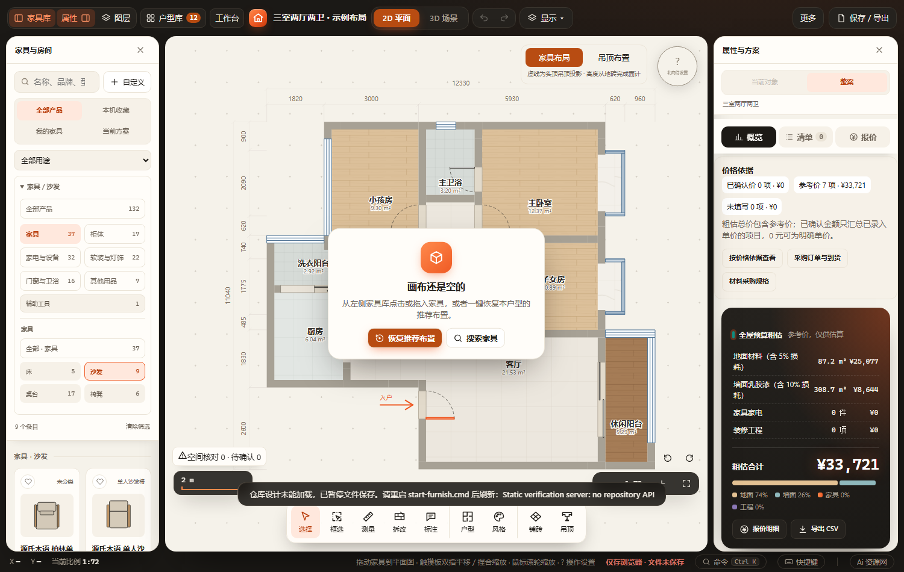
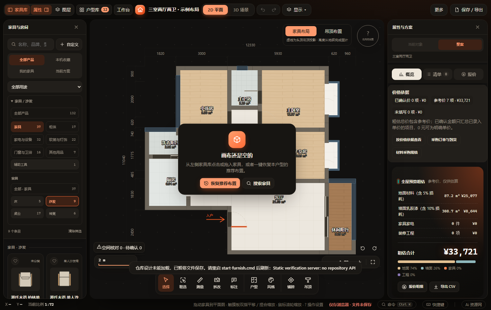
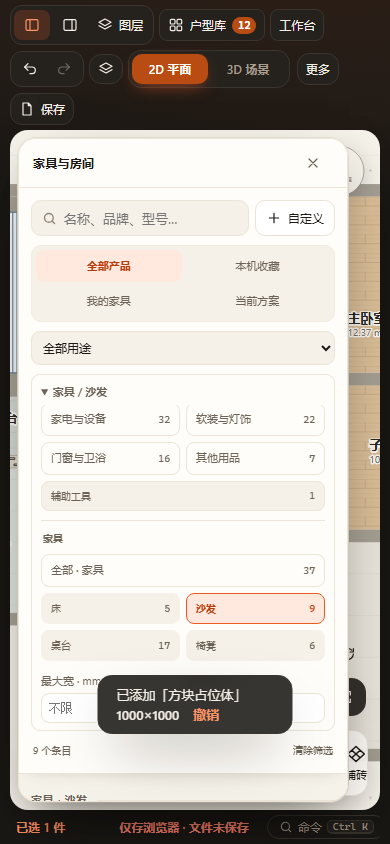

# 两级家具库分类 · 2026-10-30

以产品种类组织导航：

| 一级 | 细类 |
|---|---|
| 家具 | 床、沙发、桌台、椅凳 |
| 柜体 | 收纳柜、定制柜、浴室柜、管道包覆 |
| 家电与设备 | 厨房电器、洗烘设备、空调与温控、生活电器、安装设备 |
| 软装与灯饰 | 灯具、窗饰与布艺、绿植与装饰 |
| 门窗与卫浴 | 门窗隔断、卫浴器具、水槽与台盆 |
| 其他用品 | 宠物、运动乐器、晾晒、自定义及未知类型回退 |
| 辅助工具 | 占位体，独立置于常用大类之后 |

仅显示有条目的分类。全部产品独立置顶，主类和细类分别二列排列；类别摘要显示路径。用途继续按房间／场景跨产品分类筛选，搜索与尺寸继续联合限制，不自动清除冲突筛选。窄屏选择细类后收起筛选；展开区可滚动查看其余分类和尺寸输入。

catalog.navigation接受既有目录，生成新导航分组但保留原条目引用，不改写library／browseLibrary、历史规格、itemKey或价格优先级。自定义数组在每次libAll调用时重新生成，UI在同一份目录快照中分组并映射原ci/ii，避免自定义条目索引丢失。收藏／自定义导航计数按当前库条目计算，移除最后一条时回到全部。分类仅在libUI，不进入项目、缓存或撤销。

已通过：

- Node：test-catalog-navigation、test-catalog-browsing、test-furniture-replacement。覆盖完整且唯一、原规格及引用保持、柜体／灯具／台盆归类、用途保留、自定义及未知项回退。
- 浏览器：catalog-library、furniture-replacement、block-placeholder、current-furniture，各含HTTP与断网file://；结果见output/playwright/verification-72URft/results.json。
- 最终家具库复跑：output/playwright/verification-QD2jMN/results.json，追加两级导航不修改方案、根／子类数量与结果、窄屏细类自动收起。原搜索、用途、等于及低于尺寸阈值、收藏、自定义新增／删除、点击／拖放、撤销重做及刷新检查保留。
- 修改JS语法、git diff --check，浅色、深色及390px截图目视检查。

未执行全量、真实手机触屏或其他浏览器引擎。验证在副本及独立存储完成，原工作区装修JSON保持，不纳入本次提交。

