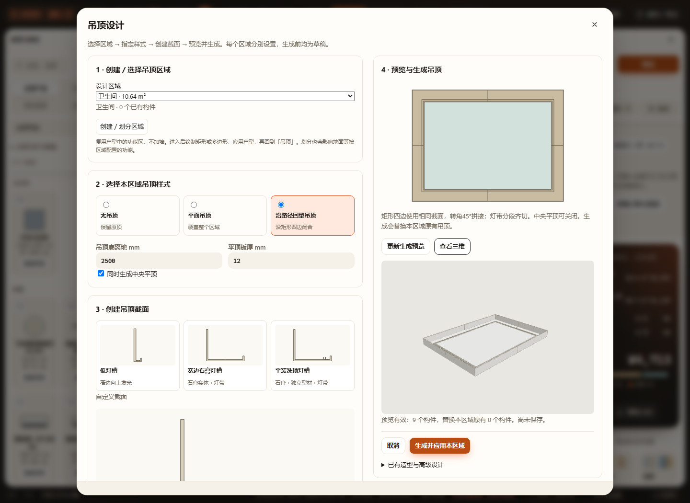
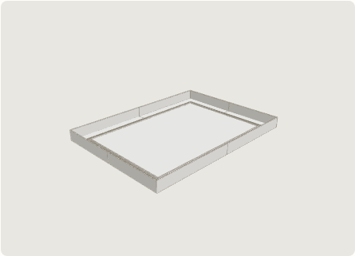

# 吊顶区域设计增量验收 · 2026-10-25

实现与边界见 [吊顶文档](../../CEILINGS.md)。

[390 px界面](mobile.png)。视觉检查确认步骤、三种截面卡片、区域预览与生成按钮可见；窄屏按单列滚动，没有横向溢出。三维样式沿用原吊顶材质，型材颜色区分仅用于二维截面示意。

## 已通过

11 项核心增量检查：`test-ceiling-design`、`test-ceilings`、`test-ceiling-corners`、`test-ceiling-end-caps`、`test-ceiling-continuous-light`、`test-ceiling-storage`、`test-ceiling-height`、`test-room-ceiling-height`、`test-product-rules`、`test-downlight`、`test-downlight-section`（均为 `tests/test-*.cjs`）。最后一项用实际生产三角面检查标准筒灯与原平顶切孔，不替代型材安装验算。

新核心测试覆盖三种预设、反向与旋转矩形、闭合回型含／不含中央板、非法厚度／高度、小区域、非矩形拒绝、原顶未知、型材尺寸和灯带承托、命名方案／重复恢复无漂移，以及真实生产网格有限性、回型体积和中央板板底／板厚。通过生产体积积分校验45°拼角及四份半边L形的端面关系。

浏览器共5组，均在隔离副本中分别使用静态HTTP及断网 `file://`：

- [ceiling-design](ceiling-design.log)：可见截面库、分别编辑石膏／型材并返回草稿、生成前无正式数据变化、生产三维预览、回型／平面／无吊顶、一次撤销重做、刷新、真实下载项目再导入、重新打开保留两份截面、其他／失效区域构件保留、图层锁定、期间方案变化保护、390 px及区域绘制入口。
- [ceilings](ceilings.log)：原单截面绘制／灯带／平顶吸附、非法输入、撤销重做、刷新和项目往返。
- [ceiling-corners](ceiling-corners.log)：原L形拼角、平顶关联、样段与整区预览。
- [ceiling-end-caps](ceiling-end-caps.log)：原开放端收口与内侧退让。
- [ceiling-continuous-light](ceiling-continuous-light.log)：原连续圆弧灯带与冲突显示。

入口改变后，旧验收脚本显式展开「已有造型与高级设计」进入原编辑器。首次复验中两组旧脚本未展开折叠项而超时，修正操作路径后通过。沙箱首次无法定位浏览器目录，指定已安装浏览器后仍禁止访问本机HTTP；最终在获准的本机环境运行隔离验收，没有下载浏览器或向真实项目写入测试数据。

语法检查覆盖三个修改生产JS和新增浏览器脚本；`git diff --check` 通过。

## 未执行与边界

未运行 `node scripts/check.cjs` 全量、真实触屏或施工照度／受力验算。没有改加载机制，但本次两种启动方式均实际验证。区域创建入口指向已有功能区矩形工具，本轮未重新遍历整个户型绘制系统；区域应用后需重新进入吊顶。

闭合回型限无孔矩形；任意闭合路径、独立吊顶分区、多实体自绘截面间的完整相交证明、未生成草稿刷新恢复均未实现。边中点有构件接缝，灯带角内分段；局部高级编辑不联动其他角和中央平顶，回首页重新生成才替换整区。

用户原有 `projects/workspace.furnish.json` 修改保留，不纳入本次提交；既有其他工作树保持。
