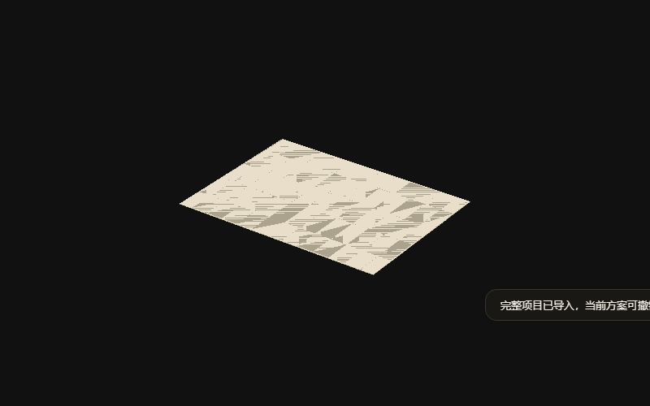
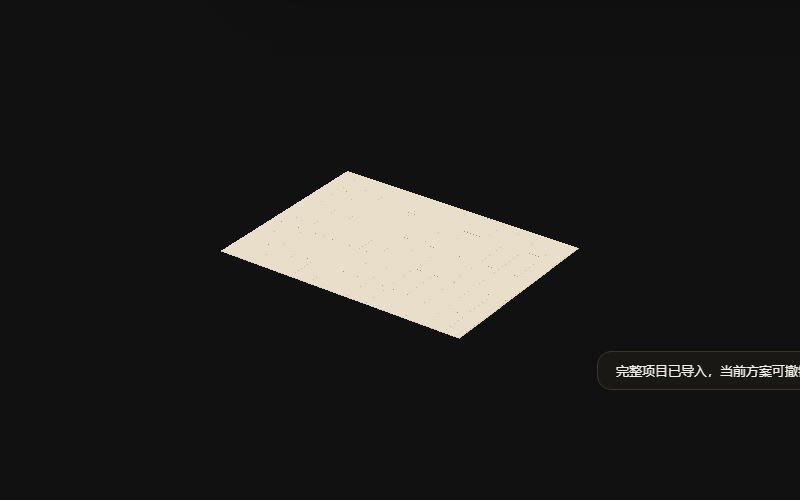

# 铝扣板条纹与三维显示验收

2026-10-27。范围：生产铝扣板的栅格深度、主三维吊顶显示、查看偏好、命名图层／定位裁切及Blender快照边界。未修改吊顶几何、持久项目字段或空间规则。

## 已通过

- 改动模块语法、index内联模块及全体普通脚本联合声明检查。
- `node tests/test-ceiling-display.cjs`：实际生产网格25%上视／实体下视、三模式、图层隐藏、顶面高度边界、几何／部件身份不变、材质恢复及资源释放；缓存透明材质与轮廓共用实时定位裁切平面。
- `node tests/test-ceiling-aluminum.cjs`：真实板缝／收边、凹形／反向／旋转轮廓、尺寸／身份、保守确认、重复项目／缓存／仓库恢复。
- `node tests/test-ceiling-panel-layout.cjs`：旧排版一致性、任意角度、固定起点、整板／裁板、浴霸冲突、平移与重复恢复。
- `node tests/test-ceiling-panel-devices.cjs`：设备整格、旋转／镜像、筒灯孔、实际生产开口／缝底、重复恢复与项目往返。
- `node scripts/verify-browser.cjs ceiling-display ceiling-aluminum ceiling-coplanar-camera`：全部HTTP与离线file://通过。显示流程在后续单独复跑时增加真实GLB打包、撤销历史不变和可见室内仰视／展开窄屏菜单截图。
- 显示浏览器：真实按钮三模式、上方25%／下方原实体材质、缝底隐藏、查看偏好刷新、方案与撤销历史不变、真实GLB导出前实体可见性和材质、390px全部按钮可用，无页面异常。
- 原铝扣板编辑浏览器：生产预览、非法值保留、保存、撤销／重做、刷新、实际项目下载再导入、390px、取消。
- 合入平板灯柔光主线65cd491后，`test-panel-light.cjs`及设备开孔／显示Node复验通过；`ceiling-display`与`ceiling-section-interaction`的HTTP／离线file://联合复验通过。原截面工具和新显示按钮使用不同的data属性，保留绘制／选择／灯带取点行为。
- 合入灯带主线c9c3b07后，保留`applyWash`与`createDisplay`两个接口；显示、铝扣板、灯带遮挡及Blender导出四组Node复验通过，`ceiling-display`与`ceiling-lighting`的HTTP／离线file://联合复验通过，实际方案只读截图重新生成并查看。洗顶先按原不透明生产几何计算，透视覆盖只作用于查看阶段。
- 同步前主线新增平板灯反射1d65067，继续保留该提交；仅文档冲突，代码自动合并。显示、平板灯和Blender导出Node复验及`ceiling-display/panel-light`的HTTP／离线file://复验通过；当前方案截图在最终合并版再次更新。
- 梁底共面浏览器：原平顶与梁底显示优先、实际鼠标环绕仰视、俯视预设及390px。
- 当前装修方案只读副本：生成实体／透视对照，前后方案序列化一致，无页面异常；没有写入主目录工作区。

## 斑块／条纹对照

使用同一生产网格、光源和`.05～300 m`相机，远距离视角放大取样，只切换板面／收边的栅格深度优先级。相对旧的板面与缝底共同`-1/-1`，新`-2/-4`恢复6524个明显变暗的干扰像素，31个像素反向变化，后者集中于薄边／板缝边缘。该指标是本夹具的对照结果，不代表任意GPU／视角完全消除所有深度误差。

| 原显示优先级 | 新显示优先级 |
|---|---|
|  |  |

当前方案：[实体](current-solid.png)、[25%透视](current-ghost.png)、[同视角旧深度参数](current-before.png)。另见[室内仰视](http-underside.png)、[390px显示菜单](http-mobile.png)。上述截图均已人工查看。

结果：[显示流程及截面联合复验](display-results.json)、[显示详细日志](display.log)、[相关三组流程](related-browser-results.json)、[合入灯带后的联合复验](lighting-merge-results.json)、[最终平板灯联合复验](final-merge-results.json)。截图及对照使用隔离浏览器、新用户配置和只读项目副本。

## 边界／未执行

- 未运行`node scripts/check.cjs`全量检查；本次按AGENTS采用增量范围。
- 未做实机触屏、不同GPU驱动或Blender实时连接／最终渲染；已完成浏览器端真实GLB快照打包。
- 透视按各网格世界顶面高度切换，不逐像素裁切。任意交叠构件采用常规透明排序；板缝线仅为查看辅助，不是实体厚度或新的施工构造。
- 隐藏／透视保留灯带发光面、柔光板与独立设备。命名图层和剖切仍可进一步隐藏它们。
