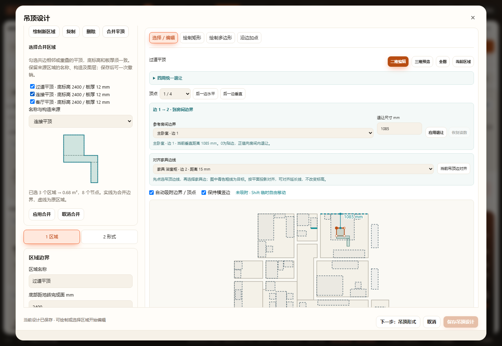
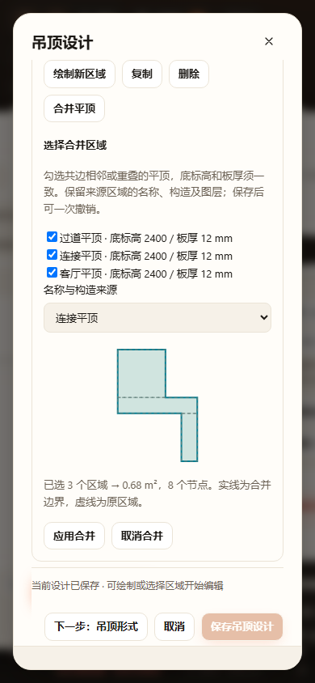

# 平顶区域合并验收 · 2026-10-28

- `node tests/test-ceiling-merge.cjs`：通过。四区凹形／T形、共边／重叠／包含／重复轮廓、旋转镜像、分离与点接触、不同标高板厚／样式、带孔拒绝、未选区域与输入不变、稳定生产ID、项目及命名方案重复恢复、空间签名、生产网格体积与凹口射线。
- `node tests/test-ceiling-regions.cjs`：通过。独立区域、恢复链路及12种生产几何组合。
- `node tests/test-ceiling-height-measurements.cjs`：通过。完成面高度派生依赖。
- `node tests/test-ceiling-plan-display.cjs`：通过HTTP与离线file://画布、图层、选择、导出、项目往返、窄屏。
- `node scripts/verify-browser.cjs ceiling-merge`：通过HTTP与断网file://，实际勾选、来源选择、取消、草稿隔离、保存、单步撤销重做、刷新及390px无横向溢出；在隔离工作副本中验收，不写真实用户项目。
- 核心和UI语法及本次差异空白检查通过。桌面与390px截图已目视，合并预览可读、操作按钮可达。

首次运行因沙箱浏览器路径及本机网络限制未进入页面；设置已有浏览器目录，并在沙箱外运行相同隔离验收后通过。原始合并结果见[result.log](result.log)。

未执行全量check、全量浏览器、Blender、实机触屏。本次不支持带孔、不同标高／板厚的合并，以及沿边吊顶、铝扣板或旧独立构件；仅点接触或分离不强行补面。未代替用户执行其真实区域合并。

