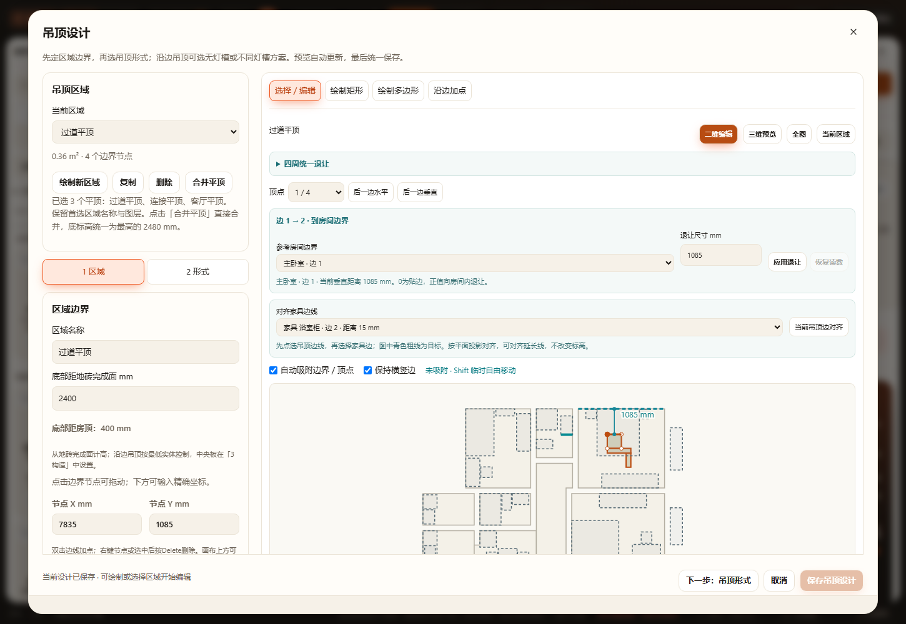
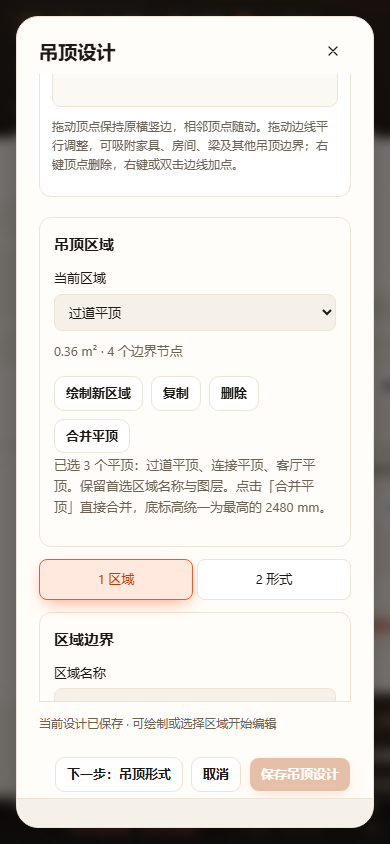

# 画布多选合并与最高标高 · 2026-10-28

已通过本次增量验收：

- `node tests/test-ceiling-merge.cjs`：首选区域2400mm、其他区域最高2480mm时输出2480mm；原输入不改、稳定身份、旋转镜像／凹形／重叠／包含、分离／点接触／带孔及板厚不一致拒绝、项目与命名方案三次恢复无漂移、生产板底2480mm、体积与凹口射线。
- `node tests/test-ceiling-regions.cjs`：区域隔离、保存恢复和12种生产几何组合通过。
- `node tests/test-ceiling-height-measurements.cjs`：完成面与原顶高度派生依赖通过。
- `node scripts/verify-browser.cjs ceiling-merge`：HTTP及断网file://通过真实Ctrl加选、重复加选不反选、Shift减选、高亮数量、分离拒绝原子性、2400／2440／2480mm自动统一为2480mm、点击「合并平顶」直接合并、取消不写状态、草稿隔离、一次保存／撤销重做／刷新和390px无横向溢出。
- 核心／UI语法与本次差异空白检查通过。桌面及窄屏截图已目视，合并数量、最高标高提示和多选高亮可见；窄屏按钮可达。

窄连接区的内部可能位于当前区域14px边线命中带内。浏览器回归将真实鼠标事件发到该位置，验证修饰键点击按点所在区域选择，不被边线拖动抢占；首次浏览器尝试发现此问题，修复后HTTP／file均通过。测试在独立工作副本中运行，不向实际用户方案写入测试区域。结果见[result.log](result.log)。

未运行全量check、全量浏览器、Blender或实机触屏。多选合并面向本次要求的键盘操作；不同板厚、分离、点接触及带孔结果仍不支持；沿边吊顶和铝扣板仍不加入普通平顶合并。高度取绝对标高最大值，并非各区距地砖读数的最大值。

