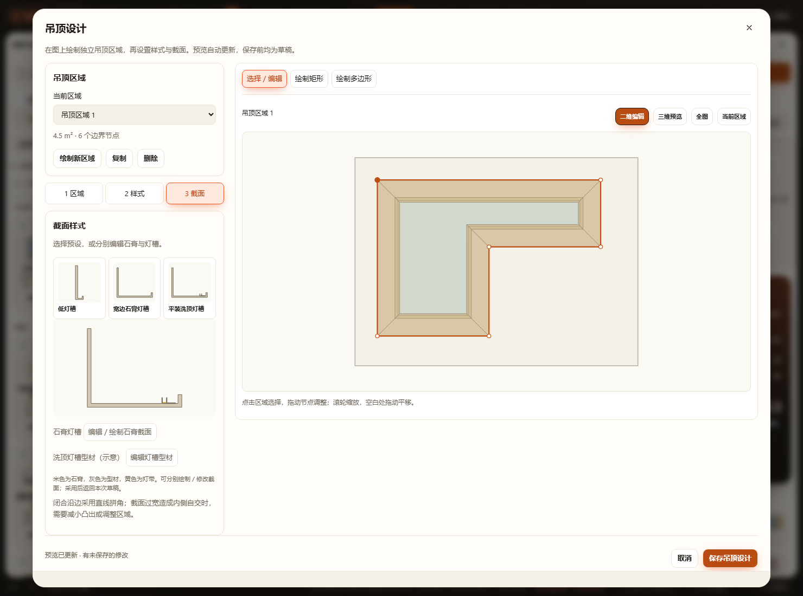
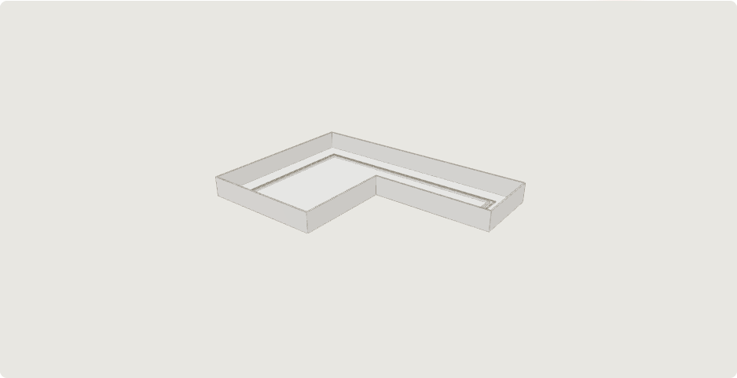

# 独立吊顶区域与多边形回型 · 第二轮增量验收

实现和持久字段见 [当前吊顶契约](../../CEILINGS.md#独立区域与多边形回型2026-10-25第二轮)。本轮按用户反馈替代首轮共用功能区及矩形限定。

[390 px界面](mobile.png)。桌面为区域列表／三个设置页签与统一编辑图；窄屏编辑图先于设置，底部保留保存栏。面积显示两位小数，坐标输入保留原精度。截图已实际查看，未用静态示意替代生产预览。

## 已通过的增量范围

23份Node回归脚本（`tests/test-*.cjs`）：

| 范围 | 脚本名（省略test-及.cjs） |
|---|---|
| 吊顶几何／状态 | ceiling-regions、ceiling-design、ceilings、ceiling-corners、ceiling-end-caps、ceiling-continuous-light、ceiling-storage、ceiling-height、room-ceiling-height |
| 共享规则与空间 | product-rules、downlight、observation-layers、spatial-review-cache、cabinet-opening-3d |
| 项目和工作区链路 | project、project-validation、project-recovery、repository-workspace、repository-storage、workspace-cache、wall-tiling-storage、recovery-storage |
| 生产身份 | blender-model-identities |

`ceiling-regions`直接核对除ceilings外原工作数据、有效房间／地面不变；覆盖独立区域增删改、无吊顶配置保留、旧缓存读取、v17缓存优先、真实仓库文件升级前归档、客户端双缓存迁移、命名方案／项目往返、重复恢复和平移无漂移。非法配置、孤立引用、生成构件与配方失配、自交／窄边、未知原顶及跨空间提示均有断言；改名和空实体区域不清除空间确认。

生产构造器验证12组矩形、斜边和凹多边形的旋转／反向变体。实际网格检查闭合拓扑（边按坐标焊接后恰好两次使用）、正体积、偏移周长积分体积、有限法线；中央板使用实际三角面体积及射线，凹口无板、实际臂区有板。独立型材与灯带分别验证；旧L形／圆弧／端板生产几何回归保留。

7组浏览器验收分别运行静态HTTP及断网file://，均使用隔离副本和新浏览器配置，不访问真实项目写接口。完整结果见 [汇总](browser-summary.json)：

- [ceiling-design](ceiling-design.log)：真实点选凹多边形、拖绘矩形、独立节点拖动／精确坐标、自动预览、分别编辑型材并返回草稿、生产三维预览、整组撤销重做、刷新、真实下载再导入、v17缓存、其他区域保留、无吊顶保留边界、跨区域非法输入保留、锁定／并发保护、Esc取消绘制、390 px，以及旧构件混合编辑／显式重建／撤销，以及从图层定位到独立属性再打开正确区域。
- [ceilings](ceilings.log)、[ceiling-corners](ceiling-corners.log)、[ceiling-end-caps](ceiling-end-caps.log)、[ceiling-continuous-light](ceiling-continuous-light.log)：原高级编辑器、直线／L形、关联平顶、开放端收口与连续圆弧灯带的原有行为。
- [layer-location](layer-location.log)：复验原有房间／飘窗／家具定位、显示和属性入口。
- [portable-smoke](portable-smoke.log)：普通脚本加载、工作区初始化和离线启动基本链路。

全部修改JS及新增模块／测试语法检查通过，`git diff --check`通过。初轮真实输入发现拖动把自身当作吸附目标、SVG点击后Esc焦点离开编辑器，两项已修复并在HTTP／file完整重验。旧高级编辑补查最初因测试未展开已保存模板的details而超时，修正操作路径后通过；仓库HTTP测试初次受沙箱本机连接限制，在获准环境重跑通过。新增客户端迁移夹具起初漏登记自定义户型，补齐真实夹具结构后回归通过；没有放宽生产校验。

本机8765服务经只读身份检查确认为当前仓库，指纹显示后端代码过期。通过项目自带同仓库指纹与令牌握手机制重启，新指纹匹配当前代码；服务在隐藏窗口运行。重启前后 `projects/workspace.furnish.json` SHA256相同。

## 未执行与算法边界

没有运行全量check、真实触屏硬件、施工受力／照度或真实Blender精修渲染。Blender只验证生产模型身份与现有几何输出链路，不把界面预览称为施工照明模拟。

只支持简单无孔区域。偏移后自交、断开多片或短边不足时保留输入并拒绝采用；不自动修改用户边界。多区域可重叠，未实现所有吊顶构件间的完整碰撞证明；跨多个净高按最小覆盖净高保守提示。未保存会话不支持刷新恢复，已保存配置支持完整恢复。

既有用户项目文件修改及其他工作树保留，不纳入本次功能提交。无新增任务分支或工作树需要清理。
