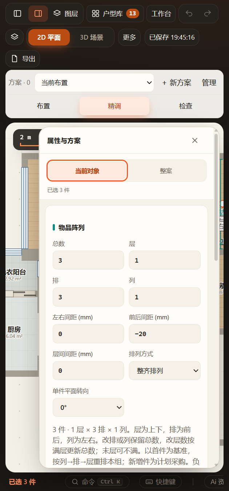

# VIHALS阵列负间距（2026-11-07）

仅VIHALS关联阵列开放负间距，允许外框交叠。范围−1000至1000mm，且单件对应轴尺寸+间距须严格大于0。猫砂／猫粮、纸品原范围不变；不修改当前正式方案位置，不增加碰撞豁免。

## 已通过

- `tests/test-inventory-array.cjs`：−20mm在0／37／90度整体旋转、镜像与0／90度单件转向下的真实中心节距，实际单件生产实体不变；零中心距、逆序及越限拒绝；−80mm强压紧仍检测实际椅架碰撞；缩宽和改变折叠端态不能留下无效节距。负值v64当前／命名方案往返通过，原v63非负回归保持。
- `tests/test-inventory-array-ui.cjs` 最终批次 `output/playwright/inventory-array-pfAvM1/`：同一正式EXE的隔离源码／数据／缓存／端口下，界面前后间距−20、min=−1000、约69.081322mm中心节距、−90非法输入保持原值、v64、撤销／保存刷新及窄屏通过；实际 `negative-gap.glb` 逐椅15部件，并验证导出两椅包络中心差为原深减20mm；补HTTP和断网file入口。[报告](ui-report.json)。
- 原纸品、产品规则、折叠椅端态／真实几何、三维姿态及生产、家具分组、替换、工作区保存与恢复的相关增量回归通过；修改模块与测试语法检查通过。
- 已实际查看下方窄屏负值输入。成功批次源码和缓存由测试管理器清理，报告、截图、GLB和测试项目保留。

## 未执行与边界

未运行全量检查，未重做单品几何、Blender资产发布或材质。图中的−20mm是软件功能测试，不能作为厂家最小收纳间距或无碰撞认证；原实体算法的保守曲面／开口边界仍适用。没有通过同组或负间距跳过实体碰撞。正式窗口未强制刷新、未压紧原布置，保留用户当前编辑与撤销历史，保存后刷新加载新范围。
