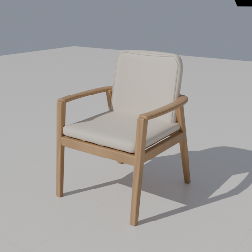
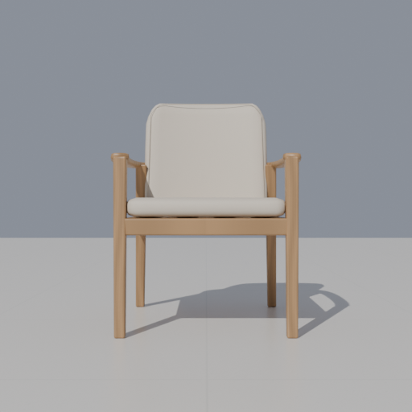
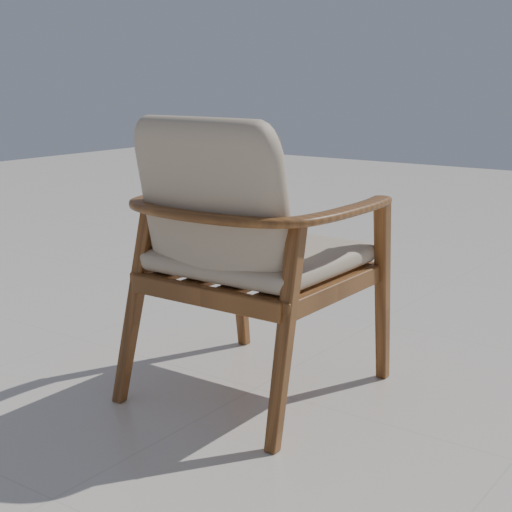

# S05118 增量验收

2026-10-31，最终源v2，Blender5.2.3 LTS，Scoop `current/blender.exe`，GPU RTX4070Ti SUPER／OptiX。按用户六张参考图及京东读取记录建模；尺寸来源和未知项见[型号契约](../../CHAIR-YESWOOD-S05118.md)。

通过：

- `test-chair-s05118.cjs`：源GLB哈希、17件真实Three生产网格／数值实体、660×660×840外包及坐高／厚度、缩放、法线、旋转镜像、100mm外部间隔、接触与0.1mm穿入、完整包含、未知高度／高度分离、吸附及项目／命名方案无漂移往返。
- `verify-model-pipeline.cjs chair-s05118 gpu`：隔离批次selection-E9rYl5／chair-s05118-nqGzB2。作者预检、独立发布；空材质槽、面索引、错误身份、单位、非有限点、未知部件6类真实源负例被拒绝；静态产品无rig负例。
- HTTP和断网file实际生产加载、宽深高编辑、撤销重做、刷新、390px窄屏及零外部请求；共3份生产GLB逐部件Blender世界边界／身份／材质回读，未用回退模型。
- 正式基础API导出／下载、front／oblique／back三机位512px GPU渲染，重开3份下载BLEND核对模型、相机、Cycles和尺寸。报告及来源哈希保存于本目录；完整本机日志位于上述output批次。
- 最终源v2桌面验证：`verify-chair-s05118-desktop.cjs D:/1601装修/Furnish项目/workspace.furnish.json`，output/chair-s05118-desktop-3BbdK5，使用同一打包EXE、正式文件副本、独立工作目录／缓存／端口，检查目录、尺寸编辑、撤销重做、保存刷新和实际3D。原正式文件SHA256未变化。试件放在户型外便于独立取景，界面提示高度／标高待核对是缺少房间承托基准的预期，不代表已完成现场安装核对。
- `test-armchair.cjs`、`test-armchair-berlin.cjs`、`test-product-rules.cjs`，相关脚本语法和差异检查。

目视检查正面、斜视、背面及桌面图：原木框、奶茶软包、环扶手、后倾靠背及四腿方向合理；最终版圆肩与扶手过渡较v1平顺。基础API场景是固定对照灯光，图中环境与参考白底棚拍不同，不宣称照片级一致。木纹为程序近似，GLB交付基础PBR；未模拟真实皮纹、软包变形、榫卯／承重或实物施工符合性。

未执行全量检查和其余92个型号的整链路重跑；本次清单新增为93项。空间截面沿现有保守算法，凹面可能误报，无型号碰撞豁免。

