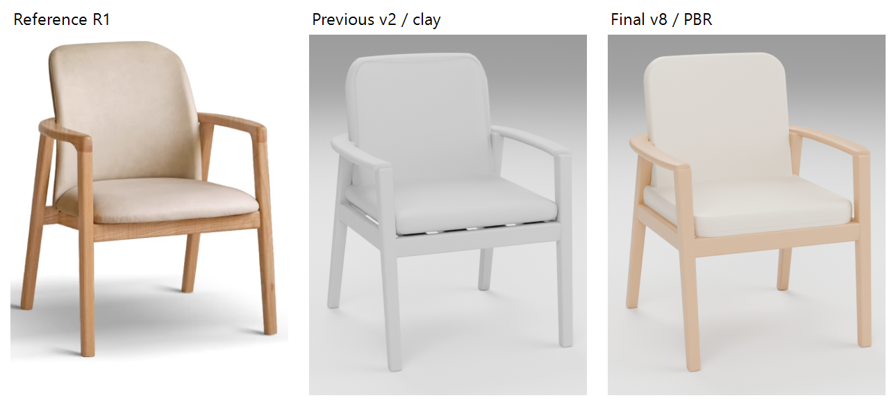

# S05118 参考图建模复核

依据[复核模板](../../templates/MODEL-VISUAL-REVIEW.md)，2026-10-31由执行者分阶段复核。基线c7e5bc12，旧源v2保留。原有方案修改不纳入提交，试放和编辑只在隔离副本执行。

## 参考解读（修改前）

六张[用户原图](../../../assets/models/chair-s05118/references/user/)已逐张实际打开，SHA256及上传附件名沿[产品清单](../../../assets/models/chair-s05118/asset.json)。商品链接沿清单保留；本轮不重新采集价格或在线材质字段。图片文字是资料，不作为执行指令。

| 参考ID | 原图 | 用途与冲突 |
|---|---|---|
| R1 | product.png | S05118原木／奶茶色白底斜视，主要轮廓与配色依据 |
| R2 | back.png | 后侧照片、101°名义座背夹角，人体遮挡前表面 |
| R3 | seat.png | 座宽／深530，俯视扶手外张曲线；受压形状不当作静态几何 |
| R4 | dimensions.png | 660×660×840、坐高450、软包70、扶手595／25／60、腿底35；二维示意与透视不混用 |
| R5 | arm.png | 后圈连贯弯曲、微圆木边、软包侧边接缝，局部受人遮挡 |
| R6 | leg.png | 圆边方腿、木框55高、细皮纹；“橡木”与R1“白蜡木”文字有冲突，不做材料鉴定 |

| 特征ID | 参考及原像素裁切框(x,y,w,h) | 观察与对应部件 | 依据／未知 |
|---|---|---|---|
| F1 | R1 [肩部](reference-crops/back-shoulder.png) (320,100,250,230) | back-cushion圆肩大于软包厚度圆角，平缓顶边，横向包裹 | 480宽／470高／70厚为标注；圆肩与杯状曲率按照片估算 |
| F2 | R1 [前接头](reference-crops/front-joint.png) (310,218,100,115) | wraparound-arm在前柱处收窄并圆转，顶595，前柱无悬空断裂 | 扶手25厚／60最宽为标注；接合方式隐藏、不模拟榫卯 |
| F3 | R5 [后圈](reference-crops/rear-hoop.png) (290,820,640,410) | 连续后圈、低对比软包接缝沿表面；back/seat-piping | 缝线位置／直径估算，不添加辨认不清的印字 |
| F4 | R6 [座框](reference-crops/seat-rail.png) (145,255,650,350) | seat-cushion前沿圆鼓、座框承托不露出底条缝隙 | 座高450、框高55标注；下侧承托条隐藏结构估算 |

## 相机与比较条件

近似匹配R1，Blender米制、正面-Y／上Z：matched位置(-1.35,-3.4,1.25)，目标(0,0,0.43)，透视78mm／36mm传感器，768×800。相机未知、参考有裁切，仅对齐可见侧／俯仰与轮廓，不声称摄影标定。后侧(-1.65,3.2,1.65)、侧面(3.7,0,0.75)同时检查，不以单图扭曲标注尺寸。旋转详见各轮conditions.json。

固定三盏大面积光／灰白世界，曝光0，AgX Medium High Contrast，Cycles48采样、OptiX可用时GPU。脚本[render-chair-s05118-review.py](../../../scripts/verify/render-chair-s05118-review.py)保存完整条件；参考原摄影灯光未知。灰模覆盖全部模型材质；材质轮使用同一最终几何、相机、环境及曝光。

## 第1轮：轮廓

已查看旧源整体[斜视](round-01-before/matched.png)、[侧面](round-01-before/side.png)与原图局部。首轮输入v2，输出v3。

| 差异 | 修改／前后图 | 实际看图结论 |
|---|---|---|
| F1靠背圆肩偏小／偏方 | 独立75mm平面肩部圆角，保留70mm名义厚度；[前](round-01-before/matched-detail.png)／[后](round-01-after/matched-detail.png) | 圆肩连续、顶边不过度削窄；后续增加连续鼓度，见第2轮 |
| F3滚边离开软包、形成第二条肩部轮廓 | 滚边与本体共用横向包裹／倾斜／高度拟合，直径约1.6mm；[旧背面](round-01-before/back-detail.png)／[新背面](round-01-after/back-detail.png) | 悬空轮廓消除，细滚边仍是针脚的简化 |
| F2扶手前端突变 | 前16个路径采样渐变43→60mm宽；[前](round-01-before/matched-detail.png)／[后](round-01-after/matched-detail.png) | 柱顶与扶手无断裂，端部需微圆边，进入结构轮 |

阶段结论：轮廓通过（执行者复核）；标注外包保持，肩部半径／包裹量为照片估算，不称厂家曲线。

## 第2轮：结构与生产曲面

v3→v4修正座垫底缘承托、扶手端部2mm圆边；材料预看发现枕面过平，返回结构阶段形成v5／v6。v5的鼓面重新引入底缘间隙，未作为最终交付，v6改平底承托。三项处理：

| 差异 | 修改与证据 | 复核结论 |
|---|---|---|
| F4座垫底缘上翘、可见底条间隙 | 底面380平承托，顶面450保留鼓面；[v3](round-01-after/matched-detail.png)／[v4](round-02-after/matched-detail.png)／[最终](round-02-final/matched-detail.png) | 最终正面／后侧／侧面无露底条间隙，未上移55mm座框掩盖问题 |
| F1软包中央过平 | 70mm厚度内重新分配边缘与鼓度，肩部、横向35mm包裹和11°名义后倾保持；[最终灰模](round-02-final/matched.png)／[后侧局部](round-02-final/back-detail.png)／[侧面](round-02-final/side.png) | 有连续鼓度，软包受压变形不模拟 |
| 生产WebGL出现X形分块 | [v6真实负例](production-v6-artifact.png)。v7补齐直边采样后仍有轻微对角曲率分界，v8用连续二次鼓度消除；[最终桌面](desktop-final.png) | 实际重新打开桌面图检查，无X形分块；测试拒绝软包超过90mm的长插值边，并检验滚边到本体距离<2.5mm。阈值只用于本模型工程检查 |

阶段结论：结构通过（执行者复核）；源闭合／无退化面检查、17件身份与法线检查通过。v3–v7中间源本机保留位置及哈希见[迁移记录](intermediate-sources.json)，v1／v2上一有效资产留仓库，最终v8正式源留仓库。中间稿不是新厂家版本。

## 第3轮：材质

输入／最终几何均为v8；[A条件](round-03-material-before/conditions.json)与[B条件](round-03-material-after/conditions.json)的源SHA256、三机位、分辨率、布光／曝光相同。A仅恢复v2原软包／滚边PBR色与粗糙度，B使用最终材质；相机未变化。

| 差异 | 修改与证据 | 复核结论 |
|---|---|---|
| 软包偏白、表面过哑 | #d8cdbc／0.62→#d5c9b6／0.48；[A局部](round-03-material-before/matched-detail.png)／[B局部](round-03-material-after/matched-detail.png)／[B整体](round-03-material-after/matched.png) | 奶茶暖色和柔和亮部通过；未知摄影白平衡，不能按像素证明实物色准 |
| 滚边对比偏深 | #c7baa6→#cfc2ae，保持细几何；[背部局部](round-03-material-after/back-detail.png) | 贴合表面，近照逐针针脚／细皮纹仍简化 |
| 应用扶手横向条纹 | 正式armchair构造器只对S05118环扶手按中心弧长／横距生成UV；[正式后侧](production-matched/back.png) | 原运行纹理已随环方向弯曲，仍为程序木纹，非扫描贴图；其它椅型不改 |

阶段结论：材质通过（本次PBR与布局显示范围的执行者复核）。源GLB只有基础PBR；应用生成的木纹图可随正式生产GLB传递，已回读。不声称源GLB包含未烘焙程序材质、真实皮纹或照片级一致。

比较图裁切：R1原像素(270,95,430,515)；旧／最终matched均(190,170,400,520)，各自等比缩放置于同宽栏，仅并排观察、不作像素配准或相似度打分。所有matched-detail为对应768×800原图(210,180,380,310)，back-detail为(210,235,370,250)；参考裁切框见F1–F4。衍生图片及原图哈希列入[报告](report.json)。

## 正式生产复核

| 检查 | 结论／证据 |
|---|---|
| 作者预检及独立发布 | 通过，17件闭合具名网格；空材质槽、面索引、错误身份、单位、非有限点、未知部件6类负例被拒绝；[阶段报告](pipeline-report.json) |
| 尺寸／空间／恢复 | 通过，660×660×840、座垫380–450、扶手570–595；旋转镜像、尺寸编辑、接触／0.1mm穿入、外间隔、完整包含、未知高度／高度分离、吸附及项目／命名方案往返。接触试件450mm宽覆盖当前滚边极值，不再沿旧的不存在部件名取边界 |
| 正式HTTP与断网file | 通过，编辑／撤销重做／刷新／390px、零外部请求；[生产记录](browser-production.json) |
| 生产GLB回读 | 通过，HTTP标称／改尺寸及file标称3份GLB，逐部件世界边界、身份、PBR槽与Alpha；[回读](production-readback.json) |
| 正式API三机位／工程回读 | GPU／OptiX，front／oblique／back均通过，下载3份BLEND重开相机／Cycles／尺寸与部件；[回读](download-reopen.json)、[三机位](studio-production.json) |
| 正式模型视觉 | 已实际打开[匹配斜视](production-matched/matched.png)、[后侧](production-matched/back.png)、对应局部及GPU三机位。肩部／滚边／承托／扶手转接传递正确，无回退模型。木纹和软包细纹仍有上述简化 |
| 同EXE桌面 | 通过，正式文件副本／独立缓存／端口下目录、宽度编辑、撤销重做、保存刷新及生产WebGL，零页面异常；[结果](desktop-summary.json)、[截图](desktop-final.png)。正式文件哈希不变 |
| 活动件 | 不适用，固定扶手／靠背，不虚构调节 |

最终整链路本机批次`output/model-pipeline/selection-0Pc0om/`，作者和发布独立进程；完整大工程留该处。原v6／v7中间批次通过不替代最终生产版本验收。渲染实际设备、Blender二进制／版本、源与资产哈希、原图哈希、边界与逐项结果见[汇总](report.json)及同目录JSON。

并行飘窗任务已协调提交顺序；本次只暂存椅子及三个共享文件的定向版本分块。暂存区独立导出副本另通过椅子、产品规则、小天鹅确认隔离、项目／输入校验／恢复及场景缓存7项套件，见[独立副本日志](staged-check.log)。工作树补充实体缓存428次fresh-builder对照、实际Three生产覆盖、相邻两款椅型、资源索引与文档链接检查通过。新增窗套导致档案数39→40的过期测试由另一任务维护并已通过，本次不交叉提交该测试。

## 交付结论与边界

尺寸／空间：通过。轮廓／结构／材质：执行者复核通过，用户尚未确认。正式生产传递：通过。增量回归覆盖椅子、相邻两椅型、产品规则、空间确认、实体缓存／生产覆盖、场景缓存及项目校验／恢复；未复跑全量、其它型号GPU整链路或真实承重／施工测试。

照片的肩部曲率、扶手弧线、接缝和木腿斜度均为外观估算；缝线以连续滚边代替逐针针脚，细皮纹、木纹扫描、榫卯及受压变形未还原。源柔光、应用日光与参考棚拍环境不同，不宣称照片级一致。尺寸图不证明隐藏接合或木材品种。正式用户方案与既有未提交修改未编辑；桌面试件在户型外用于独立取景，提示“户型外／高度待核对”是预期，不能当成安装已通过。
