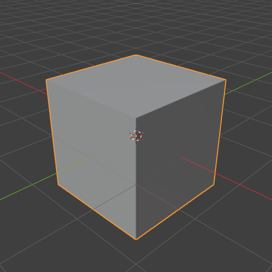

# MCP按需自动打开Blender（2026-11-11）

插件1.1.1新增本机GUI按需启动。实际执行型GUI调用自动创建本会话专用Blender、加载桥接、连接并附着；重复调用复用。显式`blender_session action=ensure`可主动打开，`FURNISH_BLENDER_AUTO_GUI=0`可禁止隐式启动。状态／目录查询及原后台队列不打开GUI。用户已有窗口仍须显式attach。

## 已通过

- `tests/test-codex-blender-plugin.cjs`：原插件协议／打包／实际清单启动及443份供应源码哈希。
- `tests/test-codex-blender-autostart.cjs`：并发启动合并、专用身份、排除已有用户实例、隔离配置、复用、开关及显式附着。
- 新增／修改MCP模块与验证入口的Node语法检查；配套skill的quick_validate通过。
- `verify-codex-blender-registration.cjs`：读取Codex实际解析的安装路径、命令和cwd，7工具发现通过。[回执](registration-report.json)。
- `verify-codex-blender-autostart.cjs`从**安装副本1.1.1**运行：Blender5.2.3，首次实际inspect调用自动开窗并连接；只读状态／目录无开窗；重复调用保留同一窗口与未保存标记；两个调用者分别定向到各自窗口，doctor通过实际指定实例的往返确认；关闭后重开上次保存工程；人类暂停拒绝不重开；缺调用者身份时拒绝且Gateway不崩溃。
- 上述测试进一步按`.mcp.json`真实命令和cwd启动MCP子进程，通过`tools/call`调用inspect，自动创建第三个测试窗口并连接成功。[完整回执](autostart-report.json)。
- 原`verify-codex-blender.cjs --gui`以禁用隐式启动的客户端复验手动附着、后台工程／异常／渲染、参考图标定链路通过。[回归回执](manual-headless-regression.json)。

Gateway使用固定生成脚本、独立BLENDER_USER_CONFIG／SCRIPTS和逐会话工作文件。自动加载使用出厂配置，已有用户窗口、偏好和正式装修方案未被接管。会话发送按已附着实例路由；供应引擎源码本轮未修改。插件Gateway指纹覆盖宿主启动代码，避免升级时悄悄复用旧协议。

已实际打开该PNG检查，画面可读、默认立方体完整入镜。这是启动／取图冒烟证据，不是产品建模或外观验收。

## 生命周期与边界

释放会话不关闭窗口。窗口存在期间保留未保存内容；用户关闭后只重开已保存workspace.blend，不承诺恢复未保存改动。启动超时返回日志路径，保留当前窗口和文件，不连续重开；人类暂停及写作用域拒绝不绕过。测试结束只关闭本轮创建的三个独立测试窗口，保留报告／工程供追溯。

本轮未运行全量型号、上游全算子、其它操作系统／Blender版本，也未改动Furnish生产模型、正式方案、保存或撤销机制。原DSH virtual-gui仍未移植；这里使用普通可见Blender窗口。安装新版本后当前旧MCP进程需重连／客户端重启，工具清单不会在同一聊天中自动热加载。
