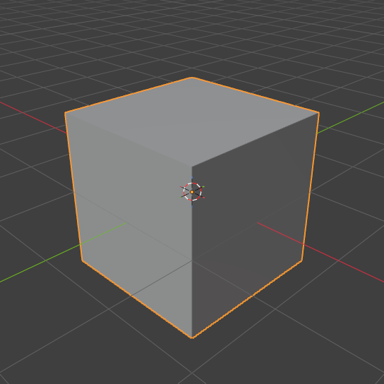
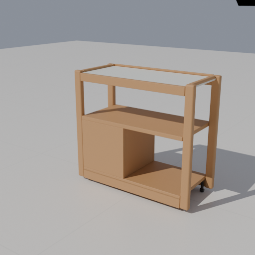

# Codex Blender 插件增量验收（2026-11-11）

目标：把DSH × Blender的独立建模引擎适配到Codex，并由同一插件调用Furnish现有生产验收。未新增／重做具体产品，正式布局和模型资产保持原状。

## 已通过

- `node tests/test-codex-blender-plugin.cjs`：插件清单、7工具发现、JSON-RPC初始化／错误、参数拒绝、嵌套失败／取消状态、原生图片块、仓库选择／绑定、非法批量和路径输入、443个供应文件哈希。
- `node --check`：全部6个新增MCP模块和新增真实验证脚本。
- 新增适配代码与文档的`git diff --check`通过；锁定上游原样源码带有既存尾空白／文件末尾空行，未为格式清理扩展供应补丁范围。
- skill-creator的`quick_validate.py`：新建模skill通过。使用已有agent-reach Python环境并启用UTF-8；未安装新Python依赖。
- 实际stdio子进程完成MCP初始化与工具发现，返回全部7工具。
- `node scripts/verify/verify-codex-blender.cjs --gui`：Blender **5.2.3 LTS**，独立出厂配置和随机回环端口；后台提交／等待／收取、0.4m实体、保存工程标记保留、实际PNG渲染、Python异常正确failed。GUI扩展握手、实例附着、检查／Python执行、自定义机位PNG、doctor.kind=ok；agent不能覆盖人类暂停。
- 原图量具：200px／2px每mm的测试夹具返回100mm；未标定负例返回needs_scale，经MCP映射为isError。该夹具不是任何产品尺寸依据。
- `furnish_model verify profile=side-table device=gpu`：通过原生产流程11阶段。见[production-summary.json](production-summary.json)、[逐部件回读](readback.json)、[下载工程重开](reopen.json)。三机位实际使用RTX 4070 Ti SUPER／OPTIX。原资产与`projects/workspace.furnish.json`的sourceUnchanged=true。
- Codex官方CLI将`furnish-local`本地市场及`furnish-blender@furnish-local`插件安装至本机插件缓存；再次从安装副本实际执行同一GUI／后台／量具验收通过，安装路径见引擎回执的plugin字段。当前聊天未热加载，需重启或新聊天发现工具。

## 证据

[引擎／GUI／量具回执](engine-report.json)保留实际执行路径、脚本、任务与截图结果。GUI图及side-table正面／斜视／操作状态三张PNG均已实际打开：画面可读、模型完整入镜；这是插件传递与取图检查，不是参考照片还原批准。

其余视图：[正面](side-table-front.png)、[操作状态](side-table-open.png)。[artifact-hashes.json](artifact-hashes.json)记录机器生成证据文件SHA256，不含本说明本身。

后台整链路原始输出保留在本机`output/model-pipeline/selection-NJigcH`；生产工具回执保留在`output/codex-blender-production/verification/4634823c-636a-4625-b203-0bbb740e7184`。未覆盖正式项目，成功隔离工作副本沿原流程清理；报告与成果保留。

## 发现并修复

上游队列Python异常可能以退出码0结束，原本会误判completed。本地为两条队列路线增加`--python-exit-code 1`，真实异常负例现为failed。原参数还在载入`.blend`后执行`--factory-startup`，会重置输入场景；现改为先出厂配置、再载入指定源工程，并提前关闭blend自动执行。该顺序也避免载入用户启用的其它扩展。

供应源码使用固定LF换行和`.gitattributes`，确保不同Git换行配置下的内容校验一致。原始／修订哈希及许可证随插件交付。

## 未执行与边界

没有对全部132个Furnish配置、全部228个上游算子、所有Blender版本或virtual-gui进行验证；未运行`node scripts/check.cjs`全量检查。应用生产代码和加载机制未修改，本轮没有额外操作正式桌面方案保存／恢复。side-table参考照片外观阶段为not-executed，技术通过不改变这一结论。

DSH TUI原生选中芯片、宿主卡片和依赖自动安装未移植。部分算子的外部依赖未在本轮安装／验证；Python有本机用户权限，不构成沙箱。既有BlenderMCP和用户工程未迁移或停用。
