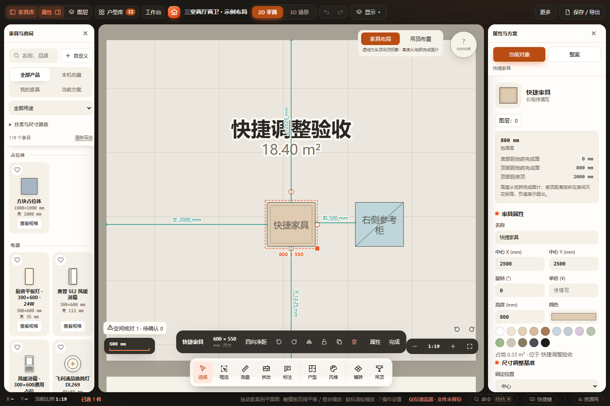
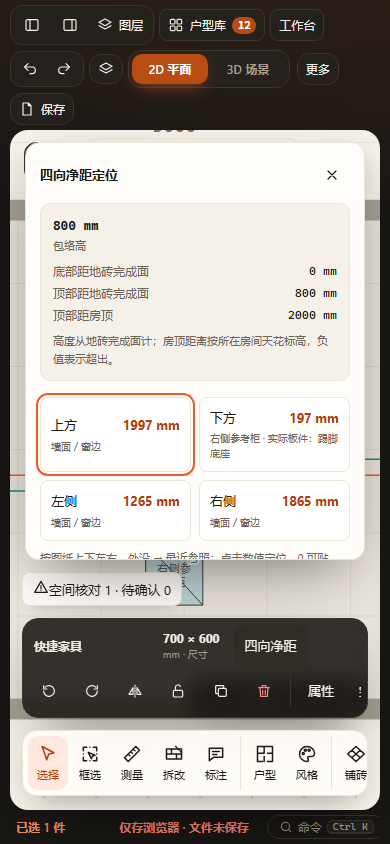
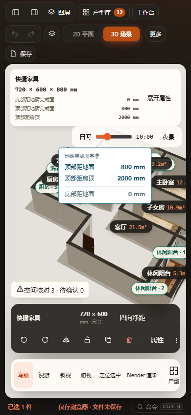

# 固定选中工具条专项验收（2026-10-28）

## 改动与通过项

- property-panel以底部菜单实际矩形为锚，工具条在画布居中，菜单上方12px；平移、缩放和展开快捷编辑器不改变这一位置。
- 删除自动寻找对象周围空位、顶部／右侧保留区及为选中对象临时平移画布的逻辑。快捷面板向上展开并按剩余高度滚动，窄画布核对提示置于工具条上方。
- `node --check src/ui/property-panel.js`、`git diff --check`通过。
- `$env:PLAYWRIGHT_BROWSERS_PATH='C:/Users/SPH/AppData/Local/ms-playwright'; node scripts/verify-browser.cjs floating-toolbar-proximity floating-toolbar`：两个专项均PASS，HTTP与断网file://均通过。
- 快捷尺寸取消／校验／应用／小数无漂移、单步撤销重做、四向定位与分组刚性移动、锁定、柜体详细设计入口、尺寸与测量刷新恢复、2D／3D切换、320×740／390×844／844×390，以及初次按住拖动期间视口和指针映射保持，通过。
- 旧用例的对象／标注自动避让断言已按当前固定覆盖层需求调整为菜单间隔、居中、边界与条带／面板不重叠；旧柜体测试改用明确关闭按钮，距离应用后显式退出对话框，掉落阻挡使用条带内部点而非圆角透明区。
- 隔离验收工作区：`output/playwright/verification-8IQGJl/`，使用新浏览器配置及静态服务，不写真实项目文件。最初默认浏览器路径缺失、沙箱本地服务访问受限；指定已装运行时并在沙箱外验收成功。

## 视觉与边界

已目视桌面、手机净距、手机尺寸和手机3D截图。工具条与菜单分离，手机动作区横向滚动；净距长面板纵向滚动。固定覆盖层可能遮挡家具或尺寸标注，画布保留原缩放和平移能力。未运行全量check、Blender及实机触屏；无持久字段或加载变化，不额外验证无关模型。

