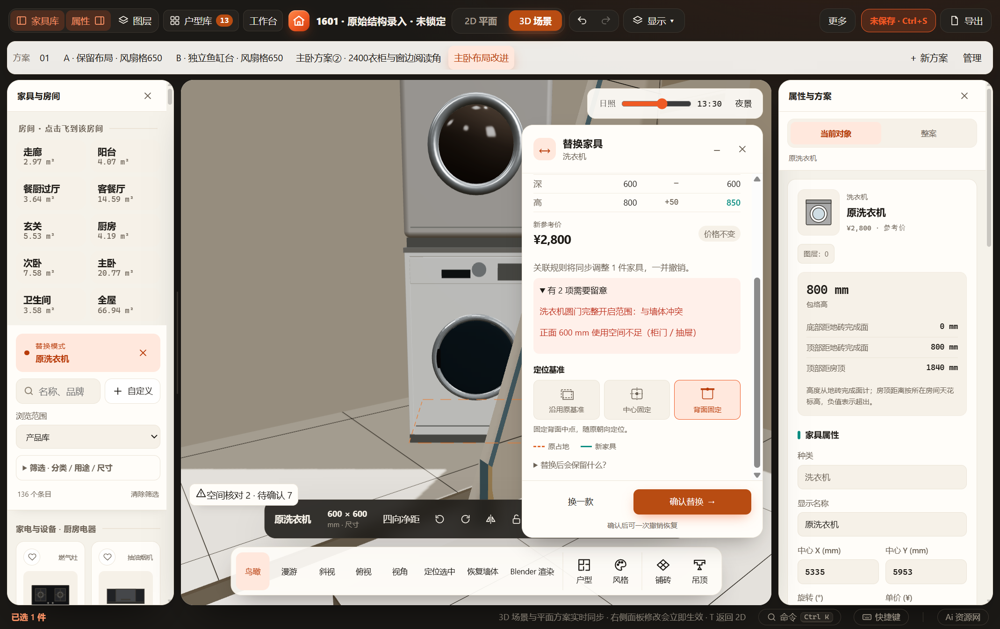
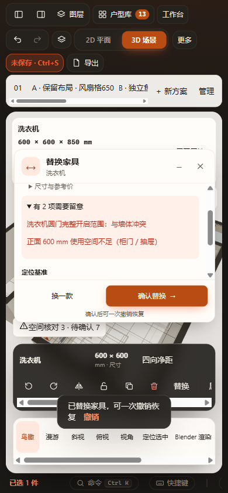

# 家具替换支持 3D（2026-10-31）

替换入口保持当前视图；候选沿原 replaceFurniture、normalizeFurnitureEdit、定位基准与空间检查生成临时 work。3D 生产构造器读取候选家具及其关联上下文、完成地面基准，预留标注同步候选；原占地用橙色虚线表示。面板按目标屏幕位置靠另一侧停靠，可收起并继续旋转观察。2D／3D 切换保留会话，取消恢复原模型，确认仍是一次 mutate，可一次撤销。

无新持久字段、加载脚本或保存通道。替换期间报告图像及 Blender 自动同步签名返回空，生产场景导出提示先确认或取消，避免把临时模型当作已保存布置。手动截图仍可保存当前预览。

## 已通过

- `node tests/test-furniture-replacement.cjs`、`node tests/test-replacement.cjs`：定位、旋转镜像、跨类型清理、不可变计算与项目往返。
- `node --check src/app.js`、`node --check src/ui/catalog-ui.js`；HTTP／file 实际解析内联三维代码。
- `node scripts/verify-browser.cjs furniture-replacement furniture-replacement-3d`：原有二维全流程；新增 HTTP 与断网 file:// 三维进入／预览、关联烘干机实际生产模型高度、旋转镜像、背面基准、跨视图会话、取消恢复、确认／撤销／重做、390px 面板、Esc，以及报告图像／场景导出不混入草稿。原有二维用例包括刷新恢复、失效选择、关联调整及窄屏。
- 面板避让与候选预留标注调整后再次运行三维用例；最终选择高亮键修正由桌面用例复验，再以最终代码重跑二维与三维双入口专项，全部通过。
- 同一 `output/desktop/Furnish-win32-x64/Furnish.exe`，独立源码、profile 与端口，复制 MCP 报告的 `D:/1601装修/Furnish项目/workspace.furnish.json`，运行同一三维用例（desktop 模式），额外 flush、刷新核对持久替换。实际完成地面标高参与生产坐标断言。原正式文件前后 SHA256 一致。

浏览器证据：`output/playwright/verification-gdZK9G/results.json`（原二维／三维）、`output/playwright/verification-D7OVov/results.json`（调整后三维）；最终双入口结果：`output/playwright/verification-5vctWK/results.json`；桌面证据：`output/playwright/replacement-desktop-QkMSPP/`。本机 Playwright 需要 `PLAYWRIGHT_BROWSERS_PATH=C:/Users/SPH/AppData/Local/ms-playwright`；桌面验收进程移除代理并设置本机 NO_PROXY 后可正常连接。第一次桌面断言误把安装高当世界高度，按完成地面基准修正后通过；不是放宽坐标精度。

## 目视与边界

检查桌面宽屏与窄屏截图，候选家具、原占地和替换面板显示正常。未运行全量检查、全部产品替换组合、漫游锁鼠标状态或 Blender 实际导出；本次不改变产品尺寸与空间算法。建筑墙体／吊顶设备洞口仍显示已保存方案，确认后才按原场景链重建；预览中的空间检查使用完整候选 work，不依赖这一显示近似。

