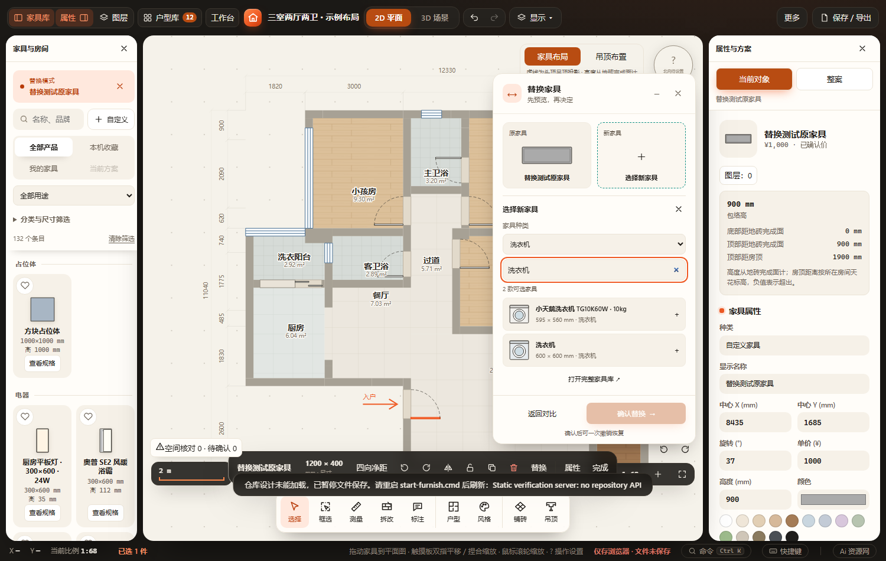
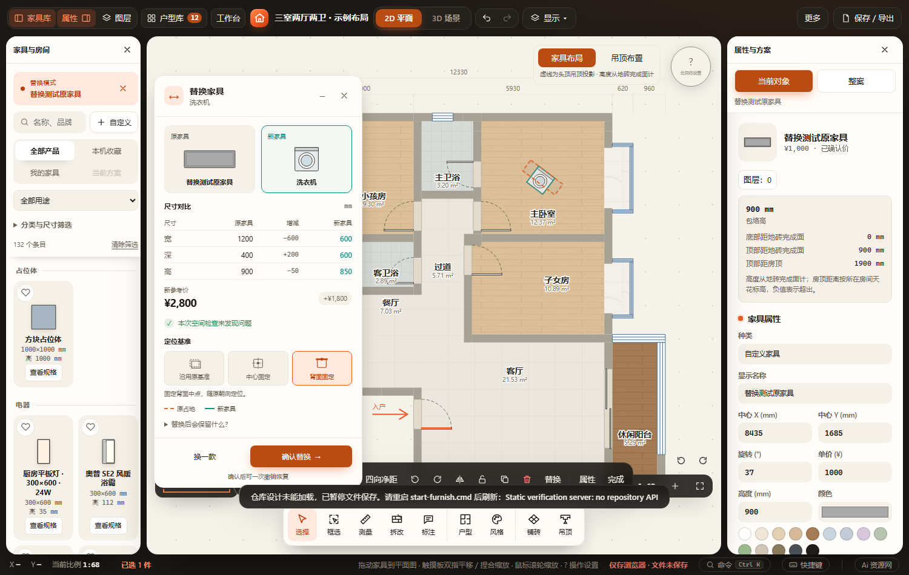
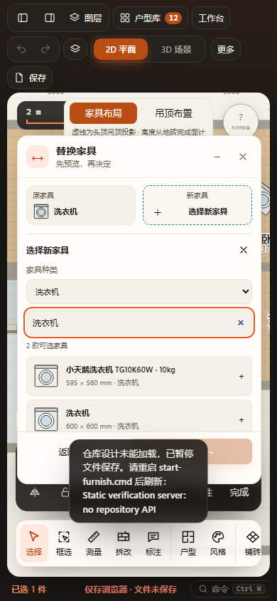

# 替换面板内选品 · 2026-10-30

按用户截图要求，将「新家具」卡片变为选品入口。复用既有libAll、FurnishProducts.kind、目录搜索和生产SVG；面板内按家具种类与关键词联合筛选，默认原种类，可切至全部。保留完整家具库入口，禁止组合洗衣区作为单件候选。选择仍调用原choose、预演与一次mutate链路，不改核心替换规则或格式。

新增原生图示基准单选、已知尺寸增减、临时收起面板。选品时禁止确认；返回／Escape只收起选品，已有候选保留；再次Escape退出整个替换。所有选品、收起和尺寸展开状态均不持久化。

通过：两项Node回归（furniture-replacement、catalog-browsing）、修改JS语法、git diff --check；Playwright furniture-replacement（output/playwright/verification-l6L0wx/results.json）与catalog-library（output/playwright/verification-AS21es/results.json），均覆盖HTTP和断网file://。替换专项包含种类过滤、搜索、空结果、面板内选品、Escape返回、收起保留画布预览、图示基准、一次撤销／重做、关联调整、保存刷新及导出隔离。验证使用独立存储和副本，未编辑用户方案。桌面与390px截图目视通过。未跑全量／真实手机触屏。

