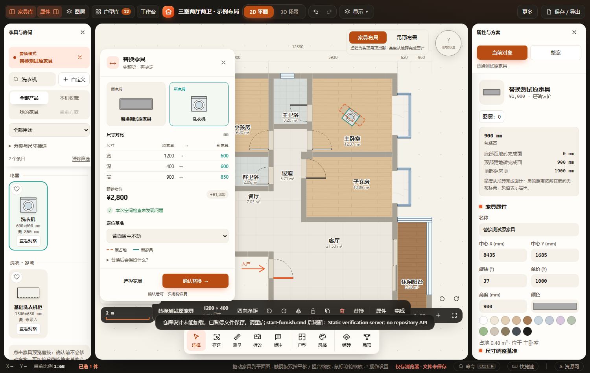
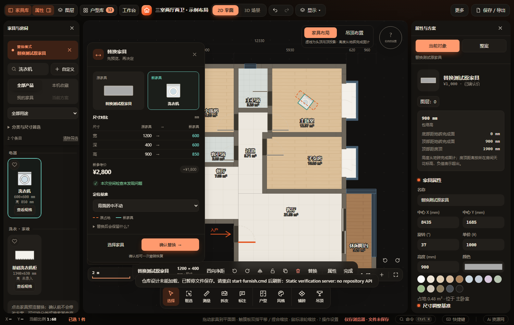
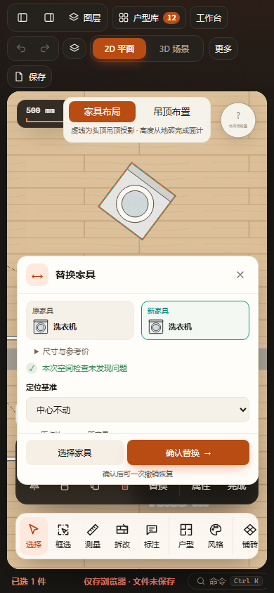

# 家具替换 UI 优化 · 2026-10-29

原家具／新品并排显示现有生产 SVG 缩略图；尺寸按宽、深、高对齐，变化值强调，参考价与差额独立展示。空间问题保留原提示与校验，说明折叠，确认按钮常驻。家具库模式提示和当前候选描边统一连接选品流程。沿原语义变量适配亮暗主题；窄屏缩略卡紧凑展示、规格默认折叠、内容独立滚动。窄屏切回桌面时，折叠规格仍可展开。

已通过：`node tests/test-furniture-replacement.cjs`、`node tests/test-catalog-browsing.cjs`；修改脚本语法、`git diff --check`；Playwright `furniture-replacement` 和 `catalog-library`（HTTP + 断网 file://）。替换专项继续覆盖取消、基准、关联设备、一次撤销、重做、刷新、导出隔离、键盘选品和失效会话，并追加候选标记、深色截图和跨断点规格展开。

最终替换结果：`output/playwright/verification-7buZGu/results.json`；家具库结果：`output/playwright/verification-PZkzrE/results.json`。验证均在副本及独立浏览器存储运行。未跑全量、真实触屏。用户装修数据及其他聊天的模型改动保留。

桌面、深色与390px窄屏截图目视通过：

